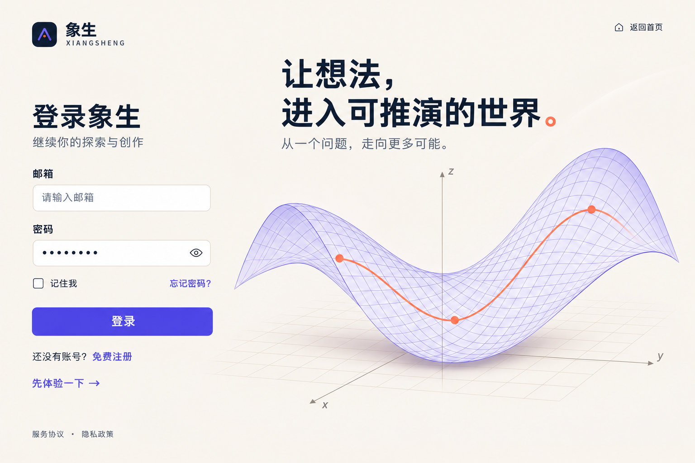

# 象生登录主页与右侧 3D 动效设计规划（Implementation Plan）

> 日期：2026-11-07。本文将本轮选定的登录页面方向整理为可实施的设计说明。本次只新增文档及配套参考图，没有安装依赖、修改页面或实现动画。
>
> **For agentic workers:** 仅在后续获得实施任务后，使用 `superpowers:executing-plans` 按本文执行；如用户选择委派，再使用 `superpowers:subagent-driven-development`。文末复选框均为待办，不代表已完成。

**Goal：** 设计与象生现有主题一致的登录主页，在左侧提供清晰的统一账号登录入口，在右侧用可运动的三维曲面表达“让静态内容变成可探索的知识”。

**Architecture：** 页面文字、表单和导航使用普通 React DOM；右侧场景采用按需加载的 Three.js，在同一套曲面函数上生成网格、轨迹与观察点。静态海报先显示，3D 可用后替换，任何渲染问题都不阻塞登录。

**Tech Stack：** 沿用 React 18、TypeScript、Vite、CSS Modules 和现有设计令牌；建议新增 Three.js 及匹配的类型定义，具体版本在实施时验证并锁定。首版不额外引入 React Three Fiber、动画状态框架或后处理库。

**Spec：** 本文第 1—12 节为设计依据，第 13—16 节为实施与验收规划。账号功能依赖已有的 [MySQL 统一账号与权限建设规划](2026-11-07-mysql-account-permissions-plan.md)。

## 全局约束

- 本文的“主页”指本轮讨论的**登录主页**，建议路径 `/login`；已有公共首页 `/` 保留。后续如需将登录页设为根入口，应作为单独的导航决策处理。
- 采用第二张概念图的“左侧登录、右侧三维曲面”布局，并以最后一张暖纸配色修订图作为视觉目标。
- 颜色沿用项目“纸上仪器 / Paper Instrument”主题：暖纸、深墨、靛蓝、珊瑚橙；不再使用上一轮的天蓝、青色和冷色环境光。
- 当前参考图是静态稿，实际动效按本文实现；不能把整张截图平移、缩放当作三维交互。
- 表单始终稳定可用，3D 仅表达产品主题，不承担认证、求解或用户数据展示。
- 持续动效有可见的暂停入口，并遵循系统“减少动态效果”偏好。
- 账号 API 尚需按另一份规划实现；本设计不等于已经接通登录。

## 重点审查场景

1. 用户输入邮箱、密码或使用密码管理器时，右侧自动静止，不抢焦点或移动表单。
2. WebGL2 不支持、模块加载失败或渲染上下文丢失时，仍能看到完整表单并登录。
3. 系统减少动效、用户手动暂停、窗口隐藏等条件叠加时，不因某一个条件解除而错误恢复动画。
4. 曲面变化后，橙色轨迹与观察点仍贴合相同曲面，不出现穿入网格、悬空或回到旧高度。
5. 多次进入、离开登录页及调整窗口大小后，没有重复动画循环、重复事件监听或持续增长的 GPU 资源。

---

## 1. 设计基准与参考图



参考图尺寸为 **1536 × 1024**，已复制到本文旁的 `assets` 目录，阅读文档无需依赖个人生成图片目录。

实施优先级：

1. 已有主题令牌和当前实际使用的品牌标识。
2. 本文规定的结构、交互、响应式与可访问性。
3. 参考图的构图、留白和曲面形态。

生成图中的个别标志细节不作为重新设计 Logo 的授权。当前首页标志来源是 `frontend/src/components/home/SiteNav.tsx` 中的深蓝圆角底、珊瑚色折线和靛蓝圆点；实现时复用该标志。`design/logo-mark.svg` 另有历史造型，不能因文件名相似而直接替换当前标志。

“明亮、大气”的实现方式是增加暖纸留白、拉开标题与图形的尺度关系、减少边框和装饰；不是重新增加一套明亮冷色主题。

## 2. 页面信息结构与桌面布局

页面保持三个区域：顶部品牌与返回入口、中部左右主区域、底部协议与隐私链接。

| 区域 | 内容 | 布局规则 |
| --- | --- | --- |
| 左上 | 当前象生标志、象生、XIANGSHENG | 与登录表单左边缘对齐 |
| 右上 | 返回首页 | 文字与小图标，保持次要层级 |
| 中部左侧 | 登录标题、邮箱、密码、记住我、找回密码、登录、注册、访客体验 | 直接置于页面上，不加外层卡片 |
| 中部右侧上方 | 两行主题标题与一句说明 | DOM 文字，不能烘焙在图片或 Canvas 中 |
| 中部右侧下方 | 三维曲面、轨迹、观察点、弱坐标网格 | 与表单分区，不穿到输入区域 |
| 右侧场景边缘 | 暂停动效 / 播放动效 | 可见但安静的文字按钮，键盘可操作 |
| 底部左侧 | 服务协议、隐私政策 | 随内容自然排布，不覆盖移动端表单 |

### 2.1 桌面尺寸建议

在 1440—1920px 宽的屏幕上，内容最大宽度建议 1728px，水平边距使用 `clamp(32px, 4.5vw, 96px)`。左列约 30%，右列占剩余空间，列间留 64—104px。

- 表单宽度 360—420px，不能随大屏无限变宽。
- 登录标题 40—48px，右侧主题标题 56—76px；视口不足时缩小字体，不能靠裁字适配。
- 输入框和主按钮高度 56px，圆角 10px，主要控件间距 20—24px。
- 右侧场景保持约 1.6:1 的容器比例，常见高度 400—580px；不把参考截图作为固定尺寸铺满。
- 页面使用最小高度和自然滚动，短屏允许纵向滚动；不能为追求“一屏”把底部内容裁掉。
- 实际页面参考 1440 × 900、1536 × 1024、1920 × 1080 三档检查，而非只检查生成图尺寸。

大屏上保留足够留白，视觉重量由右侧大曲面承担；不额外增加推荐卡片、运营数字、职业选择或第三方登录按钮。

## 3. 配色、字体与组件规范

| 用途 | 现有令牌 | 色值 / 规则 |
| --- | --- | --- |
| 页面主底色 | `--paper-2` | `#f7f4ed` |
| 轻微提亮、静态海报底 | `--paper-1` | `#fbf9f4` |
| 输入框 | `--paper-0` | `#ffffff` |
| 大标题与主要文字 | `--ink-900` | `#121b27` |
| 说明与占位文字 | `--ink-500` | `#58636f` |
| 输入框、分隔线 | `--hairline` | `#e7e0d3` |
| 主按钮、链接、曲面网格 | `--color-indigo` | `#4f46e5` |
| 曲面浅色填充 | `--color-indigo-soft` | `#ecebfb`，低透明度 |
| 观察点与轨迹 | `--color-coral` | `#ff7a59` |
| 需要珊瑚色的文字 | `--color-coral-ink` | `#b8431f`，不直接用装饰色写小字 |

令牌来源：`frontend/src/styles/tokens.css`，对应 `design/design-tokens.json`。不为登录页复制一份同名但数值不同的主题变量。

字体使用项目现有中文无衬线字体栈；数学坐标可用现有数学或等宽字体，不额外加载大体积远程字体。字号、字重和对比度在真实页面检查，不能以生成图的观感代替。

输入框默认使用暖灰细边框；聚焦时使用靛蓝边框与清晰焦点环。按钮悬停只改变色深，按下可下移 1px；不使用扩大、闪光或持续呼吸的登录按钮。

## 4. 页面文案与账号行为

### 4.1 固定文案

| 位置 | 文案 |
| --- | --- |
| 表单主标题 | 登录象生 |
| 表单说明 | 继续你的探索与创作 |
| 账号字段 | 邮箱 / 请输入邮箱 |
| 密码字段 | 密码 |
| 辅助操作 | 记住我、忘记密码？ |
| 主操作 | 登录 |
| 注册入口 | 还没有账号？ 免费注册 |
| 访客入口 | 先体验一下 → |
| 右侧主标题第一行 | 让想法， |
| 右侧主标题第二行 | 进入可推演的世界。 |
| 右侧说明 | 从一个问题，走向更多可能。 |
| 顶部链接 | 返回首页 |

表单的“登录象生”是页面 `h1`，右侧主题标题使用适当的次级标题；视觉字号不决定语义层级。

### 4.2 路由和交互

- 建议新增 `/login`、`/register`、`/forgot-password`；邮箱验证及重置页面与账号规划配套。
- 返回首页指向 `/`；访客入口优先指向现有 `/examples`，不要求注册才能浏览公开示例。
- 登录成功后，优先返回校验通过的站内 `returnTo`，否则进入 `/space`。拒绝外部地址、协议相对地址和回到登录页的循环跳转。
- 密码框提供显示/隐藏按钮，切换不清空内容、不提交表单；使用正确的自动填充属性，支持粘贴和密码管理器。
- 按回车可提交；提交中按钮显示“正在登录…”，阻止重复提交，保留输入内容。
- 账号或密码错误、邮箱未验证、网络失败和限流分别使用账号接口约定展示，不暴露服务端实现细节。
- 注册和找回密码页面不存在时，不先放一个无法使用的链接；静态原型阶段明确标注其展示范围。

当前 `App.tsx` 中的 `GlobalHomeShortcut` 会在部分非首页路由增加返回入口。新增账号页面时需同步排除这些页面，避免与本页右上角“返回首页”重复。

## 5. 右侧三维场景的设计含义

右侧不是随机波浪背景，而是一个可以随着参数改变的连续曲面：

- 靛蓝曲面代表内容模型。
- 网格代表模型内部可观察的结构。
- 珊瑚橙轨迹代表一种探索路径。
- 橙色圆点代表被选中的观察位置。
- 下方弱坐标平面提供空间参照。

用户即使不阅读说明，也应感受到“内容可以被操作，条件改变后图形会响应”。它是公共的主题演示，不读取用户上传文件、不连接 MySQL、不调用模型，也不作为原题的求解结果展示。

默认表现为曲面缓慢起伏、一个观察点沿曲线往返。无需整幅 360°旋转，不让用户追逐图形，也不在登录页提供完整实验工具栏。

## 6. 三维模型、曲面公式与轨迹

### 6.1 坐标与曲面

采用数学坐标：`x、y` 为底面，`z` 为高度。Three.js 场景统一设置相机的向上方向为 Z 轴，避免画面标着 z 向上但实际模型按 y 向上的混用。

建议首版曲面函数：

```text
x ∈ [-3.0, 3.0]
y ∈ [-1.7, 1.7]

z = f(x, y, φ)
  = 0.23 × x² - 0.11 × y²
    + 0.08 × sin(0.9 × x + 0.6 × y + φ)

φ = 2π × activeTime / 24
```

前两项给出舒展的弯曲形态，最后一项只带来幅度为 0.08 的低幅变化。`activeTime` 只累计实际播放的时间，暂停后恢复不会突然跨到另一个形态。

这组数值是实施起点；可以在保留同样形态与运动幅度的前提下微调镜头。不能将振幅放大成海浪效果。

### 6.2 网格与材质

- 桌面曲面初始采样为 96 × 64 个分段，即 6305 个顶点、12288 个三角形。
- 表面浅填充透明度从 0.10—0.14 试起；颜色来自靛蓝浅色令牌。
- 可见网格单独绘制经纬线：每 4 个分段取一条，共 25 条与 17 条；不直接把三角形全部以 wireframe 显示，避免斜线过密。
- 网格使用靛蓝，初始透明度 0.35—0.45；底面网格使用暖灰，弱于曲面。
- 首版可使用不依赖光照的基础材质，依靠网格、遮挡与透明度体现形态，不引入玻璃折射、环境贴图、Bloom 或实时阴影。
- 表面透明材质关闭深度写入；网格相对表面做微小偏移或 polygon offset，检查背面穿透、透明排序与 z-fighting。

### 6.3 轨迹与三个观察点

曲线也必须由同一曲面函数产生，不能单独画一条看起来相近的空间曲线。

```text
s ∈ [0, 1]
x(s) = -2.6 + 5.2 × s
y(s) = 0.30 × sin(π × s)
z(s, φ) = f(x(s), y(s), φ) + 0.018
```

曲线采样 129 个点。`0.018` 只是防止线与面重叠闪烁的微小高度偏移；模型与曲线仍使用同一坐标系。

- 两个参照点固定在 `s=0.12` 与 `s=0.88`，其高度仍随曲面更新。
- 一个活动点的位置为 `s(t)=0.50-0.35×cos(2π×activeTime/18)`，在 0.15—0.85 范围平滑往返。
- 活动点到两端时自然减速，避免用 `t % 1` 导致从一端突然跳到另一端。
- 曲线显示为珊瑚橙，屏幕视觉宽度约 2.5px；参照点约 6px、活动点约 8px 半径，随最终显示尺度调整。
- 不添加无限拖尾、跳动数值、随机粒子或呼吸光圈。

曲面、曲线和三个点每一帧共享同一个 `φ`。只更改曲面而不更新点高度，不符合本设计。

## 7. 镜头、构图与鼠标响应

建议使用约 32°视角的透视相机，初始位置 `(7,-9,7)`，观察目标 `(0,0,0.6)`，底部网格平面放在 `z=-0.75`。这些是初始构图参数，最终应按容器比例适配。

- 曲面四周保留约 10%—12% 安全空间，最高点和轨迹不被画布边缘裁切。
- 窗口变化时按包含振幅与偏转上限的整体包围范围重新取景，而非每帧自动缩放镜头。
- 标题位于场景容器之外，Canvas 不覆盖标题、暂停按钮或表单。
- 坐标轴只保留 x、y、z 标记，不加密集刻度与虚构数值；字母可用 DOM 投影定位，保持清晰。

仅当设备支持精确悬停指针、场景处于播放状态且指针位于右侧区域时，启用微小视差：

| 交互 | 建议响应 |
| --- | --- |
| 鼠标左右移动 | 整个场景组围绕 Z 轴偏转，最大 ±2.5° |
| 鼠标上下移动 | 围绕 X 轴偏转，最大 ±1.5° |
| 离开右侧区域 | 平滑回到基准方向 |
| 触屏滑动、页面滚轮 | 页面正常滚动，不控制三维镜头 |
| 点击、拖拽曲面 | 首版无编辑动作，不拦截登录流程 |

视差使用基于时间的阻尼，建议 `1-exp(-8×dt)`，避免在不同刷新率显示器上速度不同。底面、曲面与轨迹作为同一组偏转，保持参照关系；不使用无限 OrbitControls、不允许拖到背面或滚轮缩放。

## 8. 动画时序与暂停规则

### 8.1 运动参数

| 动作 | 周期 / 时长 | 视觉强度 |
| --- | --- | --- |
| 场景完成加载后显现 | 240ms 淡入 | 仅场景，不移动表单、不等待入场完成才能登录 |
| 曲面低幅变化 | 24 秒一轮 | 振幅 0.08 世界单位，保持整体形态 |
| 活动观察点往返 | 18 秒一轮 | 平滑减速折返，不闪烁 |
| 鼠标视差 | 时间阻尼 | 上限见第 7 节，不增加全屏跟随 |
| 焦点离开表单后的恢复等待 | 700ms | 仍需其他播放条件全部满足 |
| 暂停/播放按钮反馈 | 沿用现有 120—200ms 控件反馈 | 不改变三维构图 |

首版默认不额外叠加相机公转、整体上下漂浮和观察点呼吸。两种主要运动已经能表达“活的模型”，增加更多运动会分散注意力。

### 8.2 统一播放条件

播放状态不由单个事件直接决定，应合并为一个明确的条件：

```text
canAnimate = 场景已就绪
             且页面可见
             且场景进入视口
             且设备允许动态场景
             且系统未要求减少动效
             且用户没有手动暂停
             且表单区域没有焦点
             且当前没有提交登录
             且 WebGL 上下文有效
```

| 情况 | 必须执行的行为 |
| --- | --- |
| 点击邮箱、密码、复选框，或键盘进入表单操作区 | 立即冻结曲面、观察点和视差；保留最后一帧 |
| 密码管理器或浏览器自动填充 | 不抢焦点、不改变输入值；实际焦点在表单内时保持静止 |
| 焦点离开表单 | 等待 700ms，重新计算完整条件，再决定是否继续 |
| 提交登录或等待网络 | 暂停场景；网络状态只影响表单提示，不改变图形颜色或振幅 |
| 手动暂停 | 停止时间累计和连续渲染；焦点离开不会自动取消该选择 |
| 点击播放 | 只解除手动暂停；系统减少动效等其他限制依然有效 |
| 页面隐藏或场景离开视口 | 取消连续帧请求，不在后台累计动画时间 |
| 减少动效偏好开启 | 使用静态海报，不运行自动运动或鼠标视差 |
| 登录成功 | 正常导航，不为播放退场动画而延迟进入个人空间 |

右侧右下方增加约 14px 的“暂停动效 / 播放动效”文字按钮，可有小图标，点击区域至少 44 × 44px。状态通过文字与 `aria-pressed` 表达。它是对静态参考图的必要补充，不能只藏在鼠标悬停菜单中。

系统减少动效时显示“静态展示”，不提供一个会忽略系统偏好的播放按钮。用户手动暂停的选择首版只需在当前页面生命周期内保持。

持续自动运动与页面内容并列时需要可操作的停止机制；这一设计参考 [W3C 对 Pause, Stop, Hide 的说明](https://www.w3.org/WAI/WCAG22/Understanding/pause-stop-hide.html)。

## 9. 渲染实现与生命周期

### 9.1 技术选择

| 方式 | 适用性 | 本方案选择 |
| --- | --- | --- |
| 整张图片做 CSS 平移或缩放 | 成本低，但曲面与点不会真实响应 | 仅可用于静态资源，不作为 3D 实现 |
| 视频或 GIF | 可循环播放，难以同步视差与精确冻结状态 | 首版不采用 |
| Three.js 实时几何 | 可以统一控制曲面、轨迹、点和镜头 | **采用** |

当前 `frontend/package.json` 尚未声明 Three.js。未来实施时锁定兼容版本和对应类型，不直接把“安装最新版”作为可重复的构建规范。所选现代 Three.js 渲染器需要 WebGL2，因此必须准备静态回退。[Three.js WebGLRenderer 文档](https://threejs.org/docs/pages/WebGLRenderer.html)。

### 9.2 场景组织与帧更新

场景使用一个 renderer、一个 camera 和一个 scene；三维内容包含底面网格、曲面浅填充、经纬网格、珊瑚轨迹、三个观察点。不要为每一部分创建单独 WebGL Canvas。

- 网格和轨迹初始化时预分配顶点缓冲，之后只更新位置属性。
- 共享 `evaluateSurface(x,y,phase)`，让填充、网格线、轨迹和点读取同一时刻的参数。
- 首版用 CPU 计算这一级别的顶点变化即可，不同时引入自定义 GPU 曲面计算和另一套 CPU 点位公式。
- 所有动画计算放在独立渲染模块与 `ref` 中，不每帧调用 React `setState`。
- 使用 `requestAnimationFrame` 调度并限制实际更新到目标帧率，按经过时间计算相位；恢复时限制单步 `dt` 不超过 0.05 秒。
- 暂停时取消连续帧请求；容器尺寸改变仍允许补画一帧，但不能再次开启循环。
- 标记动态位置缓冲需要更新，禁止每帧新建几何体、材质、Canvas 或组件树。[BufferGeometry 的缓冲属性说明](https://threejs.org/docs/pages/BufferGeometry.html)。

珊瑚轨迹建议使用 Three.js addons 的 `Line2/LineMaterial`，让线宽按 CSS 像素控制，并在容器变化时同步分辨率。普通 `LineBasicMaterial.linewidth` 在 WebGL 中不能可靠实现设计要求的粗线，不能只写 `linewidth=2.5` 就认为已完成。[Line2 文档](https://threejs.org/docs/pages/Line2.html)、[LineBasicMaterial 限制](https://threejs.org/docs/pages/LineBasicMaterial.html)。

经纬线与曲线在第一版完成后若仍出现性能问题，再分析 CPU/GPU 耗时；不在测量前加入物理引擎、计算着色器或后处理链。

### 9.3 加载、卸载和异常

1. 首屏先呈现真实 DOM 表单与右侧静态海报，不等待 Three.js 下载。
2. 只有页面满足动态场景条件时按需加载三维模块，加载后先渲染一帧，成功后替换海报。
3. `ResizeObserver` 监听场景容器；同步 camera、renderer 尺寸、线宽材质分辨率及坐标字母投影。
4. 页面卸载时取消动画、恢复计时器和观察器，移除全部监听，并释放 geometry、material、renderer 等 GPU 资源。
5. WebGL 上下文丢失时暂停并显示海报；仅允许一次受控恢复尝试，反复失败后保持静态，不能无限创建上下文。
6. 路由反复切换和 React 开发模式重复挂载时保持幂等，不能叠加两个渲染循环。

加载条件与播放条件必须分开：`shouldLoad3D = dynamicAllowed && !reducedMotion && pageVisible && inView && !formFocused && !submitting`。首次加载不检查 `ready`，否则会出现“未就绪不能加载、未加载不能就绪”的循环。加载开始后即使用户进入表单，也只允许完成初始化和必要的静态首帧，不启动连续动画；最终播放仍取决于完整的 `canAnimate`。

## 10. 响应式、性能与静态回退

### 10.1 设备布局

| 视口宽度 | 布局 | 场景策略 |
| --- | --- | --- |
| ≥1280px | 完整左右双栏，表单 360—420px | 初始 96 × 64 分段，30fps，DPR 上限 1.5 |
| 1024—1279px | 双栏收紧，表单约 320—360px，缩小标题与列间距 | 64 × 40 分段，30fps，DPR 上限 1 |
| 768—1023px | 表单优先，图形排在表单下方 | 默认静态海报，图形高度约 200—240px |
| <768px | 单列表单，左右边距 20—24px，弱化右侧长标题 | 静态小图可置于表单后或隐藏，不影响核心操作 |

移动端键盘弹起后允许页面正常滚动，使用动态视口单位配合自然文档流；不固定底部链接覆盖按钮。触屏不启用鼠标视差，不拦截手势。

### 10.2 性能预算与自适应

以下是实施目标，尚未经过实际性能测量：

- 默认 30fps 已足够，不为登录背景追求持续 60fps。
- 低档几何为 64 × 40 分段，即 2665 顶点、5120 三角形。
- 右侧三维模块按登录路由延迟加载，新增压缩传输体积目标不超过 240KiB；不进入离线 HTML 和普通分享页的公共包。
- 运行时静态海报目标不超过 180KiB；文档中的完整参考图不作为运行时海报直接使用。
- 在场景正常播放时采样实际渲染帧间隔；连续 5 秒的 P95 大于 50ms，降为低档网格、20fps、DPR 1；再次连续 5 秒 P95 大于 80ms，切静态。
- 初始化、焦点暂停、窗口隐藏及主动限帧造成的时间不混入卡顿统计；使用有界采样窗口，避免统计数组无限增长。
- 不使用鼠标事件频率驱动立即重绘；事件只更新目标偏转值，由唯一帧循环读取。

### 10.3 静态海报要求

未来实施时，从同一场景在 `phase=0`、活动点 `s=0.15`、基准视角下导出静态海报，再进行常规图像压缩。海报只含右侧曲面和坐标，不含登录表单、标题或导航。

正文参考图是整页设计图，不能裁切放大后冒充精确的运行时曲面资源。海报色底要与 `--paper-2` 一致，防止出现一块明显的矩形色差；必要时保留透明通道。

不支持 WebGL2、启用减少动效、场景加载失败或设备降级时使用同一张海报。回退过程保持容器尺寸，不让左侧表单位移；用户界面不展示 GPU、shader 或堆栈错误。

## 11. 可访问性与输入优先

- 表单、标题、协议和暂停按钮均使用 DOM；Canvas 作为装饰 `aria-hidden`，不占 Tab 焦点。
- 表单有真实 `label`，键盘顺序遵循邮箱、密码、显示密码、辅助操作、登录及后续链接。
- 字段错误与对应输入建立关联；只在错误或请求结果变化时播报，不每帧播报曲面状态。
- 焦点环清晰，信息不只靠颜色区分，错误不只把边框变红。
- 检查正文至少 4.5:1、大号标题至少 3:1 的对比度；细网格为装饰，不作为必须辨认的信息。
- 复用 `frontend/src/hooks/useMotionPreference.tsx` 的 `useReducedMotion()`，同时处理 CSS 和 JavaScript 渲染循环。把 CSS 动画时长设为零，并不会自动停止 WebGL。
- 支持运行中切换系统动效偏好，立即调整；登录表单始终可用。[系统偏好说明](https://developer.mozilla.org/en-US/docs/Web/CSS/@media/prefers-reduced-motion)。

## 12. 与现有工程和账号规划的衔接

| 现有内容 | 衔接规则 |
| --- | --- |
| `HomePage.tsx` 和首页剪切实验 | 保留现有公共首页；本轮登录场景不替换真实交互示例 |
| `SiteNav.tsx` | 复用当前品牌标志；登录页仅保留简洁的品牌与返回入口，不搬入整个主导航 |
| `tokens.css` 与 `design-tokens.json` | 使用现有令牌；若未来增加少量组件变量，仍映射到这些主题值 |
| `App.tsx` 的动效 Provider | 继续使用现有上下文，不创建互相矛盾的系统偏好状态 |
| `routes.tsx` | 新增登录路由，三维场景在该路由内按需加载 |
| 账号 API 与 Cookie/CSRF | 完全服从 MySQL 账号规划；三维模块只接收“是否允许播放”等布尔状态 |
| 当前访客模式 | 访客可继续浏览公开示例，注册/登录后按账号规划认领成果 |

不要把邮箱、密码、会话 Cookie 或用户作品传入三维场景，不把登录成功伪装成本地 `localStorage` 状态。后端暂不可用时可交付明确标注的视觉原型，但不能据此宣称账号功能已完成。

## 13. 建议文件结构与模块接口

以下文件仅为未来实施规划，本次没有创建这些业务文件。

| 文件 | 职责 |
| --- | --- |
| `frontend/src/pages/LoginPage.tsx`、`LoginPage.module.css` | 页面布局、路由衔接、表单状态与场景播放条件 |
| `frontend/src/components/brand/BrandLockup.tsx` | 从当前导航抽出可复用品牌组合，外观保持一致 |
| `frontend/src/components/auth/LoginForm.tsx` | 可访问表单、字段状态、提交与焦点反馈 |
| `frontend/src/components/auth/LoginSurface.tsx` | 静态海报、Canvas 容器、暂停按钮、观察器及懒加载 |
| `frontend/src/components/auth/loginSurfaceScene.ts` | Three.js 场景创建、缓冲更新、相机、渲染与资源释放 |
| `frontend/src/components/auth/surfaceMath.ts` | 曲面函数、轨迹、观察点与相位计算，纯数学模块 |
| `frontend/src/components/auth/motionPolicy.ts` | 播放条件、设备档位和降级决策，不依赖 WebGL |
| `frontend/src/assets/login/login-surface-poster.webp` | 未来由场景导出的静态海报；不复用整页参考图 |
| `frontend/src/routes.tsx`、`frontend/src/App.tsx` | 新增账号路由及排除重复返回入口 |
| `frontend/src/api/client.ts`、账号类型与状态模块 | 按 MySQL 账号规划接入正式登录 |
| `frontend/package.json`、`frontend/package-lock.json` | 锁定新增三维依赖，验证按路由拆包 |
| `verify/login_home_browser_check.py` | 视觉、键盘、焦点、回退与三维生命周期验收 |

内部接口建议固定如下：

```text
evaluateSurface(x: number, y: number, phase: number): number
pointOnSurfacePath(s: number, phase: number): { x: number; y: number; z: number }
movingObservationS(activeTime: number): number

MotionGateState = {
  ready, pageVisible, inView, dynamicAllowed,
  reducedMotion, userPaused, formFocused, submitting, contextLost
} // 所有字段均为 boolean

canAnimate(state: MotionGateState): boolean

createSurfaceScene(container, options): SurfaceSceneController
SurfaceSceneController = {
  setPlaying(playing: boolean): void
  setPointer(pointer: { x: number; y: number } | null): void
  setQuality(quality: 'standard' | 'low'): void
  resize(width: number, height: number): void
  dispose(): void
}
```

`phase` 的单位为弧度；`activeTime` 的单位为秒。指针坐标先归一化并限制在 `[-1,1]`。质量档位控制几何与分辨率，不修改产品配色。

只有三维模块可以持有 renderer 和帧循环。React 层负责传入状态；不再由页面另起第二个循环控制同一个场景。

## 14. 分阶段实施清单

### 任务一：静态登录页面与主题对齐

**文件：** `LoginPage.tsx`、`LoginPage.module.css`、`LoginForm.tsx`、`BrandLockup.tsx`，以及路由、品牌复用和返回入口调整。

**产出：** 不依赖 3D 也可完整使用的登录页面骨架。

- [ ] 按第 2—4 节实现 DOM 布局与响应式，复用现有颜色和品牌。
- [ ] 表单先以清楚标注的展示/受控状态验证视觉，不虚构账号登录成功。
- [ ] 对比参考图检查桌面留白、标题比例和曲面预留区域；手机上检查键盘与滚动。
- [ ] 检查返回首页、注册、找回密码和访客体验的目标及实际可用状态。

这一任务采用实际页面截图对比与键盘检查，不写逐行复刻 CSS 的测试。

### 任务二：统一曲面、曲线与观察点数学

**文件：** `surfaceMath.ts`、`surfaceMath.test.ts`。

**接口：** 产出第 13 节的三个数学函数，供任务三使用。

- [ ] 先验证采样坐标有限、活动点始终处于 0.15—0.85 范围、18 秒后位置复现、端点附近连续且自然折返。
- [ ] 验证任意采样曲线点均满足 `point.z - evaluateSurface(point.x,point.y,phase) = 0.018`，误差不超过 `1e-6`。
- [ ] 实现第 6 节公式，并验证不同相位下参照点也更新高度。
- [ ] 验证曲面 24 秒周期与观察点 18 秒周期组合后，72 秒回到相同状态；暂停时输入时间不增长。

测试命令：在 `frontend` 下执行 `node --test src/components/auth/surfaceMath.test.ts`。预期全部断言通过。

### 任务三：实时三维与静态海报

**依赖：** 任务二。**文件：** `loginSurfaceScene.ts`、`LoginSurface.tsx`、静态海报、依赖清单与锁文件。

**接口：** 消费纯数学函数，产出第 13 节的 `SurfaceSceneController`。

- [ ] 生成相同曲面上的填充、经纬线、轨迹与观察点，核对 Z 轴朝向和视觉构图。
- [ ] 用固定相位对比几何顶点与纯数学函数结果，检查三条可见曲线/点位在变化后不失配。
- [ ] 实现唯一帧循环、缓冲复用、取景适配、线宽处理和完整资源释放。
- [ ] 从真实场景导出海报，检查与页面背景衔接，再启用加载后替换机制。
- [ ] 禁用 WebGL2、阻断三维模块请求并模拟上下文丢失，分别验证静态回退与表单可用。

参考图用于品牌与构图；实际曲面遵循明确公式，不强行拟合生成图中每一条可能不规则的网格线。

### 任务四：播放条件、焦点与性能档位

**依赖：** 任务一、三。**文件：** `motionPolicy.ts`、`motionPolicy.test.ts`、场景容器与页面。

**接口：** `canAnimate()` 合并所有条件，页面仅通过控制器设置状态。

- [ ] 先测试减少动效、手动暂停、表单焦点、提交中和页面隐藏同时存在时均不可播放，只有所有阻断条件解除才可播放。
- [ ] 验证手动暂停后，输入框失焦 700ms 仍不恢复；窗口重新可见也不覆盖手动选择。
- [ ] 实现精确指针视差、暂停按钮、恢复等待、有限窗口的卡顿统计与单向降级。
- [ ] 验证暂停期间没有连续帧循环，恢复时不按离开页面的墙钟时间突然跳动。
- [ ] 在系统偏好运行中切换、快速多次聚焦/失焦和重复路由进入场景时检查状态正确。

测试命令：在 `frontend` 下执行 `node --test src/components/auth/motionPolicy.test.ts`，并运行浏览器行为验收。

### 任务五：接通正式账号及整体验收

**依赖：** 账号后端按 MySQL 规划提供真实接口；任务一至四完成。

**文件：** 页面、账号客户端、状态模块、`verify/login_home_browser_check.py`。

- [ ] 使用 Cookie 与 CSRF 接入真实登录、错误提示和安全的 `returnTo`。
- [ ] 验证网络错误不清空表单，重复提交不会重复创建登录请求，成功后不等待场景退场。
- [ ] 对比 `/` 与 `/login` 的主题、标志和控件，确认没有第二套冷色主题或重复返回入口。
- [ ] 执行第 15 节清单，记录真实设备和性能结果；未达到预算时调整质量，不降低表单可用性。

## 15. 验收清单与检查入口

### 15.1 视觉与功能

- [ ] 暖纸背景、深墨文字、靛蓝按钮/网格、珊瑚橙轨迹与现有首页一致。
- [ ] 1536 × 1024 下与选定构图一致，1440 × 900 和 1920 × 1080 下比例自然。
- [ ] 360 × 640 和 390 × 844 下表单、协议和按钮不裁切，软键盘不造成不可达操作。
- [ ] 右侧曲面真实变化，活动点沿曲线往返，两个参照点随曲面更新高度。
- [ ] 鼠标只在场景区域产生受限视差，滚轮和触屏始终可以正常滚动。
- [ ] 输入时场景静止；点击暂停后仍能正常填写、提交与导航。
- [ ] 系统减少动效时没有自动动画或视差，页面没有闪烁、持续光圈或随机粒子。
- [ ] 延迟加载与 WebGL 故障不阻塞登录，静态回退无明显布局位移。
- [ ] 表单支持键盘、密码管理器和可访问错误提示，Canvas 不抢焦点。
- [ ] 连续进入/离开登录页 20 次后，当前页最多一个 renderer/动画循环；离开后没有剩余场景实例，GPU 资源不随次数单调增长。
- [ ] 动态运行记录目标帧率和长帧情况；降级后动画可控，必要时切静态。
- [ ] 正式账号未接入时，验收报告明确区分视觉完成与登录功能完成。

### 15.2 后续实施后的检查命令

在 `frontend` 目录执行，以下命令本次没有运行：

```powershell
node --test src/components/auth/surfaceMath.test.ts
node --test src/components/auth/motionPolicy.test.ts
npm test
npm run typecheck
npm run build
```

随后在实际启动的测试环境执行浏览器验收，覆盖 Chromium 与至少一种其他浏览器，并在真实手机或触屏设备确认滚动和键盘行为。截取固定相位、普通播放、聚焦暂停、减少动效和 WebGL 回退五类状态作为证据。

浏览器端性能与 GPU 生命周期需要实测；纯数学测试、参考图或构建成功都不能单独证明这些验收项通过。

## 16. 首版建议与交付边界

首版采用：**现有暖纸主题＋左侧统一账号表单＋右侧靛蓝实时曲面＋珊瑚橙观察轨迹＋输入时暂停＋静态回退**。

先确保品牌一致、登录清晰、运动克制，再考虑扩展更复杂的演示。本文不包含公共首页整体改版，也不以登录视觉方案代替 MySQL 账号与权限建设。

本次交付为本文档及其静态参考图；真实三维场景、动画与账号功能均属于后续实施内容。
