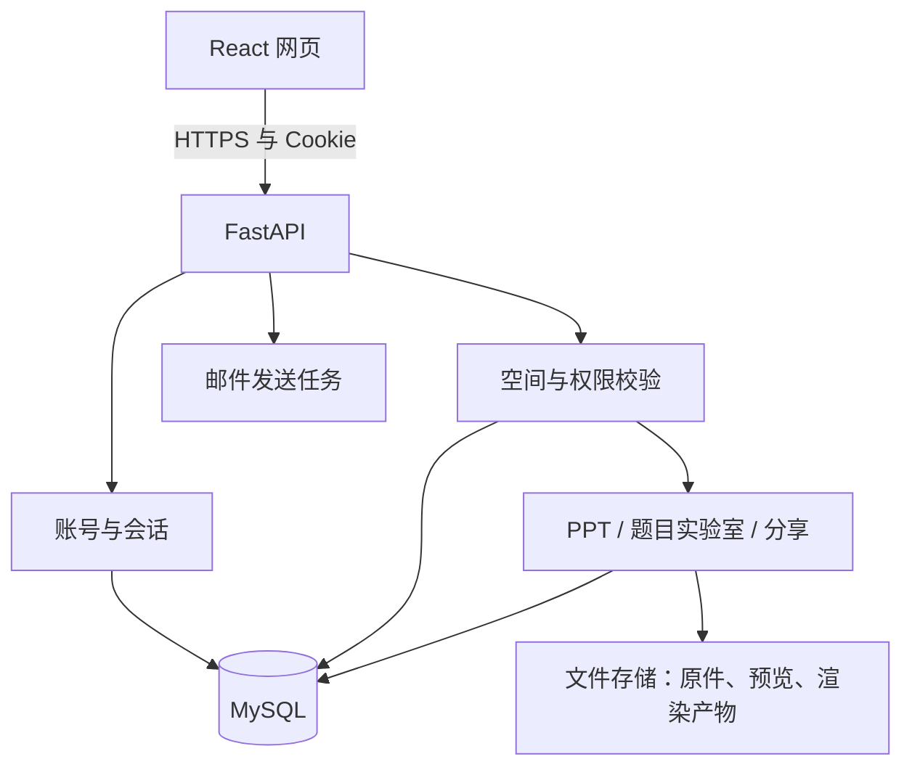

# 象生 MySQL 统一账号与权限建设规划（Implementation Plan）

> 编写日期：2026-11-07。本文是建设建议与后续实施规划，本次仅新增本文档，没有安装 MySQL、创建数据库、迁移数据或修改业务代码。
>
> **For agentic workers:** 仅在用户后续明确授权实施后，使用 `superpowers:executing-plans`，或在用户选择委派方式后使用 `superpowers:subagent-driven-development`，逐项执行文末任务。文中的复选框均表示待办。

**Goal：** 在现有象生项目上接入 MySQL，建立面向广泛用户的统一账号、长期作品保存、跨设备访问与可扩展权限体系。

**Architecture：** 保留 React、FastAPI 和 SQLAlchemy，使用 MySQL 管理账号、归属、授权和可编辑状态，文件存储管理上传原件与渲染产物。采用“统一账号＋可选个人标签＋使用模式＋空间内角色”，将登录会话与作品生命周期分开。

**Tech Stack：** MySQL 8.4 LTS、InnoDB、SQLAlchemy、PyMySQL、Alembic、Argon2id；沿用现有 Python 3.11、FastAPI、React 和 TypeScript。新增依赖的具体版本在实施时做兼容性验证后锁定。

**Spec：** 本文第 1—12 节为设计依据，第 13—15 节为实施与验收规划。用户已经明确选择 MySQL、要求撰写 Markdown；其余数值和产品规则均为本文建议，尚未实际配置。

## 全局约束

- 本次交付范围只有本文档；文内的命令和配置均为后续实施说明。
- 一个自然人可以使用一套账号访问所有模块；每位用户拥有独立凭据。
- 职业标签和使用模式不授予数据访问权限。
- 新账号作品默认私密；团队和公开展示按阶段加入。
- 登录过期、退出登录、修改密码均不直接删除作品。
- 现有材料、知识对象、实验、运行记录与分享能力需要延续。
- 所有私有内容及其图片、预览、附件、下载和后台任务都必须执行服务端授权。
- MySQL 接入验收必须包含真实 MySQL；SQLite 测试不能代替 MySQL 集成测试。

## 重点审查场景

1. 用户在两个浏览器登录，退出其中一个之后，另一设备和已保存作品的行为符合会话规则。
2. 两个账号竞争认领同一访客会话，只有一个账号成功，失败方看不到作品。
3. 从个人空间切换到团队空间时，缓存、自动保存和附件地址不混入其他空间的数据。
4. 迁移后文字能读，但原始文件、编辑文档或参数文件缺失时，明确报告缺项，不能宣布迁移成功。
5. 数据库切换后已接受新写入，再回退到旧 SQLite 时，不得静默丢失新数据。

---

## 1. 项目现状与需要补齐的内容

### 1.1 已确认的现状

以下结论来自当前代码，不代表线上环境已经部署了这些能力。

| 当前能力 | 代码位置 | 对本次规划的影响 |
| --- | --- | --- |
| FastAPI 后端已经存在 | `backend/app/main.py` | 在现有服务内增加账号模块，不另建一套独立后端 |
| SQLAlchemy＋SQLite | `backend/app/db/session.py` | 可以延续 ORM，但需要增加 MySQL 驱动和兼容性验证 |
| 启动时通过 `create_all()` 建表 | `backend/app/db/init_db.py` | 需要引入数据库版本迁移，不能靠重启升级旧表 |
| 访客会话与 Cookie、CSRF 校验 | `backend/app/api/routes_sessions.py`、`backend/app/api/__init__.py` | 保留访客入口，另外建立正式登录会话 |
| 多数内容关联 `session_id` | `backend/app/db/models.py` | 必须补上长期归属，不能只增加用户名和密码字段 |
| 原件、预览、编辑文档等保存在文件目录 | `backend/app/settings.py`、`backend/app/documents/store.py` | 数据库迁移要同时检查文件完整性 |
| iSpec 参数与部分覆盖状态保存为 JSON 文件 | `backend/app/ispec/persistence.py`、`backend/app/api/routes_regions.py` | 跨设备与多进程写入需要统一持久化和版本控制 |
| PPT 与实验室均有分享快照 | `backend/app/api/routes_publish.py`、`backend/app/api/routes_labs.py` | 继续使用发布快照，避免编辑中的私有内容意外进入分享 |

当前 ORM 中包含 `sessions`、`materials`、`pages`、`elements`、`knowledge_objects`、`object_versions`、`jobs`、`runs`、`checks`、`shares`、`labs`、`lab_shares` 共 12 张业务表；部分注释仍保留早期“9 张表”的描述。

### 1.2 建设目标

用户可以注册、登录、找回密码，在另一台设备继续编辑自己的作品；访客试用产生的成果可以保存到账号。系统可以逐步服务个人学习、内容制作、培训演示、研究交流和业务推演等用途。

首版不把实时多人编辑、学校教务系统、企业单点登录、付费订阅和公开内容社区作为上线前提。

## 2. 推荐方案与选择理由

| 方案 | 优点 | 代价 | 建议 |
| --- | --- | --- | --- |
| MySQL＋用户表，内容直接绑定用户 | 第一版较快 | 团队空间上线时需要再次调整归属与权限 | 仅适合明确长期只做个人工具的情况 |
| MySQL＋统一账号＋空间归属 | 个人和团队使用同一套基础；能支持多重场景 | 初期多出空间和资源归属设计 | **本文采用** |
| 接入独立身份服务或自建微服务 | 适合跨多个产品、复杂组织接入 | 运维和系统集成成本更高 | 当前阶段暂缓 |

选择第二种方案。首版只展示个人空间，底层保留空间边界；后续团队功能沿用相同的资源归属体系。

数据库建议采用 MySQL 8.4 LTS，并在实际部署时锁定经过验证的具体补丁版本或镜像摘要。这里选择维护周期较长的 LTS 路线，不追求把版本号写成“最新”。[依据：MySQL LTS 与 Innovation 发布说明](https://dev.mysql.com/doc/refman/8.4/en/mysql-releases.html)。

## 3. 整体架构与数据边界



- 浏览器只访问应用 API，不直连 MySQL，也不持有数据库密码。
- MySQL 保存账号、空间、归属、权限、可编辑文档状态和运行数据。
- 文件存储保存 PPT、PDF、图片、页图与导出文件；数据库记录文件关联和必要元信息。
- 首版可以使用单个后端实例及持久化文件目录；增加实例或分离任务进程前，文件目录需要替换为所有实例可访问的共享存储或对象存储。
- PowerPoint 对象分离仍沿用现有 Windows 转换能力，接入 MySQL不能替代 Office 转换环境。

## 4. 账号、标签、使用模式与角色

### 4.1 统一账号

首版采用“邮箱＋密码”，昵称用于展示，不作为唯一身份。一个内部 `user_id` 对应一个长期账号；修改昵称或绑定其他登录方式后，作品仍关联该 ID。

注册流程：

1. 填写邮箱和密码，创建待验证账号。
2. 系统发送验证链接；用户验证成功后激活账号。
3. 在同一数据库事务内创建个人空间，避免生成可登录但没有个人空间的账号。
4. 登录后选择是否把当前有效访客会话的成果保存到个人空间。
5. 个人标签和兴趣可以稍后补充，不阻塞使用。

同一规范化邮箱只能绑定一个邮箱登录身份。首版邮箱登录采用明确的大小写不敏感规则，保存原始展示值与规范化比较值；不擅自删除邮箱中的点号或 `+` 后缀。首版不支持国际化邮箱本地部分；后续扩展时单独定义兼容规则。

微信、手机号等作为后续登录方式，绑定操作需要先验证当前账号，再验证新方式。第三方登录不得只凭“邮箱相同”自动合并两个账号。

### 4.2 可选个人标签

建议提供：学生、教师、自学者、培训师、研究人员、企业员工、内容创作者，以及自定义标签。允许多选、修改和跳过。

标签只影响模板推荐、示例排序和默认提示。自选“教师”不产生组织认证，也不获得他人作品或个人笔记的访问权。

### 4.3 使用模式

| 使用模式 | 主要目标 | 默认突出的功能 |
| --- | --- | --- |
| 探索学习 | 理解概念、验证过程 | 参数、步骤、观察、个人笔记 |
| 内容创作 | 制作交互作品 | 上传、编辑、模型配置、版本 |
| 讲解演示 | 对外讲清内容 | 演示、讲解顺序、分享快照 |
| 分析推演 | 比较条件和结果 | 情景对比、指标、运行记录 |

这是界面偏好，用户随时可切换。现有题目实验室的 `explore/guided/solution` 是解题方式，保持独立，不被账号模式替代。

### 4.4 空间内角色

所有者由 `workspaces.owner_user_id` 唯一确定；非所有者的角色存入 `workspace_members`，避免两处重复维护“谁是所有者”。

| 操作 | 所有者 | 空间管理员 | 编辑者 | 查看者 |
| --- | --- | --- | --- | --- |
| 查看空间内容、运行交互 | 可以 | 可以 | 可以 | 可以 |
| 在自己的个人空间保存探索副本 | 可以 | 可以 | 可以 | 经作品允许后可以 |
| 新建与编辑空间作品 | 可以 | 可以 | 可以 | 不可以 |
| 管理分享、将作品移入回收站 | 可以 | 可以 | 不可以 | 不可以 |
| 管理普通成员 | 可以 | 可以，不能授予管理员或变更所有者 | 不可以 | 不可以 |
| 设置管理员、转移所有权、删除空间 | 可以 | 不可以 | 不可以 | 不可以 |

首版个人空间只有所有者，不提供邀请。团队阶段再启用其他角色。查看者操作参数只改变当前交互状态，不直接覆盖作者保存的内容。

平台权限单独维护为 `user/operator/admin`。运营人员不默认读取私有作品；平台管理员的诊断访问使用专门入口、填写原因并留审计记录，不在普通接口中全局绕过权限。

## 5. MySQL 建库与字段规范

### 5.1 建议配置

| 项目 | 建议 |
| --- | --- |
| 数据库名 | 开发 `xiangsheng_dev`、测试 `xiangsheng_test`、生产 `xiangsheng_prod` |
| 存储引擎 | InnoDB |
| 字符集 | `utf8mb4`，覆盖中文和表情字符 |
| 普通展示文字排序规则 | `utf8mb4_0900_ai_ci` |
| ID、令牌摘要、规范化登录标识 | 使用二进制比较；ASCII ID 使用 `ascii_bin` |
| 表名、字段名 | 小写蛇形命名，避免跨操作系统大小写差异 |
| 主键 | 延续项目带前缀的字符串 ID；新账号使用 `usr_` 前缀＋随机 ID |
| 时间 | 新表采用 UTC `DATETIME(6)`；API 继续返回现有 UTC ISO 8601 格式 |
| 结构化内容 | 参数和文档使用 JSON；归属、状态、时间及列表筛选字段单独建列 |
| Schema 管理 | Alembic 版本迁移；生产应用账号不执行建表和改表 |

`utf8mb4` 的选择依据见 [MySQL 字符集说明](https://dev.mysql.com/doc/refman/8.4/en/charset-unicode-utf8mb4.html)。

现有旧表的 ISO 时间字符串在第一阶段先保持格式，减少同时更换数据库与时间类型的风险。新增的 UTC 时间字段由数据访问层转换，不能直接传入现有只接受字符串的 `parse_iso()`。旧字段类型统一作为单独的后续迁移，不混入首次切库。

所有外键两端的长度、字符集和排序规则必须相同。JSON 迁移前检查非法内容、NaN、Infinity 和重复键；不把 SQLite 的宽松存储行为当作 MySQL 能接受的数据规范。

### 5.2 连接与部署

延续同步 SQLAlchemy 用法，增加 `PyMySQL[rsa]`，适配 MySQL 的认证方式；不在本轮顺带改成异步数据库框架。[连接方式依据](https://docs.sqlalchemy.org/en/20/dialects/mysql.html#pymysql)、[PyMySQL 认证依赖说明](https://pymysql.readthedocs.io/en/latest/user/installation.html)。

未来连接串的格式示意如下，不能直接把占位密码用于部署：

```text
mysql+pymysql://xiangsheng_app:<ENCODED_PASSWORD>@mysql:3306/xiangsheng_dev?charset=utf8mb4
```

- 优先使用结构化 URL 构造接口处理密码中的特殊字符；日志只输出数据库类型、地址与库名。
- 当前 `backend/app/db/session.py` 会记录连接串的一部分，接入含密码的 URL 前必须改为脱敏，不能沿用当前打印方式。
- MySQL 3306 端口放在服务内网；本地调试若需要映射，只绑定回环地址。
- 应用账号只获得必要的数据读写权限；迁移账号持有 DDL 权限，分别配置。
- 生产连接验证 TLS 证书和主机名；数据库健康后再执行单独迁移步骤，迁移完成后启动应用。
- 开启 `pool_pre_ping`；初始每个 API 进程 `pool_size=5`、`max_overflow=5`、`pool_timeout=10` 秒、`pool_recycle=1800` 秒，实施时结合 MySQL 超时配置调整。
- 总连接预算按 API 进程数、任务进程数和运维连接相加计算；不把单进程的池参数误当作全系统上限。
- OCR、PowerPoint 转换和模型调用期间不长时间占用数据库事务。

建议新增的配置名如下，具体取值由环境注入，不能写入前端构建变量：

| 配置 | 用途或建议默认值 |
| --- | --- |
| `DATABASE_URL` | 应用账号连接串，沿用现有变量名 |
| `MIGRATION_DATABASE_URL` | 仅迁移进程可用的 DDL 账号连接串 |
| `DB_POOL_SIZE`、`DB_MAX_OVERFLOW`、`DB_POOL_TIMEOUT_SECONDS`、`DB_POOL_RECYCLE_SECONDS` | 对应上文连接池建议 |
| `AUTH_COOKIE_NAME` | `xs_auth` |
| `AUTH_SESSION_ABSOLUTE_HOURS`、`AUTH_SESSION_IDLE_HOURS` | 普通登录：24、12 |
| `AUTH_REMEMBER_ABSOLUTE_HOURS`、`AUTH_REMEMBER_IDLE_HOURS` | 记住我：720、168 |
| `PUBLIC_APP_URL` | 生成邮件链接的可信前端地址，不使用请求任意传入的主机名 |
| `SMTP_HOST`、`SMTP_PORT`、`SMTP_USERNAME`、`SMTP_PASSWORD`、`SMTP_FROM`、`SMTP_TLS_MODE` | 邮件服务，生产必须验证 TLS |
| `OUTBOX_ENCRYPTION_KEY` | 保护短期发件载荷，与数据库连接凭据分开管理 |

以上为未来配置设计，本次没有写入 `.env`、生成密钥或设置邮件服务。

## 6. 新增数据表规划

这里是逻辑数据字典，实施时由 ORM 和 Alembic 生成、审查 DDL。未列出的创建时间与更新时间按实际需要补充，不能自动向所有表添加无用字段。

### 6.1 首版账号与基础表

| 表名 | 关键字段 | 约束与用途 |
| --- | --- | --- |
| `users` | `id`、`display_name`、`status`、`platform_role`、`created_at`、`deleted_at` | `status=pending/active/suspended/deleted`；内部用户主键固定 |
| `login_identities` | `id`、`user_id`、`provider`、`issuer`、`identifier`、`display_identifier`、`password_hash`、`verified_at` | 唯一键 `(provider, issuer, identifier)`；首版 `provider=email`、`issuer=''`；密码只属于密码登录方式 |
| `user_profiles` | `user_id`、`tags`、`interests`、`preferred_mode`、`avatar_key` | `user_id` 既为主键也为外键；标签和兴趣使用受长度限制的 JSON 数组 |
| `auth_sessions` | `id`、`user_id`、`token_hash`、`csrf_token_hash`、`created_at`、`last_seen_at`、`idle_expires_at`、`absolute_expires_at`、`revoked_at`、`device_label` | 登录令牌摘要唯一；索引 `(user_id, revoked_at)` 与过期时间 |
| `auth_action_tokens` | `id`、`user_id`、`identity_id`、`purpose`、`token_hash`、`expires_at`、`consumed_at` | 用于邮箱验证和密码重置；令牌单次使用，摘要唯一 |
| `auth_throttles` | `bucket_key_hash`、`window_start`、`attempt_count`、`expires_at` | MySQL 原子计数实现首版跨进程限流；数据短期保留；后续可替换为 Redis |
| `workspaces` | `id`、`kind`、`name`、`owner_user_id`、`personal_owner_user_id`、`created_at` | `kind=personal/team`；`personal_owner_user_id` 可空且唯一 |
| `resources` | `id`、`kind`、`workspace_id`、`guest_session_id`、`created_by_user_id`、`expires_at`、`deleted_at` | 长期归属和保留策略的权威记录；规则见 6.2 |
| `resource_states` | `id`、`resource_id`、`state_kind`、`slot_key`、`payload`、`revision`、`updated_at` | 唯一键 `(resource_id, state_kind, slot_key)`；承载原来文件中的可变状态 |
| `guest_claims` | `guest_session_id`、`user_id`、`workspace_id`、`claimed_at` | `guest_session_id` 为主键；同一访客会话只能被认领一次 |
| `audit_events` | `id`、`actor_user_id`、`workspace_id`、`action`、`resource_id`、`result`、`request_id`、`created_at` | 记录安全及授权变更；用户删除时保留最小审计事实并按策略去标识化 |
| `notification_outbox` | `id`、`template`、`recipient_identity_id`、`status`、`attempts`、`next_attempt_at`、`encrypted_payload`、`expires_at` | 账号事务提交后异步发验证邮件；失败可重试；含验证链接的载荷加密并短期清除 |

补充规则：

- 个人空间的 `personal_owner_user_id` 必须等于 `owner_user_id` 且非空；团队空间该字段为空。数据库约束与事务共同保证每个用户最多一个个人空间。
- `auth_sessions.token_hash` 和各类令牌摘要使用 `BINARY(32)` 保存 SHA-256 结果；这里摘要的对象是高熵随机令牌，**用户密码仍使用 Argon2id**。
- `notification_outbox` 不长期保留明文验证链接；加密密钥放在部署密钥配置中，与数据库和应用源码分开。
- MySQL 业务用户表与 MySQL 自身的数据库登录账号是两回事，网站注册不创建数据库账号。

除唯一索引外，至少准备资源列表索引 `(workspace_id, deleted_at, id)`、访客归属索引 `(guest_session_id, deleted_at, expires_at)`、状态查找唯一索引、发件扫描索引 `(status, next_attempt_at)` 和审计索引 `(workspace_id, created_at, id)`。若列表采用按更新时间排序，则索引按实际排序字段调整，并用 `EXPLAIN` 核对；不提前给每个 JSON 属性建索引。

### 6.2 资源归属规则

`resources.kind` 首版支持 `material` 和 `lab`。`materials`、`labs` 分别新增唯一且非空的 `resource_id` 外键；其他记录通过父对象找到资源，不重复维护一套所有权。

| 资源状态 | `workspace_id` | `guest_session_id` | `expires_at` |
| --- | --- | --- | --- |
| 未认领访客作品 | 空 | 有值 | 按访客保留期设置 |
| 账号或团队作品 | 有值 | 空 | 默认空，由账号存储政策管理 |

数据库约束要求前两列恰好一列有值。资源只能归属于一个空间或一个访客会话。

- `created_by_user_id` 是创建者记录，不单独授予访问权；迁移的访客作品可为空。
- 原有表中的 `session_id` 过渡期保留为历史来源，不再作为正式账号作品的访问条件，也不得触发连带删除。
- `knowledge_objects` 没有关联材料的独立对象，在迁移时建立独立的材料容器，再通过该容器关联资源。
- `jobs`、`runs`、`checks` 沿父材料或父知识对象找到同一资源；重试任务和下载任务结果也走该边界。
- 新写入账号内容时旧 `session_id` 可以为空；现有非空约束和所有依赖该字段的查询必须同步调整。
- 子表删除依赖现有外键关系；文件删除采用可重试任务。资源先标记删除并立即不可访问，文件清理失败不恢复访问。

### 6.3 现有文件状态如何进入 MySQL

`resource_states` 只保存需要可靠编辑和同步的状态，避免所有文件都塞入数据库。

| 原有内容 | 新存储位置 | `state_kind` / `slot_key` |
| --- | --- | --- |
| PPT 自由编辑文档 | `resource_states.payload` | `editor_document` / `main` |
| 每个 iSpec 的参数值 | `resource_states.payload` | `ispec_values` / 实际 `object_id` |
| iSpec 跨页共享参数 | `resource_states.payload` | `ispec_values` / `__shared__` |
| 区域人工覆盖参数 | `resource_states.payload` | `region_overrides` / `main` |
| 作为当前作品依据的 iSpec 识别定义 | `resource_states.payload` | `ispec_definition` / `main` |
| 实验室文档及轨迹 | 沿用 `labs.document` 与 `labs.revision` | 不重复存入 `resource_states` |
| 知识对象、运行和核对结果 | 沿用当前对应业务表 | 不重复保存第二份权威记录 |
| 原始 PPT/PDF、图片、页图、图层图片、离线包 | 文件或对象存储 | 与资源关联，访问仍校验权限 |

切换后，一个状态只能有一个权威来源。旧 JSON 文件作为迁移备份，不在运行时继续双写；数据库临时故障时返回保存失败，不能悄悄回退到旧文件形成两个版本。

写入使用 `expected_revision` 和条件更新，更新成功后版本加一；过期版本返回 HTTP 409。首次创建的版本为 1。新版客户端必须传递版本号，旧客户端缺少版本时返回明确的校验错误并提示刷新，不无条件覆盖。

### 6.4 第二阶段与后续表

| 阶段 | 表或扩展 | 用途 |
| --- | --- | --- |
| 团队协作 | `workspace_members`：唯一键 `(workspace_id, user_id)`，角色 `admin/editor/viewer` | 保存非所有者成员权限 |
| 团队协作 | `workspace_invitations`：空间、邀请邮箱、目标角色、令牌摘要、过期时间、接受状态 | 安全邀请，邀请被接受时再次检查发起人的当前权限 |
| 探索分支 | `exploration_branches`：来源资源及版本、目标资源、创建者、时间 | 保存用户自己的推演副本与来源关系 |
| 作品护照 | 在现有版本/运行记录上增加来源与派生关系 | 不用单独建一张同名大表重复保存整套内容 |
| 公开展示 | 独立公开条目与展示状态 | 经用户主动发布后才进入广场或搜索索引 |

## 7. 登录、密码与会话规则

### 7.1 密码建议

- 首版没有强制多因素认证，建议密码长度 15—128 个 Unicode 字符，允许空格、粘贴和密码管理器。
- 使用成熟库实现 Argon2id；至少达到 `memory_cost=19456 KiB`、`time_cost=2`、`parallelism=1`，并在目标服务器压测后调高。验证已有密码时可渐进重哈希。
- 拦截常见和已泄露密码；不要求无原因定期改密，也不使用安全问题找回密码。
- 密码重置链接建议 15 分钟有效，邮箱验证链接建议 24 小时有效；均使用至少 256 位安全随机令牌，单次消费。

上述密码存储和长度建议分别参考 [OWASP Password Storage](https://cheatsheetseries.owasp.org/cheatsheets/Password_Storage_Cheat_Sheet.html) 与 [OWASP Authentication](https://cheatsheetseries.owasp.org/cheatsheets/Authentication_Cheat_Sheet.html)。具体有效期是本规划的产品默认值。

### 7.2 登录态

继续使用服务端会话＋`HttpOnly` Cookie，避免为当前网页额外引入一套 JWT 刷新机制。

- 正式登录使用独立 `xs_auth` Cookie，不复用访客 Cookie。
- 登录成功后重新生成登录令牌和 CSRF 令牌，不能把旧访客令牌提升为账号令牌。
- 生产设置 `Secure`、`HttpOnly`、`SameSite=Lax`、`Path=/`，不设置宽泛父域 Cookie。
- 普通登录：绝对有效期 24 小时，空闲有效期 12 小时；“记住我”：绝对有效期 30 天，空闲有效期 7 天。两者同时满足才有效。
- `last_seen_at` 最多每 5 分钟写一次，更新空闲期时不得超过绝对有效期。
- 退出当前设备只撤销当前会话；“退出其他设备”撤销除当前会话外的全部会话。
- 密码重置成功撤销全部登录会话；已登录修改密码需要验证当前密码，并在成功后重新登录。
- 写请求继续验证 Origin 与 CSRF；退出登录也使用 POST 并校验 CSRF。
- 注册、登录和找回密码不要求已有正式账号 Cookie，使用现有访客会话取得预登录 CSRF，并验证 Origin。用户从邮件进入新浏览器时先建立该会话，再提交令牌兑换。
- 登录过期后，页面保留本地未提交草稿，但清空账号与空间相关缓存；重新登录后先核对用户和作品版本再恢复保存。

### 7.3 限流、邮件与日志

建议登录按规范化账号 10 次失败/15 分钟、按 IP 100 次尝试/15 分钟作为初始阈值；发送邮件按收件身份 3 次/小时、按 IP 30 次/小时作为初始阈值。实施后根据校园或企业共享出口的实际情况调整，避免长期锁死账号。

登录失败统一提示账号或密码不正确；密码找回统一返回受理结果。用户不存在时也执行等价的密码哈希校验，减少明显时序差异。限流计数原子更新，不能只保存在某个 Python 进程内。

邮件发送失败不回滚已经提交的账号数据；发件任务从 outbox 重试，重新发送使旧动作令牌失效。验证链接指向前端确认页，由用户操作后向后端提交消费请求，避免邮件扫描器通过一次 GET 提前用掉令牌。

日志不保存密码、原始 Cookie、CSRF、动作令牌和完整验证链接。安全日志中的网络信息按最小必要原则处理，建议保留 30 天；授权变更审计建议保留 180 天。这些期限是初始运维建议，正式运营前需与隐私说明一致。

## 8. 访客成果认领与作品生命周期

### 8.1 认领流程

1. 用户登录且邮箱验证完成后，页面提示“将当前试用成果保存到个人空间”。
2. 点击后发送 `POST /api/v1/guest/claim`，不由客户端指定要认领的资源 ID。
3. 后端同时验证正式账号会话、当前有效访客 Cookie 和 CSRF。
4. 在事务内锁定访客会话，检查 `guest_claims`，只查询该会话尚未到期、未删除的资源。
5. 将这些资源的归属切换到该用户个人空间，清除访客保留期限，写入认领记录与审计。
6. 同一用户重试返回同一认领结果；另一账号再次认领返回不可用，不透露作品清单。

认领中途发生数据库错误则整笔回滚，不能只移动材料而遗漏实验。由于文件使用稳定资源/材料 ID 定位，优先不在认领事务中移动大文件。

历史访客内容不会仅凭电脑相同、邮箱相同或管理员指定自动属于某账号；只有持有有效访客凭据才能认领。过期或遗失凭据的内容维持原规则，不承诺自动找回。

### 8.2 保留与删除

| 对象 | 建议规则 |
| --- | --- |
| 访客内容 | 延续当前默认 24 小时保留，仍可通过配置调整 |
| 已保存账号作品 | 不随登录会话过期；首版不自动按天删除，超出容量后限制新增并提示整理 |
| 用户删除的作品 | 立即停止普通访问和相关分享；建议保留 7 天回收站，再异步清理 |
| 已发布分享快照 | 独立管理到期和撤销；源作品删除后停止对外访问 |
| 动作令牌与发件载荷 | 过期或消费后按短周期清除，不长期保留完整载荷 |

访客认领不能自动延长已有公开链接的有效期。迁移旧分享时记录原内容的到期时间，认领后只延长作者作品的保留，不改变已发出链接的范围和期限。

后台清理以资源归属、删除状态与内容保留策略为准，不能按“登录会话已过期”整批删除账号作品。先确认项目实际存在的清理入口，再接入幂等清理任务；不假定目前已有完整定时清理系统。

## 9. 分享、私密内容与权限执行

### 9.1 分阶段提供访问范围

| 范围 | 含义 | 实施阶段 |
| --- | --- | --- |
| 仅自己 | 默认；仅个人空间所有者访问 | 首版 |
| 持链接可查看 | 有链接者可读发布快照，支持有效期和撤销 | 首版 |
| 指定成员 | 受邀用户登录后通过空间成员权限访问 | 团队阶段 |
| 公开展示 | 主动发布到作品广场或允许搜索收录 | 后续阶段 |

首版继续扩展现有 `shares`、`lab_shares`，增加独立的 `expires_at`、`allow_copy` 和发布内容选项；不同时再维护第三套分享事实表。新链接使用更长的随机标识，旧链接在原到期范围内兼容。链接参数应从访问日志中脱敏。

分享必须从明确裁剪后的快照生成，默认不附带原始上传文件、个人草稿、私有解答和账号信息。发布时可以预览实际对外内容；个人笔记只有用户明确勾选后才包含。

`allow_copy=false` 表示应用不提供保存副本和工程导出入口，无法阻止浏览者截图或手工复制。撤销链接阻止后续在线访问，无法收回已下载的离线 HTML 或已经获得的副本。

### 9.2 服务端授权顺序

1. 验证访问者身份或访客会话。
2. 定位资源并检查是否删除、过期。
3. 检查当前账号与资源空间的关系，或核对该资源的访客归属。
4. 根据操作校验所有者/成员角色；分享读取则校验对应快照和有效期。
5. 授权通过后才读取对象、文件或执行后台任务。

私有对象不存在与无访问权统一返回资源不可用；用户已知空间内缺少某项管理权限时返回 403。不能仅隐藏前端按钮，也不能只凭 `material_id`、`lab_id`、用户传入的 `workspace_id` 或随机 URL 认定有权访问。[依据：OWASP Authorization](https://cheatsheetseries.owasp.org/cheatsheets/Authorization_Cheat_Sheet.html)。

内置公开示例继续按明确的只读示例清单访问；用户从示例克隆出的作品重新建立私有归属。后台任务入队和实际执行时均核对资源状态与所需权限，权限已撤销或资源已删除时不得继续发布。

## 10. 建议新增接口与页面

### 10.1 账号及空间接口

所有路径均在现有 `/api/v1` 下。沿用 `{data, request_id}` 与 `{error, request_id}` 响应格式。

| 方法与路径 | 用途 | 关键要求 |
| --- | --- | --- |
| `POST /auth/register` | 注册待验证账号 | 邮箱规范化、密码策略、事务内写 outbox |
| `POST /auth/verify-email` | 消费验证令牌并激活 | 原子单次消费，创建个人空间 |
| `POST /auth/resend-verification` | 重发验证邮件 | 统一受理响应、限流 |
| `POST /auth/login` | 登录并下发 Cookie | 限流、验证账号状态、轮换令牌 |
| `POST /auth/logout` | 退出当前设备 | 校验 CSRF，撤销当前会话 |
| `POST /auth/logout-others` | 退出其他设备 | 需要近期身份验证 |
| `GET /auth/sessions` | 查看自己的登录设备 | 不返回原始令牌或令牌摘要 |
| `POST /auth/forgot-password` | 请求密码重置 | 不暴露邮箱是否已注册 |
| `POST /auth/reset-password` | 设置新密码 | 原子消费令牌、撤销全部会话 |
| `POST /auth/change-password` | 已登录改密 | 校验当前密码，成功后重新登录 |
| `GET /me`、`PATCH /me` | 读取/修改本人资料偏好 | 不允许修改平台角色或认证状态 |
| `GET /workspaces` | 列出本人可进入的空间 | 首版只返回个人空间 |
| `GET /workspaces/{id}/resources` | 空间作品列表 | 服务端过滤归属，分页 |
| `POST /guest/claim` | 保存当前访客成果 | 同时验证两种会话，事务内认领 |

首版增加登录、注册、验证邮箱、找回密码、账号设置页面，改造现有个人空间。前端缓存键需要包含当前用户与空间，退出时清理；未登录浏览公开分享无需跳转注册。

### 10.2 契约与错误码

现有错误码只覆盖访客与材料场景。账号上线时新增 `AUTH_REQUIRED`、`INVALID_CREDENTIALS`、`EMAIL_NOT_VERIFIED`、`INVALID_OR_EXPIRED_TOKEN`、`FORBIDDEN`、`RATE_LIMITED` 等账号错误，并在后端、前端、OpenAPI 和契约说明中同步更新。

版本冲突继续使用 `VERSION_CONFLICT`；保留旧接口已有的必要兼容，不用 `SESSION_EXPIRED` 表达所有密码、权限和账号状态错误。

## 11. SQLite 与文件数据迁移方案

### 11.1 切换前准备

1. 盘点实际 SQLite 文件、12 张业务表和所有相关文件目录，确认没有其他进程在写。
2. 为当前库建立 Alembic 基线，并建立目标 MySQL schema；逐项检查字符串长度、外键、JSON 与排序规则。
3. 在隔离环境演练，生成只读检查报告。可恢复问题列明修复结果，不可恢复问题单独列出；禁止悄悄跳过损坏记录。
4. 准备数据库与文件的同一批次备份、校验清单和恢复步骤。

### 11.2 推荐首次迁移方式

首轮采用短时停止写入的一次性切换，不引入双写和增量同步系统。

1. 暂停上传、编辑、发布、认领及其他写操作，等待后台任务完成或明确暂停。
2. 获取 SQLite 与文件存储的一致性备份；备份过程与工具要覆盖 SQLite 的 WAL 状态，不能只随意复制主文件。
3. 通过 ORM/结构化导入把旧业务数据按外键依赖顺序导入 MySQL，保留原主键；不把 SQLite SQL dump 原样交给 MySQL 执行。
4. 为历史材料与实验创建访客资源归属记录；缺少材料容器的独立知识对象按 6.2 处理。
5. 导入自由编辑文档、参数桶、人工覆盖与当前识别定义，写入 `resource_states`，保留原文件的只读备份。
6. 给历史分享补齐与原资源一致的独立到期时间，核对快照和附件路径。
7. 检查每表记录数、父子关联、JSON 语义校验和文件清单；文件缺失不以文字记录存在代替。
8. 部署账号版服务与同步升级的前端，切换 `DATABASE_URL`，先保持外部写入关闭完成冒烟检查，再开放写入。

没有长期账号的历史数据保持访客归属，不批量归到第一个注册用户或管理员名下。

### 11.3 回退边界

- 开放新写入前检查失败：恢复旧版本与同批备份，继续使用旧 SQLite。
- MySQL 已接受新写入后出现故障：先停止写入并备份 MySQL 增量和文件，再选择修复前进或经过验证的逆向迁移。
- 不能仅改回旧 `DATABASE_URL` 宣称恢复成功；新账号、新作品和新编辑状态并不存在于旧备份中。
- 切换后原 SQLite 留作只读恢复材料，不继续作为另一套可写生产库。

Alembic 负责结构版本管理，历史数据和文件导入由单独迁移脚本完成；二者不是同一件事。[Alembic 官方教程](https://alembic.sqlalchemy.org/en/latest/tutorial.html)。

## 12. 与象生功能结合的创新方向

### 12.1 首版：按目标进入工作台

注册后允许跳过职业身份，直接选择“理解一道题”“制作交互演示”“比较不同条件”。将选择保存为偏好，影响推荐和工作台入口；不改变权限，也不自动提交用户材料给模型。

### 12.2 第二阶段：个人探索分支

允许用户把获准复制的分享快照保存为自己的作品。分支保存来源快照版本、自己的参数、观察与结论，不覆盖作者原稿，也不复制未发布的私人笔记。

同一资源内可使用对照情景；形成独立作品时才新建资源和分支关系，避免每拖一次参数就复制整套材料。文件可按内容复用，但引用计数和删除策略需要避免删除仍被分支使用的文件。

### 12.3 后续：可追溯的作品说明

结合现有模型版本、运行和核对报告，展示来源材料、参数条件、编辑版本、计算内核与核对状态。来源标记说明事实，不能把自选身份或系统计算包装成专业资质认证。

## 13. 后续实施文件与模块边界

下列均为后续建议改动，并非本次已经新增的代码。

| 文件或目录 | 计划职责 |
| --- | --- |
| `backend/app/settings.py`、`.env.example` | MySQL、正式会话、邮件与密钥配置；生产校验 |
| `backend/requirements.txt` | MySQL 驱动、Alembic、密码库的兼容版本 |
| `backend/app/db/session.py` | MySQL 连接池、脱敏日志、数据库会话 |
| `backend/app/main.py`、`backend/app/db/init_db.py` | 生产启动检查 schema 版本，停止依赖 `create_all()` 自动升级 |
| `backend/app/db/models.py` | 为原业务表增加资源关联，调整旧会话非空约束 |
| `backend/app/db/account_models.py`（新增） | 账号、凭据、会话、动作令牌及发件模型 |
| `backend/app/db/workspace_models.py`（新增） | 空间、资源、可变状态、认领及审计模型 |
| `backend/alembic.ini`、`backend/alembic/`（新增） | schema 基线及增量迁移 |
| `backend/app/accounts/`（新增） | 密码、会话、验证邮件、限流与账号服务 |
| `backend/app/workspaces/`（新增） | 归属解析、权限判断、认领与生命周期规则 |
| `backend/app/api/routes_auth.py`、`routes_me.py`、`routes_workspaces.py`（新增） | 新接口，不在路由里堆叠完整业务逻辑 |
| `backend/app/api/__init__.py` 及现有业务路由 | 把会话归属校验接入统一资源权限 |
| `backend/app/documents/store.py`、`backend/app/ispec/persistence.py`、区域及识别读取代码 | 替换可变文件状态的权威存储；保留现有计算与内容校验 |
| `backend/app/schemas/errors.py`、`frontend/src/api/types.ts`、`contracts/openapi.yaml` | 账号、版本号及错误响应契约 |
| `backend/scripts/migrate_sqlite_to_mysql.py`（新增） | 只读检查、受控导入、逐项报告，明确区分检查与执行模式 |
| `frontend/src/api/client.ts`、`frontend/src/state/`、`frontend/src/routes.tsx` | 登录态、CSRF、空间缓存边界及页面路由 |
| `frontend/src/pages/SpacePage.tsx`、`frontend/src/components/home/SiteNav.tsx` | 个人空间和账号入口 |
| `deploy/docker-compose.yml`、`deploy/README.md` | MySQL、独立迁移步骤、持久化和恢复说明 |

建议的内部接口边界：

- `resolve_principal(request, db) -> Principal`：区分账号、访客与匿名，返回当前身份，不把标签放入权限条件。
- `require_resource_access(db, principal, resource_id, action) -> Resource`：支持 `read/edit/share/delete`，统一校验归属和角色。
- `claim_guest_resources(db, user_id, guest_session_id) -> ClaimResult`：只接收经过验证的会话，内部完成锁定和事务。
- `save_resource_state(db, resource_id, state_kind, slot_key, payload, expected_revision) -> StateRecord`：调用前完成编辑授权；使用条件更新避免覆盖。
- `consume_action_token(db, raw_token, purpose) -> TokenResult`：校验摘要、用途、过期和单次使用，并与激活/改密事务组合。

## 14. 分阶段执行清单

以下是可分别评审的交付任务。涉及数据约束或安全边界的任务，先增加能复现目标失败的测试，再实现，最后运行对应测试；本次不执行任何任务。

### 任务一：MySQL 连接与迁移基线

**依赖：** 无。**产出：** 可从空库建立、可追踪版本的 MySQL 环境。

**文件：** 数据库连接、设置、依赖、启动检查、Alembic、部署配置及 `account_models.py` 中的 `users` 结构；新增 `backend/tests/integration/test_mysql_schema.py`。

- [ ] 验证旧模型在真实 MySQL 中的 ID、JSON、索引和外键行为；先记录不兼容情况。
- [ ] 补齐驱动和脱敏连接日志，建立单独的迁移步骤。
- [ ] 先建立第 6.1 节 `users` 的表结构，作为任务二空间外键的依赖；任务三再补齐凭据、会话和账号业务，避免任务间 schema 循环依赖。
- [ ] 测试中文、表情、大小写敏感标识和无效外键：中文表情往返一致，非法关联拒绝。
- [ ] 对空测试库运行迁移到 head，再次运行无额外变化；重启服务不重复执行 DDL。

### 任务二：统一资源归属与可靠状态保存

**依赖：** 任务一。**产出：** 访客与账号均可使用的资源归属；可变状态统一入库。

**文件：** 空间模型、原业务表、状态存储、权限服务；新增 `backend/tests/integration/test_resource_ownership.py`、`test_resource_state_concurrency.py`。

- [ ] 先验证缺失归属、双重归属被拒绝，访客 A 无法访问访客 B 的资源。
- [ ] 创建空间、资源和状态模型，完成原业务表关联；业务操作统一解析父资源。
- [ ] 验证两个并发请求携带同一版本写入：恰好一个成功，另一个返回 409，最终状态没有混合内容。
- [ ] 覆盖文件、预览、任务重试、发布和导出路径；数据库故障不得转写旧 JSON 文件。

### 任务三：注册、邮箱验证与正式登录

**依赖：** 任务一、二。**产出：** 可验证、可退出、可恢复密码的统一账号。

**文件：** 账号模型与服务、账号路由、邮件任务、错误契约；新增 `backend/tests/integration/test_accounts_auth.py`、`test_auth_tokens.py`。

- [ ] 先验证重复邮箱、待验证账号、错误密码、超时令牌和复用令牌的拒绝行为。
- [ ] 实现注册、outbox、邮箱验证、个人空间创建、登录会话与 CSRF。
- [ ] 验证两个请求同时消费同一令牌时仅一次成功；邮件暂时失败不丢失账号和待发任务。
- [ ] 验证跨设备退出、空闲/绝对过期、密码重置撤销全部会话和敏感日志脱敏。
- [ ] 验证自选教师标签和伪造平台角色字段都无法获得管理权限。

### 任务四：访客认领与旧数据迁移

**依赖：** 任务二、三。**产出：** 可演练、可核对、明确回退边界的数据迁移与认领功能。

**文件：** 认领服务、迁移脚本、迁移报告模板；新增 `backend/tests/integration/test_guest_claims.py`、`test_mysql_migration.py`。

- [ ] 先验证只有材料 ID 而没有访客凭据时不能认领。
- [ ] 验证两个账号竞争时只有一个成功；事务中途失败后所有归属保持原状，同账号重试幂等。
- [ ] 用含材料、实验、原稿、编辑文档、共享参数及已发布快照的样本迁移，逐项核对。
- [ ] 验证缺失文件、损坏 JSON、孤立外键分别进入失败报告，不被计为成功。
- [ ] 演练切换前恢复；对切换后新写入演示停止写入、保全增量的处理，不演示直接丢弃新数据的回退。

### 任务五：前端账号闭环与个人空间

**依赖：** 任务三、四。**产出：** 用户能完成注册、认领、保存、换设备继续使用的全过程。

**文件：** 账号页面、路由、API 客户端、状态和导航；新增相关组件测试与 `verify/account_browser_check.py`。

- [ ] 接入正式登录态、邮件验证、找回密码、账号设置和个人空间，职业标签允许跳过。
- [ ] 登录过期保存失败时保留本地草稿；重新登录不同账号后不向新账号上传旧账号草稿。
- [ ] 缓存键包含用户和空间；验证账号切换后不会看到前一个账号的列表或内容。
- [ ] 浏览器验收跨设备保存、访客转存、私有附件、分享访问及撤销。

### 任务六：首版上线检查与后续扩展

**依赖：** 任务一至五。**产出：** 可恢复、有容量边界和监控的首版。

**文件：** 部署与备份说明、检查脚本；以后再新增团队成员与邀请模块。

- [ ] 建立数据库和文件的配套备份，至少完成一次在隔离环境恢复并打开作品的演练。
- [ ] 检查连接池、慢查询、磁盘容量、失败邮件和后台任务告警；容量指标不通过臆测给出承诺。
- [ ] 测试环境关闭真实付费模型调用，邮件使用隔离收件服务，避免验收触发真实通知。
- [ ] 首版稳定后，再分别安排团队空间、个人探索分支和作品来源说明，逐项验收。

### 工期参考

在一名熟悉当前项目的开发者、有可用邮件服务和测试环境、旧数据规模较小的前提下，首版可先按 **10—16 个工作日** 估算：基础与归属 3—5 天、账号 3—4 天、迁移与认领 2—3 天、前端及综合验收 2—4 天。该估算不是交付承诺；异常数据、部署限制和真实文件规模需要在任务一的盘点后重新评估。

## 15. 验收与运行检查

### 15.1 首版必须满足的用户场景

- [ ] 学生、教师、企业员工和不选择标签的用户均可完成同一套注册流程。
- [ ] 注册、验证、登录、找回密码、退出设备形成完整闭环。
- [ ] 在设备 A 保存 PPT 编辑内容、参数和实验笔记，设备 B 登录同一账号后恢复一致状态。
- [ ] 账号 A 不能通过猜 ID、换空间参数、附件 URL 或任务 ID 读取账号 B 的内容。
- [ ] 退出或登录过期后作品仍保存；未提交草稿不会跨账号误保存。
- [ ] 访客成果可安全认领，过期成果不会被自动恢复或归给其他人。
- [ ] 默认私密，分享只包含预览过的快照；撤销和到期后不可继续在线访问。
- [ ] 同时编辑返回可处理的版本冲突，不出现最后一次写入悄悄覆盖。
- [ ] 数据库及文件恢复演练后，作品可以阅读、编辑、运行与再次发布。
- [ ] 现有上传、识别、编辑、交互、实验室、分享和离线导出回归通过。

### 15.2 后续实施时的检查命令

以下命令仅为实施后的检查入口，本次未运行；需要先完成相应代码与测试，并将连接串指向独立 MySQL 测试库。

在 `backend` 目录执行：

```powershell
py -3.11 -m alembic upgrade head
py -3.11 -m alembic current
py -3.11 -m pytest tests/integration -q
py -3.11 -m pytest -q
```

在 `frontend` 目录执行：

```powershell
npm test
npm run typecheck
npm run build
```

另外运行账号浏览器验收和现有核心流程验收。接口集成测试使用独立 MySQL；测试自身的临时 SQLite 夹具可以继续承担纯逻辑测试，但不能据此宣称 MySQL 已兼容。

备份初始目标可设为每天全量、保留最近 7 天，并定期做恢复演练。这只能支持约一天级别的恢复点；如需要分钟级恢复点，应另外配置 binlog 持续归档与文件版本策略，并验证完整恢复链路，不能把 binlog 打开等同于备份完成。

## 16. 当前建议采用的首版范围

**MySQL＋邮箱密码账号＋个人空间＋可选身份标签＋跨设备保存＋访客成果转存＋私密/链接分享。**

底层同时准备空间归属与版本控制，界面先保持简单。团队成员、探索分支和公开作品展示分别作为后续独立交付项。本文是后续讨论与实施的依据，不代表数据库或账号功能已经接入。
