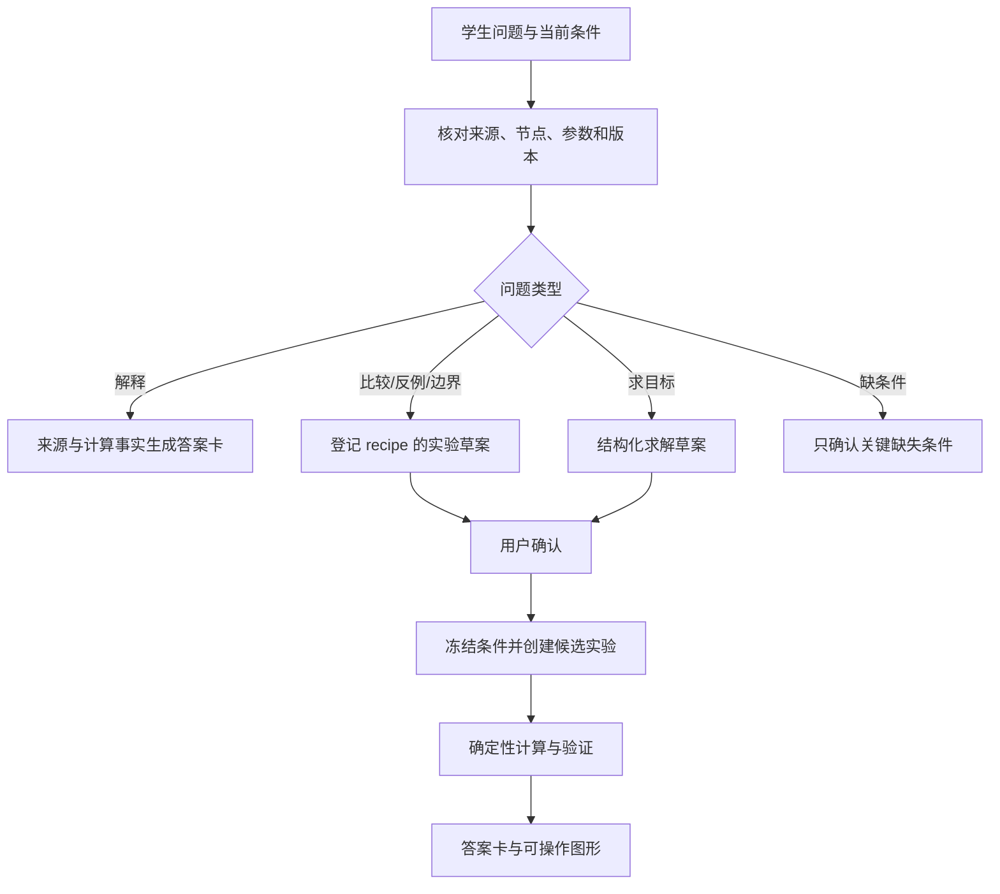

# 象生 PPT AI「简单呈现」开发交接文档 / Implementation Plan

> **For agentic workers:** REQUIRED SUB-SKILL: Use superpowers:subagent-driven-development or superpowers:executing-plans to implement this plan task-by-task. Steps use checkbox (`- [ ]`) syntax for tracking。
>
> 本文件交给技术人员实施。本次只编写开发文档，没有实施业务代码、数据库迁移或模型调用。文中的新增文件、接口、字段和测试均为待开发约定，不能当成现有能力。

**Goal:** 学生在 PPT 原页通过「讲懂这里、动手试试、问一个问题」完成学习，不必进入工程工作台；创建者通过独立入口完成来源核对和发布。

**Architecture:** 继续使用现有阅读器、PPT AI 规划与计算、实验分支、发布快照和离线运行时。新增学习呈现层、个人练习状态、问题协调层与结果卡，连接现有能力；AI 负责理解和讲解，登记算子负责计算，可视化组件负责展示。原稿基准、个人练习、补充实验分别管理。

**Tech Stack:** 沿用当前 React 18、TypeScript、Vite、React Query、SVG，以及 Python 3.11、FastAPI、Pydantic、SQLAlchemy、NumPy、SymPy；复用当前 PPT AI 模型客户端和任务系统。浏览器验证沿用项目 Playwright；本期不引入新的前端框架、消息队列或模型供应商。

**Spec:** 本文第 1—8 节是本轮开发规格，第 9 节是实施任务，第 10—12 节是验收、执行检查和交付要求。上轮能力建设参考 `docs/superpowers/plans/2026-11-07-ppt-ai-interaction-handoff.md`；发生冲突时，本文件只覆盖本轮「呈现、练习、问题协调、结果及发布」相关内容，保留上轮明确排除的通用自然语言画布控制。

**编制日期:** 2026-11-08。路径均相对项目根目录。目标使用者：学生自主学习优先，同时支持老师课堂演示与课件创建者核对发布。

## Global Constraints

1. 保留现有 PPT 上传、原稿阅读、自由编辑、旧实验和演示能力；不能为新界面另造整套播放器。
2. 学生操作写入个人练习状态；原稿和发布基准保留为独立对照。
3. 提问可以生成解释、补充实验草案或求解草案；不建设通过聊天直接修改 PPT 文字、当前画布、当前参数池或播放状态的通用入口。
4. 所有新实验/求解草案先展示关键条件，再由用户明确执行；模型回复本身不直接写回原稿或创建发布基准。
5. 数学结果、图形、答案卡、验证和讲解必须绑定同一份条件及输入哈希。
6. 原稿事实、OCR、推断、用户核对、教学探针和补充条件分别记录。探索用条件不伪装成原稿内容。
7. 新读接口没有生成副作用；准备、讲解、提问、执行、保存、核对和发布使用显式写接口。
8. 沿用现有归属、会话、Origin、CSRF、任务幂等与版本检查。公开读链接不获得作者的私有写权限。
9. 保留当前后端模型配置。密钥不进入前端、文档示例、日志、公开快照和离线包；不以此次改造为由更换模型。
10. 不以样本文件名、固定页码、固定标题或审查材料 ID 分派业务逻辑。
11. 不把仅有结构校验的结果标成「交互验收通过」；未运行浏览器验证必须显示未覆盖。
12. 兼容旧材料及旧冻结快照；新字段必须有读取降级策略。
13. 本轮不新增复杂学校/班级/角色权限体系。根据材料归属和访问场景区分创建者、公开接收者和离线使用者。
14. 开发期间不覆盖账号、上传转换、数据库等其他并行工作的变更；接手时重新核对当前代码。

## Review Focus

以下五类输入必须有真实测试，不能只靠人工阅读实现判断：

1. **慢响应期间切页或编辑来源：** 旧任务结果不得覆盖当前页、新版本或新的练习条件。归属 T02、T04、T07。
2. **未保存调参后提问、保存后立即再次操作：** 请求使用当前草稿条件；保存后所有消费者使用服务器返回的新版本。归属 T02、T07、T09。
3. **小数、零向量、奇异矩阵和不可逆坐标基：** 保留精度，给出正确的解类型与退化提示，不显示 NaN 或无依据的数学结论。归属 T03、T06。
4. **两个分享接收者、退出/切换账号和离线打开：** 练习彼此独立，不写作者分支，不读取他人本地记录，不尝试离线模型请求。归属 T09—T11。
5. **旧材料、未知模板、不同页面同名参数：** 保留原稿与已有实验，不按名称错误关联，不把能力缺失包装成可操作实验。归属 T01、T04、T06、T10。

---

## 1. 本轮范围与产品决策

### 1.1 必须交付

| 编号 | 交付能力 | 用户可感知的结果 |
| --- | --- | --- |
| R01 | 原页学习入口 | 在当前 PPT 页直接开始，不先跳工作台 |
| R02 | 按页整理学习内容 | 先看本页目标和可用实验，不阅读全课覆盖日志 |
| R03 | 原稿依据对照 | 看得见公式/图片对应区域，可定位和核对 |
| R04 | 简明讲解 | 核心意思、来源、关键一步，完整过程可展开 |
| R05 | 目标驱动实验 | 针对学习问题呈现图形与必要控件 |
| R06 | 当前上下文提问 | 自动携带页、区域和当前练习条件 |
| R07 | 实验/求解草案确认 | 用户看懂条件后创建独立实验 |
| R08 | 学生答案卡 | 明确答案、原因、验证和适用条件 |
| R09 | 个人练习与保存 | 可调参、恢复、保存、重开，不污染课件基准 |
| R10 | 创建者核对与发布 | 待核对有依据、验收有下一步、分享前能预览 |
| R11 | 分享与离线探索 | 已发布实验在接收端可操作，各人状态独立 |
| R12 | 失败降级与可访问性 | 不支持仍可读；键盘、手机、读屏有完整路径 |

### 1.2 本轮的明确边界

- 首批重点完成二维矩阵的特征方向、换基和逆映射三个教学场景。现有其他登记算子保留通用呈现和明确降级。
- 不承诺任意 PPT、任意公式或任意学科都能自动重建可靠实验。
- 不新增通用聊天命令控制；「让输出变成某值」可转成待确认的目标求解草案，不能直接改当前画布。
- 不把 AI 生成脚本视为主要实现路线；继续使用登记算子和受控可视化模板。现有专用视图试验保留原隔离策略。
- 不实施新的 PDF/图片题目上传、班级管理、学习排行榜或完整学习评价系统。
- 一道小问题可以作为示范场景的轻量学习反馈，不作为本轮完整考试/评分系统。

### 1.3 访问场景与能力边界

| 场景 | 原稿/冻结讲解 | 本地实验 | 新联网 AI 提问 | 云端保存 | 核对/发布 |
| --- | --- | --- | --- | --- | --- |
| 自己上传或拥有的材料 | 支持 | 支持 | 支持，沿用现有会话与额度 | 保存自己的练习 | 归属允许时支持 |
| 公开分享接收者 | 支持已发布内容 | 支持，各人独立 | 本期不借用作者权限调用私有接口 | 本期保存在本机 | 不支持 |
| 离线 HTML 使用者 | 支持已打包内容 | 支持 | 不发起模型请求 | 本机保存/恢复 | 不支持 |

**取舍说明：** 本轮保证分享后能操作实验和阅读已准备的讲解，不建设公共链接替作者消耗 API 的问答通道。「复制到我的学习空间后继续联网提问」可另立任务，不应显示尚未实现的复制按钮。公开/离线页面只展示实际可用入口，并说明能力范围。

## 2. 当前基线与必须先修复的问题

本节来自 2026-11-08 的实际操作与代码核对，是研发起点，不代表下面的新设计已经存在。

| 当前实现 | 已核实情况 | 本轮改动 |
| --- | --- | --- |
| `frontend/src/pages/PptAiWorkspace.tsx` | 状态、规划、实验、求解和验收集中在工作台 | 提取共享状态协调逻辑；保留高级管理入口 |
| `frontend/src/components/presentation/DeckPlayer.tsx` | AI 区域可挂回原页；AI 面板传入 `readOnly` | 接入学习面板和个人练习状态 |
| `frontend/src/components/ppt-ai/PptAiInteraction.tsx` | 有基础控件、曲线、表格、指标；矩阵主要是数值呈现 | 精度修复、按目标选控件、接入矩阵学习场景 |
| `frontend/src/components/experiments/` | 已有向量、特征方向、换基等展示 | 通过适配层复用，不直接依赖示例标题/页码 |
| `frontend/src/ppt-ai/runtime/branchStore.ts` | 已有本地状态、保存和冲突基础 | 用于私有分支持久化；个人临时状态与基准分开 |
| `backend/app/ppt_ai/experiments.py` | 补充实验使用登记 recipe、关键词选择和数值命题解析 | 增加受限问题协调，保留确定性执行 |
| `backend/app/ppt_ai/targets.py` | 有线性逆映射和有界标量搜索 | 增加独立于节点参数的显式解结构 |
| `backend/app/ppt_ai/tasks.py` | 已有持久任务、幂等、租约和恢复 | 增加学习任务种类，不另建任务框架 |
| `backend/app/ppt_ai/snapshots.py` | 冻结 bundle、branch、实验、报告及资源 | 冻结选定基准及学习呈现，明确可操作状态 |
| `SharedDeckPage.tsx`、`frontend/src/offline/main.tsx` | 都使用 `DeckPlayer` | 共享同一学习运行时，按能力关闭联网操作 |

首批必须修复：

1. **保存版本被旧状态覆盖。** 工作台保存后再刷新时，旧闭包可能把旧 branch 保留下来；以服务器保存返回值为准，不用单纯延时规避。
2. **向量解没有独立返回/展示。** 当前逆映射主要把解写入节点的 `v1/v2` 参数；节点缺少这些参数时，答案无法通过候选参数表可靠呈现。
3. **目标求解状态枚举不一致。** 后端有 `multiple`、`none_in_scope`；前端 `TargetStatus` 当前别名到实验状态，需分别定义并逐项对齐。
4. **小数控件失配。** 已复现显示 2.5、滑块值取整，右方向键后变成 4。先修源值、范围、步长与控件绑定，再做界面包装。
5. **基准选择不够明确。** 当前部分阅读/发布路径使用最新分支。新增个人练习后不能继续用「最后创建的任意分支」作为课件基准。
6. **分享可打开不等于 AI 可操作。** 当前阅读面板明确只读；须实现临时练习状态和已发布能力标记。

当前根目录未发现 Git 仓库元数据。技术人员应在实际版本控制位置建立变更和评审记录，不因本文自行初始化仓库或覆盖现有工作区。

## 3. 页面、交互与状态规格

### 3.1 阅读页

- 原有页导航、原稿、缩放和翻页继续使用。
- 顶部增加一个「本页学习」入口；区域热点使用「看懂这里」等任务文案。
- 点击后展开当前页的学习面板，默认展示一条学习目标与最多三个任务入口。
- 多个对象按「页码＋内容含义」命名；禁止多个下拉选项都只叫「矩阵与向量变换」。
- 桌面侧栏不压缩图形到不可用；复杂实验可全屏展开。关闭后保留页码、缩放和阅读位置。
- 手机使用底部面板/全屏实验，关闭后焦点回到原入口。

### 3.2 讲懂这里

默认内容顺序：核心意思 → 原稿依据 → 关键一步 →「展开过程」→「用图验证」。

- 讲解关联一个明确的页/区域；整页讲解可关联多个来源区域。
- 原图区域与提取公式并排可见，支持定位原页。公式同时提供可读文本。
- 第一屏不显示模型名称、接口地址、内部编号、recipe、revision、哈希或 JSON。
- 原稿推导与 AI 补充例子分开标注；没有来源的例子标记为「辅助例子」。
- 内容只解释当前有效来源；过期时提示重新准备，不继续把旧答案放在新来源下面。

### 3.3 动手试试

- 先显示「这次观察什么」「哪些条件固定」「你可以改变什么」。
- 仅展示该学习目标的关键控件，完整参数可展开。
- 所有可调数值提供精确输入；拖动、键盘和输入得到一致数值。
- 保留「恢复课件条件」和「保存这次探索」。
- 图、公式、指标、结论和解释共用一次求值结果。
- 实验初始条件有来源标签；自由探针、试验范围等教学条件单独标注。

### 3.4 问一个问题

1. 显示提问范围，例如「第6页 · 特征方向 · 当前练习条件」。
2. 展示最多三个与当前目标匹配的建议问题；建议来自已登记能力，不能推荐不存在的实验。
3. 已知建议问题直接组织结构化意图；自由输入经过受限意图解析。
4. 解释问题返回讲解；实验/求解问题返回草案，展示关键条件和明确的执行按钮。
5. 缺条件时一次确认最关键的一项，不要求用户理解一整套工程表单。
6. 任务完成后直接展示答案卡/实验卡，避免自动跳到分支管理页。

### 3.5 学习面板状态

| 状态 | 用户文案/行为 | 允许的下一步 |
| --- | --- | --- |
| `unprepared` | 本页学习内容尚未准备 | 创建者点击准备；原稿继续可读 |
| `preparing` | 正在整理公式/准备实验/检查结果 | 继续阅读、离开面板；不重复启动相同任务 |
| `ready` | 本页有可用讲解/实验 | 开始学习 |
| `needs_review` | 展示具体来源疑点 | 查看原图、确认/修改/跳过 |
| `explanation_only` | 可讲解，当前没有可靠实验 | 阅读讲解、补充条件 |
| `unsupported` | 说明当前缺少的能力或内容 | 原稿阅读、已有旧实验 |
| `failed` | 显示实际失败与重试入口 | 重试，保留用户输入 |
| `stale` | 来源或条件已变化 | 重新准备；旧结果可进入历史，不冒充当前结果 |

界面状态独立于旧计划的 `support_status`；通过明确映射生成，不能简单把 `supported` 当成发布验收已通过。

### 3.6 创建者高级入口

- 保留 `/materials/:materialId/ai`，文案改为「核对与管理」，学生主流程不依赖进入此页。
- 首屏先显示可用内容、需核对内容和接收者预览；覆盖明细、完整参数、分支版本、日志折叠。
- 核对项必须提供原图/公式、当前识别值、建议修改和影响范围。
- 发布前明确选择「课件基准」或「这次探索快照」；不默认发布最后产生的候选分支。
- 未通过项说明阻塞原因及下一步。缺少浏览器环境时可重试或明确选择只分享原稿；不得自动伪造检查通过。

## 4. 前后端职责与拟修改文件

### 4.1 前端

| 类型 | 路径 | 责任 |
| --- | --- | --- |
| 修改 | `frontend/src/components/presentation/DeckPlayer.tsx` | 学习入口、当前区域上下文、学习面板、临时练习接入 |
| 修改 | `frontend/src/components/presentation/DeckPlayer.module.css` | 侧栏/全屏布局 |
| 修改 | `frontend/src/pages/MaterialDeckPage.tsx` | 私有学习数据查询与能力注入 |
| 修改 | `frontend/src/pages/SharedDeckPage.tsx` | 仅注入公开冻结数据与本地探索能力 |
| 修改 | `frontend/src/offline/main.tsx` | 离线能力注入，禁止联网问答 |
| 修改 | `frontend/src/pages/PptAiWorkspace.tsx` | 高级管理、真实核对、发布预览；使用共享状态协调器 |
| 修改 | `frontend/src/api/pptAI.ts` | 新学习接口与返回类型，沿用统一请求/错误处理 |
| 修改 | `frontend/src/ppt-ai/types.ts` | 目标状态、显式解、branch kind/title 与可选学习描述 |
| 修改 | `frontend/src/ppt-ai/runtime/evaluate.ts` | 结构化几何结果、新换基算子、前后端计算对齐 |
| 修改 | `frontend/src/ppt-ai/runtime/snapshot.ts` | 冻结快照 v1/v2 归一化与学习能力读取 |
| 修改 | `frontend/src/ppt-ai/runtime/branchStore.ts` | 保存返回值、冲突和版本更新；不混用基准和临时练习 |
| 修改 | `frontend/src/components/ppt-ai/PptAiInteraction.tsx` | 精度、输入、目标控件与场景路由 |
| 修改 | `frontend/src/components/ppt-ai/TargetSearchPanel.tsx` | 明确解、解类型、验证；高级表单随目标类型调整 |
| 修改 | `frontend/src/components/ppt-ai/RegionReviewPanel.tsx` | 原稿区域和识别结果对照 |
| 修改 | `frontend/src/components/ppt-ai/InteractionPlanPanel.tsx` | 按学习结果组织、折叠日志和高级参数 |
| 新增 | `frontend/src/ppt-ai/learning/types.ts` | 学习呈现、上下文、草案、答案卡、能力定义 |
| 新增 | `frontend/src/ppt-ai/learning/controller.ts` | 基准/草稿/任务状态协调、上下文哈希、响应接收判定 |
| 新增 | `frontend/src/ppt-ai/learning/draftPersistence.ts` | 本地草稿命名空间、失效、恢复与退出清理 |
| 新增 | `frontend/src/ppt-ai/learning/sceneAdapter.ts` | AI 节点 → 现有场景的数据适配，禁止按页码分派 |
| 新增 | `frontend/src/ppt-ai/learning/resultCard.ts` | 确定性结果 → 学生答案卡数据，不依赖 JSX |
| 新增 | `frontend/src/components/ppt-ai/learning/LearningPanel.tsx` | 三入口与状态编排 |
| 新增 | `frontend/src/components/ppt-ai/learning/SourceEvidence.tsx` | 原页高亮、区域裁剪和文字依据 |
| 新增 | `frontend/src/components/ppt-ai/learning/LearningResultCard.tsx` | 结论、过程、验证、限制与下一步 |
| 新增 | `frontend/src/components/ppt-ai/learning/MatrixLearningScene.tsx` | 特征方向、逆映射和换基场景展示 |
| 新增 | `frontend/src/components/ppt-ai/learning/LearningPanel.module.css` | 学习面板、手机与可访问样式 |
| 新增 | `frontend/scripts/verify-ppt-ai-learning.mjs` | 对真实构建的学习运行时执行浏览器验证 |

旧实验的纯几何与绘图可从 `BasicScenes.tsx`、`GuidedScenes.tsx`、`SpatialScenes.tsx`、`FigureSpecView.tsx` 等提取/复用；不整份复制成另一套计算实现，也不要求一次重构全部旧场景。

### 4.2 后端与契约

| 类型 | 路径 | 责任 |
| --- | --- | --- |
| 新增 | `backend/app/api/routes_ppt_ai_learning.py` | 学习读、准备、讲解、提问、执行和练习保存接口 |
| 复用/核对 | `backend/app/api/registry.py` | 现有 routes_ 自动发现；新增路由无需在 main 或 __init__ 手工重复挂载，测试须确认被发现 |
| 新增 | `backend/app/ppt_ai/learning_types.py` | 严格学习 DTO，和 TS/JSON Schema 对齐 |
| 新增 | `backend/app/ppt_ai/learning_context.py` | 当前条件验证、冻结、输入哈希和来源失效判断 |
| 新增 | `backend/app/ppt_ai/learning.py` | 按页投影、学习描述、准备与缓存读取 |
| 新增 | `backend/app/ppt_ai/learning_questions.py` | 受限意图、条件检查、动作草案和执行协调 |
| 新增 | `backend/app/ppt_ai/learning_explanations.py` | 基于来源和计算事实的讲解、缓存和降级 |
| 新增 | `backend/app/ppt_ai/learning_practices.py` | 个人练习创建、列表、来源验证与基准分离 |
| 新增 | `backend/app/ppt_ai/learning_validation.py` | 受信浏览器验证调度及发布就绪判断 |
| 修改 | `backend/app/settings.py` | 学习入口发布开关、浏览器验证超时；不修改既有模型凭据 |
| 修改 | `backend/app/ppt_ai/types.py` | 显式目标解、分支 kind/title、可选学习描述和冻结 v2 |
| 修改 | `backend/app/ppt_ai/contracts.py` | 注册新增学习与目标结果契约 |
| 修改 | `backend/app/ppt_ai/planner.py` | 学习目标与来源关系提议 |
| 修改 | `backend/app/ppt_ai/compiler.py` | 经校验的学习描述进入编译节点 |
| 修改 | `backend/app/ppt_ai/pipeline.py` | 应用方案后生成明确的 baseline 分支 |
| 修改 | `backend/app/ppt_ai/registry.py` | 学习目标/模板映射与新换基算子登记 |
| 修改 | `backend/app/ppt_ai/evaluation.py` | 矩阵几何事实与换基计算 |
| 修改 | `backend/app/ppt_ai/targets.py` | 独立于参数池的解、零/奇异矩阵处理 |
| 修改 | `backend/app/ppt_ai/tasks.py` | 新任务分派、预算与恢复 |
| 修改 | `backend/app/ppt_ai/branches.py` | 明确分支用途，保存及序列化 |
| 修改 | `backend/app/ppt_ai/store.py` | 基准选择、学习缓存和练习列表查询 |
| 修改 | `backend/app/api/routes_ppt_ai.py` | 旧 active/overview 与新基准选择对齐 |
| 修改 | `backend/app/db/ppt_ai_models.py` | branch kind/title 的持久化 |
| 新增 | `backend/alembic/versions/<实际版本号>_ppt_ai_learning_branch_meta.py` | 增量迁移与旧分支回填；文件版本由实际 head 决定 |
| 修改 | `backend/app/ppt_ai/validation.py` | 真实操作用例、可操作状态和陈旧报告判断 |
| 修改 | `backend/app/ppt_ai/snapshots.py` | 冻结指定基准/探索、学习内容及已验证能力 |
| 修改 | `backend/app/api/routes_publish.py` | 显式选择发布范围，预览与正式发布共用冻结逻辑 |
| 修改 | `backend/app/offline.py` | 学习数据、资源与统一运行时打包 |
| 新增 | `contracts/ppt-ai/learning.schema.json` | 学习 DTO 的根类型与严格定义 |
| 新增 | `contracts/ppt-ai/target.schema.json` | 求解结果和显式解契约 |
| 修改 | `contracts/ppt-ai/plan.schema.json`、`manifest.schema.json` | 兼容可选学习描述、新算子与冻结数据引用 |

上表是责任拆分；新增文件均为拟新增。实施人员可按现有代码模式做小范围合并，但不得把全部业务继续堆回 `DeckPlayer.tsx` 或 `PptAiWorkspace.tsx`。

## 5. 数据与状态契约

本节所有「新增」结构使用学习契约版本 `ppt-learning.1`。既有 PPT AI 主契约继续兼容，不直接改掉已有字段语义。

### 5.1 LearningContext：每次提问/求解的条件快照

| 字段 | 类型/要求 | 语义 |
| --- | --- | --- |
| `document_revision`、`source_hash` | 当前来源版本/哈希 | 使用当前编辑内容，不能只读最初上传件 |
| `bundle_id`、`bundle_revision` | 当前已编译对象 | 服务端校验所属材料和有效性 |
| `page_no`、`node_id`、`region_id` | 当前页和选中对象 | 服务端确认三者一致；不默认选择第一节点 |
| `branch_id`、`branch_revision` | 所依据的服务器分支 | 服务端做乐观并发校验 |
| `draft_revision` | 单调递增整数 | 前端每次有效人工修改递增 |
| `client_request_id` | 每次提交的唯一标识 | 区分同一条件下先后提交的不同问题/目标 |
| `input_values` | 允许参数的当前值 | 包含未云保存的练习修改；服务端逐项验证 |
| `input_hash` | 服务端确认的条件哈希，可空 | 条件已改变或尚未确认时传null；服务端计算并返回 |

哈希输入固定为：来源版本/哈希、bundle ID/版本、node ID、branch ID/版本、draft revision，以及按键排序且经校验的 `input_values`。哈希不包含时间戳、显示文案、页面缩放或client request ID。服务端使用现有hash工具生成权威哈希，前端不另写一套可能产生浮点序列化差异的算法；若请求携带旧哈希，则必须与服务端复算一致。修改条件时清空旧哈希。

响应必须回显client request ID、draft revision、来源/节点身份及服务端input hash。前端只接收仍对应当前请求和条件的结果；即使两个问题的参数相同，也不能让先提交的慢问题覆盖后提交的问题。目标值、搜索命题、recipe和范围等操作输入另外进入任务的请求哈希，答案卡同时绑定task ID/请求哈希，避免把不同目标的结果混用。

不能让「解释当前变化」解释服务器旧值。后端把经过验证的 `input_values` 合并为不可变计算上下文，不修改被引用的原分支。

### 5.2 LearningDescriptor：教学目标与呈现方式

计划选项和编译节点新增可选 `learning` 字段，旧数据为 `null`。

| 字段 | 约定 |
| --- | --- |
| `contract_version` | `ppt-learning.1` |
| `goal_id` | `eigen_direction`、`change_of_basis`、`inverse_mapping`、`registered_exploration`、`explain` |
| `title`、`objective` | 学生能理解的名称和本次观察目标 |
| `source_refs` | 来源页、区域/元素身份、bbox、摘录、语义哈希 |
| `template_id` | `matrix.eigen_probe`、`matrix.change_of_basis`、`matrix.inverse`、`generic.registered`、`text.explain` |
| `bindings` | 语义角色 → 已登记参数 ID；不以中文标签作为身份 |
| `fixed_roles`、`editable_roles` | 这次实验固定/可改的条件 |
| `controls` | 展示范围、步长、精度与必要性；不能放宽合法参数约束 |
| `suggested_actions` | 最多三个可执行建议，引用登记 action 类型 |
| `review_items` | 需核对的具体字段、依据和处理方式 |

AI 可以提出目标和对应依据；编译器确认目标所需数据与算子均存在。第6页/第22页仅是验收样本位置，不是 `goal_id` 的判断依据。

### 5.3 LearningPage：按页读取的呈现投影

包含 `page_no`、来源版本、`state`、`items`、`pending_task_id`、`capabilities`。

每个 item 包含稳定身份、学习描述、来源、准备状态、已有讲解/实验摘要。原生计划、覆盖表、模型配置和诊断信息不作为学生默认 DTO 输出。高级页仍可使用原 overview。

`capabilities` 至少区分 `can_explain_online`、`can_ask_online`、`can_explore_locally`、`can_save_cloud`、`can_manage`。这是服务端访问上下文和冻结能力投影，不是前端自行决定的权限。

### 5.4 LearningReply 与 LearningActionDraft

- Reply：`reply_id`、上下文标识、`client_request_id`、`input_hash`、`request_hash`、`state`、`answer_card`、`clarification`、`action_draft`。
- `state`：`answered`、`needs_clarification`、`action_ready`、`unsupported`、`stale`。
- ActionDraft：`action_id`、`kind`、`context`、`summary`、`conditions`、`added_conditions`、`execution_payload`、`created_at`。
- `kind` 只允许 `run_experiment`、`solve_target`；解释不需要可执行动作。
- `execution_payload` 使用既有实验/目标契约的受限子集，由服务端校验，不能携带脚本或任意 URL。
- `action_id` 绑定已落库的学习问题任务结果；执行端按当前用户、材料和上下文查询，拒绝前端替换草案。
- 执行时验证版本和条件哈希。确认后在冻结条件上创建 candidate 分支；不能偷偷覆盖用户刚产生的新草稿。

输入问题最多2000字符，建议问题最多3条，简明答案默认最多8个展开步骤。长推导仍可按已有内容展开；不通过静默截断破坏方程含义。模型输出使用安全文本/公式渲染，不接入任意HTML。

### 5.5 显式目标解：修复答案缺失

`TargetStatus` 独立定义为后端真实集合：`found | multiple | none_in_scope | unknown | timeout | infeasible_proven`。实验的 `not_found_in_scope` 不直接替代目标的 `none_in_scope`。

`TargetCandidate` 新增可选 `solution`，不再依赖 `candidate.values` 中恰好存在向量参数。

| solution 字段 | 约定 |
| --- | --- |
| `unknowns` | 求解未知量，如 `[v1, v2]` |
| `values` | 按 unknowns 顺序的解/特解 |
| `classification` | `unique`、`particular`、`scalar_candidate` |
| `exact_values` | 可选的精确表达式字符串，缺失时不伪造精确解 |
| `free_variables`、`nullspace_basis` | 多解时描述自由变量和解族；至少提供经验证特解 |
| `equations` | 从确定性输入生成的方程展示数据 |
| `verification` | 代回左侧、目标右侧、残差与容差 |

旧结果缺少 solution 时，仅在值映射完整且可验证时兼容展示；否则提示重新求解，不从内部编号猜答案。

### 5.6 LearningResultCard：统一答案卡

固定包含：`title`、`conclusion`、`solution`（可空）、`steps`、`verification`、`source_refs`、`scope`、`limitations`、`next_actions`、`input_hash`、`request_hash`和结果task ID。

- 数学数字、解类型、证明/搜索状态来自计算事实，AI 不能改写。
- AI 可生成自然语言解释，输出校验失败时使用确定性模板。
- 讲解不承诺从逐帧轨迹中不存在的步骤；没有过程时说明方法和验证，不编造推导。
- 结论变化必须匹配当前条件。新任务运行时旧答案标为「上一组条件的结果」，不得放在新目标下面充当当前答案。

### 5.7 分支用途与个人草稿

`PptAiBranchRecord` 增加：

- `kind`：`baseline | practice | candidate`，与既有生命周期 `status` 分开。
- `title`：最多200字符的用户可读名称，不参与数值计算哈希。

迁移回填：无父分支且为既有初始 active 分支的记录归为 baseline；其余历史记录按创建来源归类为 candidate。歧义记录不自动选为基准，提供修复检查。新建基准由应用方案路径明确赋值；练习 API 不接受客户端自报 baseline。

阅读默认基准：当前有效 bundle 内的 baseline，不能取任意最新 branch。发布指定 branch 时验证归属、bundle 和报告；指定 practice 则明确呈现为探索快照。

临时练习保存在独立 `LearningDraft`：基准身份/版本、当前值、draft revision、上下文哈希、更新时间和面板状态。拖动不产生云端 PATCH。

本地键至少包含：访问者作用域、私有材料或分享身份、快照/来源哈希、节点 ID。账号切换或退出清理私有草稿；同名参数、不同材料和不同快照不混用。存储不可用时退回内存并说明本次不能自动恢复。

重开旧探索使用其不可变bundle和已存求值结果。原页历史资源不可用时明确说明，不拼接当前已修改的原图冒充历史来源；基于新来源继续计算需重新准备/核对。

## 6. 接口与服务协作

### 6.1 现有接口的复用

前缀为 `/api/v1/materials/{material_id}`，现有接口包括：

| 接口 | 使用方式 |
| --- | --- |
| `GET /ai-overview`、`GET /ai-active` | 高级管理/私有运行时；active 改用明确基准 |
| `POST /ai-plans`、`POST /ai-plans/{plan_id}/apply` | 准备方案；需要核对的内容不自动采用 |
| `GET /ai-tasks/{task_id}` | 所有学习任务继续使用统一轮询和恢复 |
| `POST /ai-bundles/{bundle_id}/experiments` | 执行已验证的补充实验 |
| `POST /ai-bundles/{bundle_id}/target-search` | 执行已确认的目标草案 |
| `GET/PATCH /ai-branches/{branch_id}` | 私有分支读写；PATCH 使用 `expected_revision` |
| `POST /ai-bundles/{bundle_id}/validate` | 验收调度；不能信任前端自报浏览器通过 |

既有实验和目标请求版本字段为 `expected_branch_revision`，分支 PATCH 为 `expected_revision`，不能混写。

### 6.2 拟新增私有学习接口

以下接口尚不存在。全部沿用现有成功/错误封装、归属和写校验。

| 方法与后缀 | 关键输入 | 返回与语义 |
| --- | --- | --- |
| `GET /ai-learning` | `page_no`，可选 `node_id` | LearningPage；缓存未命中返回 unprepared，不调用模型 |
| `POST /ai-learning/prepare` | 来源版本、可选 region IDs、operation ID | 202任务；复用规划/编译流程，只让可确认内容进入 ready |
| `POST /ai-learning/explanations` | LearningContext、`mode=concept\|change`、operation ID | 202任务；生成/复用与本次条件匹配的讲解 |
| `POST /ai-learning/questions` | LearningContext、问题、可选建议 action ID、operation ID | 202任务；结果为 LearningReply，不直接改变实验 |
| `POST /ai-learning/actions/{action_id}/execute` | 确认时的上下文标识、operation ID | 202任务；执行已落库草案，产生候选分支/结果 |
| `POST /ai-learning/practices` | LearningContext、title、operation ID | 202任务；完成后结果含完整practice BranchState，服务器重新求值 |
| `GET /ai-learning/practices` | 可选 bundle ID、分页参数 | 本材料下自己的已保存探索，不返回他人的记录 |
| `POST /ai-learning/preview` | LearningPublishSelection | 返回接收者预览快照；不创建公开链接、不调用模型 |

prepare/explanations/questions/action execute/practices 使用 `ai_learn_prepare`、`ai_learn_explain`、`ai_learn_question`、`ai_learn_execute`、`ai_learn_practice` 任务种类，注册到现有分派表。私有结果复用任务记录 JSON；本期不新增完整聊天历史表。

保存练习通过任务返回完整BranchState；重复operation ID返回同一任务/创建结果。使用现有任务的(session、material、kind、operation ID)唯一约束，候选/练习创建与任务结果提交需要可恢复且幂等，需有并发唯一性和进程恢复测试，不只在浏览器里禁按钮。首次保存产生新的practice快照；显式更新已有practice时沿用PATCH及expected_revision。该更新不能改变baseline用途。

服务之间调用领域方法，不能通过内部HTTP绕过版本/归属校验，也不要在父任务里不留记录地发起重复子任务。若实现为父子任务，派生operation ID必须稳定，重启后可继续找到原子任务。

发布和导出继续使用现有 `POST /publish`、`POST /export-html`，为其增加兼容旧调用的可选请求体 `LearningPublishSelection`：

| 字段 | 规则 |
| --- | --- |
| `mode` | `baseline \| practice \| original_only` |
| `bundle_id`、`expected_bundle_revision` | 发布AI学习内容时必填 |
| `branch_id`、`expected_branch_revision` | baseline/practice必须明确选择并校验 |
| `expected_document_revision` | 防止预览后编辑来源再发布旧结果 |
| `selected_learning_item_ids`、`selected_experiment_ids` | 明确的公开集合，不默认包含所有个人记录 |

`original_only`不要求bundle/branch。旧调用无请求体时维持兼容入口，但新学习内容仍须满足发布检查；不能把兼容当成绕过条件。前端在 `api/pptAI.ts` 增加 `previewPptAiLearning`、`publishPptAiLearningMaterial`、`exportPptAiLearningHtml`，复用现有requestJson/requestDownload；旧ApiClient方法保留兼容。

预览返回与分享运行时相同的教学快照结构；私有预览的页图使用当前用户可访问的资源地址，正式分享映射为公开快照资源地址，内容和资源哈希一致。公共集合包含必要且已确认的依赖；裁剪后的公开内容另算content hash，不用原完整bundle哈希冒充公开投影哈希。

版本/来源冲突按现有错误封装返回409并保留草稿；字段、维度或非法参数返回可定位的输入错误；无归属资源继续使用统一不可用响应。已经入队的模型超时/失败通过任务终态呈现，不将异常堆栈直接展示给学生。

### 6.3 受限问题协调流程



- 预设问题可直接映射登记意图，减少模型调用。
- 自由问题的模型输出必须经过学习 Schema、参数身份和能力注册表校验。
- 无法识别时返回 clarification/unsupported，不能把「为何」一律当敏感性实验，也不能默认对第一个数值指标运行。
- 反例命题必须明确变量、输出口径、比较关系和范围；有限范围未发现不等于证明。
- 用户确认后服务端以冻结条件创建 candidate，再复用既有实验/目标计算逻辑；不能先 PATCH 基准来迁就旧接口。

### 6.4 讲解缓存、预算与失效

- 课程概念讲解缓存键包含来源哈希、所解释基准的条件指纹、目标/模板版本、提示词版本、模型配置指纹；条件变化讲解绑定当前练习input hash。
- 概念讲解注明「课件基准条件」，变化解释注明「本次练习条件」。含具体数值的基准讲解不能冒充已改参数后的图形解释。
- 同一有效缓存由读接口读取；缓存缺失通过显式 POST 生成。
- 调参不调用模型；关键状态提示优先使用计算规则和本地文案。点「解释这次变化」才创建必要模型任务。
- 沿用现有调用次数/令牌预算与任务超时配置；预算耗尽显示可重试状态和本地解释，不偷偷无限重试。
- 相同请求在处理期间去重；重复点击不产生多份实验、分支或模型请求。
- 来源编辑、节点语义变化、模板/内核升级导致相关缓存过期。已有保存记录保留原快照身份。

## 7. 数学、可视化与来源要求

### 7.1 场景一：特征方向

- 以 `matrix.transform` 扩展的向量/几何事实支撑 `matrix.eigen_probe` 学习模板，不再只渲染参数表。
- 默认固定源矩阵，允许选择原稿向量或拖动教学探针；完整矩阵参数可展开。
- `v1/v2` 缺失时可创建教学探针参数，记录 `teaching` 来源，不声称原稿给出了该向量。
- 显示 v、Av、是否共线、倍率与对应公式；零向量明确提示「零向量不能作为特征向量」。
- 非零v被映射为零时，若满足Av=0，应说明特征值为0；不能把它与输入零向量混淆，也不要求绘制有方向的零箭头。
- 只用颜色变化不够，必须同时给文字状态。

验收值：A=[[2,1],[1,2]]；v=(1,0) → Av=(2,1)，不共线；v=(1,1) → (3,3)，倍率3；v=(1,-1) → (1,-1)，倍率1。

### 7.2 场景二：换基

- 新增登记算子 `matrix.change_of_basis`；后端与前端都实现同一输入/输出契约。
- 首版采用二维旋转基，参数 `basis_angle_deg`；P 的定义固定为 [[cosθ,-sinθ],[sinθ,cosθ]]。
- 输出 A、P、P⁻¹、B=P⁻¹AP、新旧坐标、固定世界坐标中的 x/Ax 及不变量。
- A 和对应关系必须来自当前来源或用户确认。只有一张孤立矩阵时，不能自动宣称它属于完整换基关系。
- 若高级输入允许一般 P，则 P 不可逆时给出明确状态，保留原稿，不显示逆矩阵或伪造结果。
- 复用现有 `ChangeOfBasisExperiment` 的绘图能力，数据由统一求值结果输入，避免图和指标各算各的。

验收值：A=diag(2,3)，θ=-45°，B=[[2.5,-0.5],[-0.5,2.5]]；θ=0°时B=A。迹始终5、行列式6、特征值2和3；世界坐标中的 x、Ax 保持，坐标表达变化。

### 7.3 场景三：逆映射与求解

- 用户选「矩阵固定，求输入向量」时，只保留目标向量等相关字段。
- 隐藏无关的标量目标值、矩阵可改变量和搜索范围；通用标量搜索仍显示其必要范围。
- 直接返回向量解，不要求原节点已定义 v 参数。
- 唯一解、多解、无解和有限搜索未发现分别展示。
- 数值容差沿用当前 ATOL=1e-8、RTOL=1e-6；近奇异/数值不确定情况需说明，不能仅凭模型口头判定已证明无解。

### 7.4 参数控件

- 参数合法域与教学展示范围分别管理。展示范围缩小不能悄悄改变求解范围或原模型合法域。
- 普通小规模无单位矩阵系数可先用 [-5,5] 展示；超出时扩到包含原值，并明确实际范围。
- 2.5、-0.5 的示例步长0.1；0.125等源值要有能准确表示它的步长或精确输入策略。
- 初始源值、控件、表格、计算必须一致；不能依赖浏览器自动取整。
- 输入非法值不覆盖最后有效值；显示字段旁错误，不用整页报错。
- 程序化标签含来源和参数名。滑块和数值输入分别命名，键盘操作等价。

### 7.5 来源核对与语义身份

- 使用当前文档图像/节点及相对 bbox 做高亮，处理缩放与旋转后的定位。
- 核对时显示真实原图、识别公式、当前值、来源类型和具体疑点；图片编号与 bbox 只放高级详情。
- 用户修正产生新的核对记录，不覆盖最初来源。
- 同名参数默认独立。跨页关联继续要求已确认的对象身份和语义关系；不同示例矩阵不因 a11 同名共享值。
- 样本的第6页矩阵与第22页换基示例是不同对象，不能自动合并其元素。

## 8. 保存、发布、离线与验证

### 8.1 三层状态

| 层 | 内容 | 写入规则 |
| --- | --- | --- |
| 课件基准 | 创建者核对后的条件与内容 | 明确管理操作才修改；修改使相关验收失效 |
| 临时练习 | 当前用户正在拖动/输入的条件 | 本地立即更新，可恢复；不每次调参发 PATCH |
| 已保存探索/候选实验 | 问题、条件、结果、来源快照身份 | 显式保存/执行生成独立 branch |

保存返回后更新版本、值、input hash 和依赖表单，再刷新查询缓存。旧请求和较低版本结果不能回写。版本冲突保留本地草稿与问题，提供「载入最新条件后继续」和「保留为另一份探索」。

### 8.2 发布与冻结

- 发布请求显式携带 bundle/branch、预期版本、模式 `baseline|practice|original_only`。
- `baseline` 选择课件基准；`practice` 冻结用户明确选择的探索；`original_only` 明确排除 AI 学习内容并告知创建者。
- 预览与正式发布使用相同快照构造过程，不能预览一套数据、正式分享另一套数据。
- 新写冻结版本为 `ppt-ai.frozen.2`，增加 `learning`、按节点验证状态和运行能力；读取端兼容 v1。
- 新的可操作节点必须来源有效、参数/内核检查通过、必要语义疑点已处理、真实运行时交互检查通过。
- 验收按来源/数值/交互/资源分别记录；解释类内容可以独立发布，不假装是可执行实验。
- 跨页关系未确认时保持独立，不能带着未确认合并参与联动。若该关系是某实验的前提，则只阻塞相应实验。
- 公开投影不含私有材料管理信息、模型配置、未验收生成程序、客户端不需要的诊断数据。
- 学习讲解只包含明确选择发布且匹配当前来源/条件的内容。个人提问、其他practice和未选择的candidate不能因属于同一bundle而全部发布；现有按bundle收集实验的路径须改为明确选择的公开集合。

### 8.3 浏览器验证的可执行路径

1. 私有验证任务冻结选定版本的临时验证输入，使用真实离线构建生成私有测试 HTML；此临时文件不等于公开发布。
2. `learning_validation.py` 调用项目 Node/Playwright 验证脚本，传入受控输入/输出路径，使用当前构建运行时。
3. 脚本按用例点击区域、调整参数、输入目标、恢复初值，并读取对应数值/答案/图形状态，记录证据。
4. 后端验证报告中的 bundle/branch/input/runtime 哈希与任务输入一致后保存结果。
5. 浏览器不存在、运行超时或未覆盖的用例明确记录；前端提交的 `browser.status=passed` 不能替代服务端验证。

采用独立后台任务运行浏览器，HTTP 请求不等待全部操作。生产部署须带上兼容的 Node、Playwright/浏览器和离线构建；缺少时保留原稿分享路径，不伪装完整交互发布。

### 8.4 分享与离线

- 分享和离线继续共用 DeckPlayer、学习场景与结果卡。
- 接收者的参数修改写入各自本地状态；没有向作者私有 branch 发 PATCH 的路径。
- 打包来源图、必要公式资源、已生成讲解、学习描述、基准、已选择探索和运行时代码。
- 离线页面展示已打包讲解与本地计算提示；不发起新模型请求，也不显示无法使用的联网按钮。
- 当前下载曾在测试浏览器失败，导出必须在日常 Chrome/Edge 和自动化浏览器分别验证。
- 页面只确认发起下载时，提示「下载已开始，请检查下载记录」；取得文件、断网打开和操作通过才算验收完成。

### 8.5 启用与回退

- 后端新增 `ppt_ai_learning_enabled`，环境名 `PPT_AI_LEARNING_ENABLED`，初始默认false；仍同时受既有PPT AI总开关约束。
- 前端根据服务端capabilities决定入口，不再设置一个可能与后端漂移的独立功能开关。
- 新增浏览器验证超时设置 `ppt_ai_learning_browser_timeout_s`，默认60秒，允许范围(0,120]；超时记录未覆盖/失败原因。
- 阶段验收后在演示/测试环境显式打开学习入口；模型配置保持现状。
- 关闭入口可回到原阅读和高级管理；不删除已保存探索、不撤回数值修复，也不自动回滚数据库。
- 用户材料内容不因关闭新入口而丢失；已发布冻结快照继续由版本兼容运行时读取。

## 9. 实施任务与顺序

所有任务采用：先补能暴露问题的测试 → 确认失败原因 → 实施最小改动 → 运行任务检查 → 形成独立评审变更。以下测试路径为拟新增或拟扩展，本文不包含实现代码。短文件名的完整路径见第4节；前后端同名类型与求值器均需同步。

推荐顺序：T01 → T02/T03 → T04 → T05/T06 → T07/T08 → T09 → T10 → T11 → T12。同一接口契约冻结后，前后端可围绕同一夹具并行，不提前猜测对方字段。

### T01：冻结契约、回填分支用途与准备夹具

**Files:** 修改 `backend/app/ppt_ai/types.py`、`db/ppt_ai_models.py`、`contracts.py`、`frontend/src/ppt-ai/types.ts`；新增 `learning_types.py`、前端学习 types、两份 Schema 和增量迁移。

**Interfaces:** 产出第5节全部 DTO；BranchState 增加 kind/title；TargetCandidate 增加 solution；导出 `LEARNING_CONTRACT_VERSION=ppt-learning.1`。

- [ ] 增加 `backend/tests/ppt_ai/test_learning_contracts.py`：完整 DTO 通过，未知动作/非法来源/非有限数拒绝，旧节点缺 learning 可读。
- [ ] 扩展 `test_branches.py`：历史 baseline/candidate 回填；practice 不能被选择为默认基准；客户端不能创建 baseline。
- [ ] 先运行新增用例，确认暴露缺失契约/迁移字段。
- [ ] 实现严格模型、Schema 映射和迁移；回填歧义输出可检查记录，不猜基准。
- [ ] 建立共享夹具：原矩阵、换基、唯一解、多解、无解、零向量、不同页面同名矩阵、旧快照。
- [ ] 检查：后端契约/分支测试通过；前端 typecheck 通过；旧序列化样本仍可读。

### T02：统一状态、修复保存版本与草稿绑定

**Files:** 新增学习 `controller.ts`、`draftPersistence.ts`、`backend/app/ppt_ai/learning_context.py`；修改 `branchStore.ts`、`PptAiWorkspace.tsx`、查询缓存更新逻辑。

**Interfaces:** `createLearningController(initial)` 产出只读状态、`setValue`、`resetToBaseline`、`buildContext`、`acceptTaskResult`、`acceptSavedBranch`、订阅能力。所有请求由 `buildContext` 获取同一条件快照；UI 不各自拼接版本。后端 `validate_learning_context(db, *, material, session_id, context: LearningContext) -> FrozenContext` 校验并冻结，`build_learning_input_hash(context) -> str` 生成权威哈希。

- [ ] 新增 `frontend/src/ppt-ai/learning/controller.test.ts`：保存 r1→r2 后下一次请求为r2；旧r1响应拒绝；切页慢响应不覆盖；重置恢复基准。
- [ ] 新增 `draftPersistence.test.ts`：不同账号/材料/分享/快照隔离；来源变化后旧草稿不自动套用；存储失败可用内存。
- [ ] 先复现「保存后生成实验报版本冲突」，保留回归用例。
- [ ] 实现基准与练习分离、单一状态协调器及旧请求隔离；避免 refresh 捕获旧 branch。
- [ ] 对未保存修改构建正确 input values/hash；新增后端 `test_learning_context.py` 验证哈希、节点身份和参数合法域。
- [ ] 检查：状态测试通过；保存→提问无需刷新；未保存调参后提问条件与界面一致。

### T03：修复数值控件与显式求解结果

**Files:** 修改 `targets.py`、前后端类型、`PptAiInteraction.tsx`、`TargetSearchPanel.tsx`；新增 `resultCard.ts` 的确定性映射。

**Interfaces:** 求解结果按第5.5节返回 solution；`buildLearningResultCard(result, context)` 返回第5.6节结构，不能从截断编号推断变量。

- [ ] 扩展 `backend/tests/ppt_ai/test_experiments_targets.py`：无v参数的节点仍返回 `(3,1)`；奇异矩阵多解/无解；零矩阵零目标返回可验证特解。
- [ ] 新增 `frontend/src/ppt-ai/learning/resultCard.test.ts`：全部目标状态文案、答案与验证；旧结果缺答案明确要求重算。
- [ ] 增加浏览器用例：2.5首次显示不取整、步长0.1右键到2.6、-0.5和0.125精确输入、非法输入保留有效值。
- [ ] 实现显式解和目标类型相关表单，区分展示范围与合法/搜索范围。
- [ ] 统一控件、计算、表格、答案的数据来源。
- [ ] 检查：数学回归测试、控件浏览器用例和 typecheck 通过。

### T04：学习描述、按页投影与后台准备

**Files:** 新增 `learning.py`、学习 routes；修改 `planner.py`、`compiler.py`、`pipeline.py`、`tasks.py`、`backend/app/settings.py`、前端请求客户端；复用API自动发现并增加路由注册断言。

**Interfaces:** `build_learning_page(..., page_no, node_id?) -> LearningPage` 是只读投影；`handle_learning_prepare_task(...)` 使用现有任务处理器签名。GET/POST 按第6.2节约定。

- [ ] 新增 `backend/tests/ppt_ai/test_learning_projection.py`：多页只返回本页；无实验/仅讲解/待核对/旧材料分别映射；GET不调用模型。
- [ ] 验证开关关闭时原阅读可用、新入口不可误用，打开后新路由被自动注册；缺任务依赖时返回明确不可用状态。
- [ ] 扩展 planner/compiler 测试：教学目标所需条件缺失时不编译成ready；改标题/页序后仍依据语义和绑定识别。
- [ ] 为旧目标迟到和来源编辑建立 stale 测试。
- [ ] 实现按页投影、去重准备、缓存读取和新任务注册；复用整份规划，但前台只呈现当前页结果。
- [ ] supported选项仅在必要来源和编译检查通过后进入可预览状态；未核对项保持具体确认。
- [ ] 检查：投影/编译/任务测试通过；第一屏能看到本页可用内容与明确下一步。

### T05：原页学习面板与来源对照

**Files:** 新增 LearningPanel、SourceEvidence、样式；修改 DeckPlayer、MaterialDeckPage、核对与计划面板。

**Interfaces:** LearningPanel 接收 LearningPage、控制器状态、capabilities 和事件回调；SourceEvidence 接收当前文档对应的来源引用及定位回调，不接收任意模型图片URL。

- [ ] 新增 `frontend/e2e/ppt-ai-learning.spec.ts`：本页入口、区域入口、三任务、返回原稿、切页后上下文正确。
- [ ] 覆盖公式/图片核对、多个同名对象、无可用实验时原稿可读。
- [ ] 实现按状态呈现、局部加载、保留提问输入；不显示全课覆盖日志和内部编号。
- [ ] 实现原图/公式/识别值对照及原页高亮定位。
- [ ] 将旧工作台保留为高级管理入口，学生完成实验不需要跳转。
- [ ] 检查：1440×1000和390×844可完成入口到返回；原有编辑/缩放/翻页不回归。

### T06：接入学习目标对应的矩阵场景

**Files:** 新增 sceneAdapter、MatrixLearningScene；修改 registry、前后端 evaluate、编译器的学习绑定；复用既有场景绘图。

**Interfaces:** `adaptLearningScene(node, values, evaluation, descriptor)` 返回模板所需几何与控件描述；`matrix.change_of_basis` 输入/输出遵循第7.2节；未知模板返回可识别的降级状态。

- [ ] 新增 `frontend/src/ppt-ai/learning/sceneAdapter.test.ts` 与后端 `test_learning_geometry.py`，使用第7节独立数值夹具比较几何、倍率和不变量。
- [ ] 验证零向量、奇异P、不同示例同名元素、未知算子的行为。
- [ ] 实现特征方向与逆映射模板；源矩阵与教学探针分开标记。
- [ ] 登记并实现换基算子，前后端结果使用统一输入规则和容差。
- [ ] 浏览器验证拖动/键盘/输入后图、公式、结论同步；修改输入与重排页序仍工作。
- [ ] 检查：两个重点样本和至少一个改变矩阵值的变体通过；不能只有固定样本画面对上。

### T07：上下文提问、受限意图与草案执行

**Files:** 新增 `learning_questions.py`；修改学习 routes/tasks/client；前端面板增加问题与草案确认。

**Interfaces:** `handle_learning_question_task(...)` 产出 LearningReply；`handle_learning_execute_task(...)` 只执行已归属、未过期的 ActionDraft。两者使用现有任务处理器签名。

- [ ] 新增 `backend/tests/ppt_ai/test_learning_questions.py`：解释/实验/目标意图，缺条件追问，未知变量拒绝，非数值反例命题不盲搜。
- [ ] 验证未保存条件进入问题上下文；执行草案前改条件返回stale；执行重复operation ID只生成一份候选实验。
- [ ] 模型返回任意脚本、画布修改、跳页命令时不进入执行路径。
- [ ] 实现建议问题直达结构化意图、自由输入校验和明确确认卡。
- [ ] 在冻结条件上新建candidate并复用现有求解/recipe；结果留在学习面板。
- [ ] 检查：反例能读懂、条件能核对、原稿基准不变、离开面板后旧响应不覆盖当前页。

### T08：概念讲解、变化解释与答案卡

**Files:** 新增 `learning_explanations.py`、LearningResultCard；修改学习任务与结果卡映射。

**Interfaces:** `handle_learning_explain_task(...)` 返回绑定input hash的答案卡；可复用静态概念讲解，变化解释必须使用当前计算事实。

- [ ] 新增 `backend/tests/ppt_ai/test_learning_explanations.py`：来源绑定、条件变化缓存失效、模型失败时模板降级、事实与叙述分离。
- [ ] 验证拖动操作不调用模型；只读缓存接口无生成副作用。
- [ ] 实现核心意思/依据/关键一步/展开过程/用图验证；技术数据折叠。
- [ ] 结果卡覆盖唯一解、多解、无解、范围未发现和超时；标明有限搜索范围。
- [ ] 浏览器检查新条件计算中旧答案有标记，完成后只展示同一input hash结果。
- [ ] 检查：学生能从第一屏读出问题、答案和关键理由，不需要理解 JSON 或内部编号。

### T09：保存与重开个人探索

**Files:** 新增 `learning_practices.py`；修改 branches/store/学习routes和控制器；增加保存列表的轻量UI。

**Interfaces:** `create_practice(...) -> BranchState` 校验LearningContext并重新求值；`handle_learning_practice_task(...)` 以现有处理器签名调用它并落库结果；`list_practices(...)` 只返回本人kind=practice记录。客户端轮询到成功后以返回BranchState更新控制器。

- [ ] 新增 `backend/tests/ppt_ai/test_learning_practices.py`：归属、kind、幂等、保存值复算、来源过期拒绝、标题不影响数值哈希。
- [ ] 覆盖保存后立即提问、新开页重开、基准不受影响和冲突保留草稿。
- [ ] 实现可读记录名、恢复课件条件和保存这次探索。
- [ ] 私有材料云保存，公开/离线按第1.3节本机保存，不调用作者接口。
- [ ] 退出/切换身份时清理私有本地状态，存储禁用时给出可理解提示。
- [ ] 检查：两个浏览器上下文互不影响，重开记录条件与图/答案一致。

### T10：明确发布基准、真实验收与接收者预览

**Files:** 修改 validation/snapshots/routes_publish、active选择；新增 learning_validation和Node验证脚本；高级页增加发布选择与预览。

**Interfaces:** LearningPublishSelection及预览/发布/导出遵循第6.2节；冻结输入显式选择bundle/branch/expected revision/mode；新冻结v2可携带学习投影；验证报告绑定source/bundle/branch/input/runtime哈希。

- [ ] 新增 `backend/tests/ppt_ai/test_learning_publish.py`：最新candidate不被误发布、practice显式选择、过期报告拒绝、original_only明确排除AI内容。
- [ ] 验证前端自报浏览器通过不被信任；脚本缺失/超时标记未覆盖且有下一步。
- [ ] 实现私有临时HTML验证和真实控件/答案/恢复检查。
- [ ] 实现接收者预览与正式分享共用冻结逻辑；未验收节点有明确原因。
- [ ] 新增 `frontend/e2e/ppt-ai-learning-sharing.spec.ts`：两个接收者独立操作；网络记录无私有PATCH/生成调用；基准不变。
- [ ] 检查：新分享能实际调参和恢复，旧链接按旧快照兼容，不能只验证链接可打开。

### T11：离线与历史兼容

**Files:** 修改 offline.py、offline/main.tsx、runtime/snapshot.ts及导出相关逻辑；复用学习场景和答案卡。

**Interfaces:** v1/v2快照归一化为统一运行时；离线capabilities关闭联网生成，保留本地探索。

- [ ] 扩展 `backend/tests/ppt_ai/test_snapshots.py`、`frontend/src/ppt-ai/runtime/snapshot.test.ts`：旧快照、新字段缺失、未知模板和公共投影。
- [ ] 新增 `frontend/e2e/ppt-ai-learning-offline.spec.ts`：下载本次生成文件，断网打开，翻页/调参/恢复/读取已打包解释。
- [ ] 修复实际下载失败原因；页面提示以可确认的事实为准，不保证尚未保存成功的文件。
- [ ] 保证资源本地齐备、不加载CDN、不发模型请求；存储不可用时仍可当前页探索。
- [ ] 在日常Chrome/Edge分别保存并断网操作，记录证据；自动化失败不能用旧导出文件替代。
- [ ] 检查：源条件、默认图与在线一致；离线答案/范围标签完整。

### T12：手机、可访问性与完整用户任务验收

**Files:** 学习面板/场景样式、控件、E2E；不再扩无关功能。

**Interfaces:** 不新增业务接口；验证第10节全部验收条目。

- [ ] 自动检查控件名称、焦点、对比、结构；人工检查图形文本替代和任务阅读顺序。
- [ ] 键盘完成入口→调参→求解→恢复→返回；手机完成相同任务。
- [ ] 修复横向溢出、全屏返回、虚拟键盘遮挡和加载期间误操作。
- [ ] 运行前后端相关测试、类型检查、完整构建、真实模型抽检和在线/分享/离线用户任务。
- [ ] 至少邀请5位未参与开发的学生独立试用，记录任务是否完成、卡住位置和能否解释现象；不得把建议指标写成已获得数据。
- [ ] 按第12节提交证据与剩余限制，阻塞项未解决不标整体验收通过。

## 10. 验收标准与黄金用例

### 10.1 产品与工程验收表

| 编号 | 验收动作 | 通过标准 |
| --- | --- | --- |
| A01 | 从已准备课件进入本页实验 | 两次点击内开始操作，过程中无需工作台 |
| A02 | 阅读讲解并查来源 | 可看真实区域/公式、定位原页、展开关键过程 |
| A03 | 调小数参数 | 2.5不会取整；步长0.1时右键得到2.6；-0.5与0.125准确输入 |
| A04 | 拖动/输入并观察 | 图、公式、指标、答案对应同一次求值；拖动无模型请求 |
| A05 | 未保存修改后提问 | 服务端使用当前草稿条件，答案绑定同一input hash |
| A06 | 保存后再次提问/求解 | 使用新版本，无须刷新，无旧状态回写 |
| A07 | 任务中切页/编辑 | 旧结果不覆盖当前页/新来源；可从历史查看原结果 |
| A08 | 矩阵反求 | 显示未知量、解类型、明确答案与代回验证，不显示破折号代替答案 |
| A09 | 创建补充实验 | 明确条件和新增假设，确认后新建，基准不变 |
| A10 | 不支持或需核对内容 | 原稿可读，疑点具体、可修正，不空白或伪称可执行 |
| A11 | 跨页同名参数 | 不同矩阵默认独立；仅确认语义关系才联动 |
| A12 | 核对并分享 | 发布范围明确，预览等于接收者效果，报告绑定正确版本 |
| A13 | 两个接收者操作 | 各自条件独立，无作者私有写请求 |
| A14 | 离线操作 | 本次下载文件断网可翻页/调参/恢复/看已打包讲解；无联网请求 |
| A15 | 账号/材料切换 | 不恢复其他身份、材料或旧快照的私有草稿 |
| A16 | 键盘/读屏 | 输入框有名称，焦点可见且可返回，图形有文字结果 |
| A17 | 手机 | 390×844无整体横向溢出，实验可展开/返回，关键操作不被遮挡 |
| A18 | 历史材料 | 旧快照、旧iSpec与旧实验仍可读可用；未知扩展明确降级 |
| A19 | 模型失败/超时/预算不足 | 原稿与本地实验可用，保留问题，明确重试或模板解释 |
| A20 | 验收真实性 | 无关键用例跳过，无旧截图替代，无前端自报通过充当浏览器证据 |

两次点击指标仅针对已经准备且可用的实验，不把初次识别等待伪装成即时完成。

### 10.2 数学黄金用例

| 用例 | 输入 | 预期 |
| --- | --- | --- |
| G01 特征方向 | A=[[2,1],[1,2]]，v=(1,1) | Av=(3,3)，共线，倍率3 |
| G02 保持不变 | 同A，v=(1,-1) | Av=(1,-1)，倍率1 |
| G03 非特征方向 | 同A，v=(1,0) | Av=(2,1)，不共线 |
| G04 零向量 | 同A，v=(0,0) | 提示零向量不作为特征向量，不误报特征方向 |
| G05 换基 | A=diag(2,3)，θ=-45° | B=[[2.5,-0.5],[-0.5,2.5]]，迹5、det6 |
| G06 换基恢复 | 同A，θ=0° | B=A，世界坐标中的x/Ax保持 |
| G07 非法基 | 一般P=[[1,1],[2,2]] | P不可逆，有明确说明，无NaN/假逆矩阵 |
| G08 唯一解 | A=[[2,1],[1,2]]，y=(7,5) | v=(3,1)，代回一致，残差满足容差 |
| G09 无v参数节点 | 仅有四个A参数，目标同G08 | 仍独立返回并展示v=(3,1) |
| G10 多解 | A=[[1,1],[2,2]]，y=(3,6) | 多解；可验证特解及自由变量说明 |
| G11 无解 | 同A，y=(3,7) | 在明确方程条件下验证不相容，不给伪逆当精确解 |
| G12 全零方程 | A=0，y=(0,0) | 多解，至少特解v=(0,0)，残差0 |
| G13 反例 | A=[[a11,1],[1,2]]，a11∈[-2,2]，命题det>0 | 可给a11=-2、det=-5，并解释推翻命题 |
| G14 范围未发现 | 已声明有限范围/候选，未找到见证 | 只表示该范围/候选未发现，不称已证明 |
| G15 零特征值 | A=[[1,0],[0,0]]，v=(0,1) | Av=(0,0)，v是非零特征向量、特征值0；与G04区分 |

浮点结果以任务声明容差比较；显示可舍入，内部不按显示精度过早截断。源值与近似值的展示要能区分。

### 10.3 需求追踪

| 需求 | 主要实施任务 | 核心验收 |
| --- | --- | --- |
| R01 原页入口 | T05 | A01、A17 |
| R02 按页整理 | T04、T05 | A01、A10 |
| R03 来源对照 | T04、T05 | A02、A07 |
| R04 简明讲解 | T08 | A02、A19 |
| R05 目标驱动实验 | T06 | A03、A04，G01—G07、G15 |
| R06 当前上下文提问 | T02、T07 | A05、A07 |
| R07 草案确认 | T07 | A09、A11 |
| R08 答案卡 | T03、T08 | A08，G08—G14 |
| R09 练习与保存 | T02、T09 | A06、A15 |
| R10 核对发布 | T10 | A12、A20 |
| R11 分享/离线 | T10、T11 | A13、A14、A18 |
| R12 降级/可访问性 | T05、T12 | A10、A16、A17、A19 |

## 11. 开发验证命令与环境

以下命令供技术人员实施后执行，本次编写文档没有运行项目测试，也没有宣称待开发测试通过。

后端，工作目录为 `backend`：

```powershell
py -3.11 -m pytest tests/ppt_ai -q
py -3.11 -m pytest tests/integration -m integration -q
```

第二条依赖真实MySQL与项目现有测试配置；环境未满足时明确记录未覆盖，不能算通过。不要对个人或生产数据库运行破坏性测试。

前端，工作目录为 `frontend`：

```powershell
npm run typecheck
npm test
npm run build
npm run test:ppt-ai:e2e -- ppt-ai-learning.spec.ts ppt-ai-learning-sharing.spec.ts ppt-ai-learning-offline.spec.ts
```

- 使用当前脚本和已有测试工具，不为了本文另建一套前端测试框架。
- E2E沿用 `frontend/e2e/playwright.config.ts`；先准备本轮测试会话与材料。缺E2E材料或浏览器导致核心用例skip时，整体验收仍未完成。
- 计算/意图回归使用稳定夹具和模型响应替身；另做至少一轮真实模型、陌生/变体PPT的流程抽检。
- 测试材料使用隔离账号/会话；不得把审查产生的材料ID或管理员凭据提交为固定测试配置。
- Node验证脚本使用当前构建产物；记录内核、运行时和快照版本。部署后若缺Node/浏览器，说明未覆盖并保留原稿分享。
- 数据库迁移从实际Alembic head创建，先在测试库升级/回滚验证；不硬编码本文日期为revision。

## 12. 交付、阶段与完成定义

### 12.1 阶段交付

| 阶段 | 任务 | 可独立评审的结果 |
| --- | --- | --- |
| 第一阶段：正确性与状态 | T01—T03 | 保存不冲突、小数不失真、求解有答案，契约对齐 |
| 第二阶段：原页学习 | T04—T06 | 原页入口、来源对照、特征方向/换基/逆映射可操作 |
| 第三阶段：提问与探索 | T07—T09 | 当前条件提问、草案确认、解释、保存重开 |
| 第四阶段：可交付材料 | T10—T12 | 核对发布、接收者操作、离线、手机和可访问性验收 |

比赛演示应使用完成第四阶段闭环的材料。阶段一修复完成不等于本轮学习产品全部完成。若需要缩小版本，应明确移出哪些场景和能力，不能只删除验收项。

### 12.2 技术人员交付清单

- [ ] 前后端与契约变更清单，标出新增/修改文件。
- [ ] 数据库迁移、回填规则、旧数据兼容和失败恢复说明。
- [ ] 新接口实际请求/响应示例及错误场景；不包含密钥和会话凭据。
- [ ] T01—T12执行状态、对应提交/评审记录和测试结果。
- [ ] A01—A20、G01—G15逐项证据或明确未覆盖说明。
- [ ] 当前运行生成的在线、分享、离线文件及截图/操作记录。
- [ ] 至少一份变体/陌生PPT结果，说明成功、降级和失败的具体范围。
- [ ] 真实模型抽检记录：模型标识、调用次数、等待时间、失败/重试，隐去隐私内容。
- [ ] 5位首次使用学生的任务记录与反馈，区分真实观察和开发者推测。
- [ ] Node/浏览器/离线构建的部署依赖，开关与回退方法。
- [ ] 已知限制，特别是公开分享新AI问答、旧快照能力、未支持学科与浏览器覆盖。

**完成定义：** 首次使用者可以在原页找到学习任务、看见依据、操作图形、读到正确答案与解释、恢复/保存探索，并通过分享或离线继续执行被允许的实验；上述行为有当前版本的真实验证证据。

### 12.3 参考资料

- 原能力交接：`docs/superpowers/plans/2026-11-07-ppt-ai-interaction-handoff.md`。
- 本轮用户流程审查：`verify/ppt-ai-user-audit-2026-11-08/report.html`，包括12项发现与当次截图。
- 审查资料只用于理解问题，不作为新版本功能已通过验收的证据。
- 样本《用空间视角理解矩阵运算.pptx》可作为首轮验收材料；研发逻辑必须能处理页序、标题和矩阵值变化。
