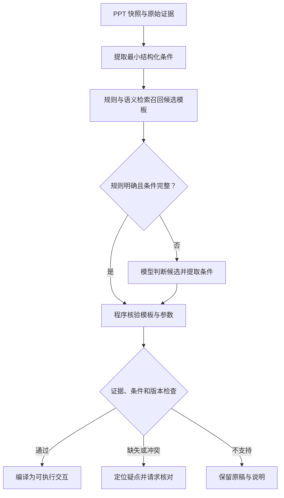

# PPT 混合匹配、模板扩展与识别准确性实施方案

- 编写日期：2026-11-08
- 项目：象生 XiangSheng
- 状态：已实施（2026-11-08，见文末实施记录）
- 依据：本次需求讨论及对当前项目文件的只读核对
- 文档范围：规则与模型共同匹配、结构化条件提取、交互模板扩展、陌生 PPT 验收、健壮性与可延展性

> 本文中的材料数量、准确性指标和新增模块均为实施目标，不代表已经完成或通过验收。整理本文件仅新增文档，不修改现有业务代码，不下载 PPT，不运行项目测试。

## 1. 目标、优先级与现有基础

本轮工作分为四个阶段：先交付规则与模型共同参与的匹配器，再完善结构化条件提取，然后分批增加模板，最后用陌生 PPT 做完整验收。健壮性、版本兼容和调用预算从第一阶段接入。

### 1.1 目标

1. 增加可识别、可执行的交互模板种类。
2. 提高同一模板对不同教师、课程、公式写法和排版的适配能力。
3. 提高模板选择、参数提取和来源绑定的准确性。
4. 保证模型异常、条件缺失、计算失败和版本变化时能够明确降级。
5. 使新增模板主要通过独立模板包接入，减少对主链路的反复修改。

### 1.2 开发优先级与运行顺序

- 开发优先级：先完成混合匹配器，使用现有识别结果生成最小条件；再完善跨对象、跨页的条件整理。
- 每次运行顺序：始终先取得条件和证据，再决定最终采用哪个模板。

### 1.3 当前基础与需要改进的部分

当前项目已有能力注册、规划、编译、求值、任务队列和离线运行基础，继续复用这些主链路。

| 当前情况 | 改进方向 | 当前相关文件 |
| --- | --- | --- |
| 模型规划步骤主要改写学习问题，尚不参与模板选择和参数提取 | 新增受约束的候选排序与条件提取 | [planner.py](E:/代码/ICT/backend/app/ppt_ai/planner.py) |
| 分类较依赖关键词 | 增加公式结构、变量角色、数据形状和上下文判断 | [regions.py](E:/代码/ICT/backend/app/ppt_ai/regions.py) |
| 已有计算能力注册表 | 在其之上增加模板描述与适配层 | [registry.py](E:/代码/ICT/backend/app/ppt_ai/registry.py) |
| 现有验收主要使用合成材料，标注粒度以类别为主 | 增加真实陌生 PPT 的模板、参数和证据标注 | [build_ppt_ai_eval.py](E:/代码/ICT/backend/scripts/build_ppt_ai_eval.py) |

## 2. 总体架构



规则与模型分别承担适合的工作，最终执行资格由程序判断。原始材料保持不变，条件整理、参数映射和用户修正作为有版本的派生产物保存。

## 3. 第一阶段：规则、模型与程序共同参与模板匹配

### 3.1 职责分工

| 环节 | 具体实现 |
| --- | --- |
| 规则召回 | 根据公式结构、术语、变量、矩阵尺寸、图数据、单位和必要条件，召回候选模板 |
| 语义召回 | 根据模板说明、术语别名及开发集示例，补充规则未命中的候选 |
| 模型判断 | 阅读当前区域及必要上下文，对候选排序，提取变量角色、参数和来源 |
| 程序裁决 | 检查模板是否登记、来源是否真实、参数是否完整、维度与定义域是否成立 |
| 结果处理 | 自动采用、等待核对、仅讲解或暂不支持 |

### 3.2 第一版处理边界

- 每个区域最多向模型提供 5 个候选模板，避免把全部模板描述放入提示词。
- 同一内容最多保留 3 个合理交互方案，例如函数探索、切线和积分。
- 强规则且条件完整的内容可以直接通过程序核验；模型优先处理歧义、陌生表达和规则冲突。
- 模型可以返回“无法判断”，不能强制每页匹配一个模板。
- 模型自评分只作诊断信息，不能直接作为执行依据。
- 模型只能选择已登记模板、提交参数建议，不能生成本轮执行的计算代码。
- 语义检索只使用模板目录及开发集样例，盲测材料不进入检索库。

### 3.3 模型输出契约

模型建议至少包含以下信息：

```text
区域编号
候选模板编号及版本
参数与变量角色
每个参数对应的来源编号
缺失条件
冲突与不确定项
选择理由
```

例如，模型提取“初速度为 10 m/s”，程序应能找到对应原文或图像证据。如果原文是“36 km/h”，应保存原值，并由确定性单位换算得到 10 m/s。

### 3.4 冲突处理与执行门禁

规则与模型不一致时，按证据处理。原生数据、经过验证的公式解析和明确来源具有更强依据；无法消除的冲突进入核对状态。

保留现有状态语义：

| 状态 | 含义 |
| --- | --- |
| `supported` | 条件、证据和计算检查均满足执行要求 |
| `needs_review` | 存在需要核对的缺失、歧义或冲突 |
| `explanation_only` | 可以提供讲解，但没有足够条件生成计算交互 |
| `unsupported` | 当前模板或运行时不支持该输入 |

用户选择方案不等于确认条件；点击“已核对”也不能绕过缺失必需值、维度错误或未解决冲突。确认记录必须绑定条件版本，修改条件后重新校验。

## 4. 模板包与能力注册设计

### 4.1 分离模板说明与计算算子

现有能力注册表继续负责“系统能计算什么”。新增模板目录负责“什么内容适合怎样的交互”。

第一版每个模板映射一个算子，允许多个模板复用同一个算子。

| 模板包内容 | 必须定义的信息 |
| --- | --- |
| 模板身份 | 稳定编号、版本、对应算子、前端渲染器 |
| 识别说明 | 适用语义、同义词、公式特征、反例特征 |
| 输入约束 | 必需条件、可选条件、单位、数据形状、支持范围 |
| 参数绑定 | PPT 中的变量如何映射到算子输入 |
| 计算与视图 | 求值器、输出、控件、图形和步骤 |
| 兼容信息 | 最低运行时版本、离线支持、计算规模上限 |
| 验证材料 | 标准数值、边界案例、陌生 PPT、交互操作用例 |

新增模板时，主要增加模板包及注册项，避免不断往主规划函数中堆积分支。

### 4.2 注册完整性检查

启动时检查以下问题：

- 模板编号重复。
- 对应算子未登记。
- 求值器或前端渲染器缺失。
- 输入、输出及参数契约不一致。
- 版本或离线能力声明不完整。

不完整的模板不能进入可用目录。

### 4.3 模板身份的持久化

在已有 `provider` 中保存经过校验的版本化引用，例如：

```json
{
  "template_ref": {
    "id": "physics.projectile_2d",
    "version": "1.0",
    "adapter_version": "1"
  }
}
```

模板引用需要参与编译产物哈希，并随保存、重载、分享及离线导出保留。

- 新运行时读取旧材料时使用兼容适配。
- 遇到未知模板版本时，明确降级到原稿阅读。
- 模板参数到算子输入之间的适配关系必须确定且有版本。
- 内部诊断使用独立的版本化契约，不向严格公共 Schema 随意增加字段。

## 5. 第二阶段：结构化条件与识别准确性

### 5.1 统一条件对象

建立统一的 `ConditionSet`，供规则、模型、编译器共同消费。

| 字段类别 | 保存内容 |
| --- | --- |
| 原始证据 | 原文、页码、对象编号、区域位置、内容哈希 |
| 数学关系 | 公式、变量、等式与约束关系 |
| 变量含义 | 原始名称、角色、类型、单位、形状 |
| 输入数据 | 数值、数组、矩阵、图结构、网络参数 |
| 假设与条件 | 初值、边界条件、算法约定、明确的物理假设 |
| 来源区别 | 原稿条件、用户补充、模型推断、教学探针 |
| 疑点 | 缺失值、OCR 歧义、冲突、无法关联的对象 |

### 5.2 优先改进项

1. 统一上下标、分数、乘号、负号和变量别名的表示，同时保留原文。
2. 关联同一题目中的标题、公式、数据表和图示。
3. 跨页关联需要题目延续、对象关系或明确引用等依据；同名变量不自动合并。
4. 原生文字、公式、表格和图表优先提取，图片区域再走 OCR。
5. 对负号、指数、积分上下限、箭头方向等高影响歧义，展示原图定位并要求核对。
6. 检查公式定义域、单位、矩阵维度、图边完整性、网络张量形状。
7. 区分执行所必需的条件与教学控件，减少没有必要的人工确认。

### 5.3 最小条件与完整条件的兼容

第一阶段通过适配器将当前 `Region` 转换为最小 `ConditionSet`，先支持混合匹配。

第二阶段丰富对象关联、规范化和跨页处理，但保持匹配器的输入接口稳定，不因条件层增强而重写匹配器。

## 6. 首批模板扩展清单

以下为新增或完善的交互目标。已有计算能力可以复用，但均需接入新的识别与模板匹配链路。

| 方向 | 模板 | 第一版执行范围 |
| --- | --- | --- |
| 高数 | 泰勒近似 | 多项式、sin、cos、exp、ln(1+x)；阶数 0—8；检查展开点与定义域 |
| 高数 | 二重积分 | 多项式与矩形区域；展示网格累加，区分数值近似与解析参考值 |
| 最优化 | 一维牛顿优化 | 低阶多项式、解析导数；小曲率或非正曲率明确停止；与求根牛顿法区分 |
| 最优化 | 最小二乘直线拟合 | 小型二维数据；显示残差；秩不足时不伪称唯一解 |
| 数据结构 | 栈与队列 | 初始数值列表、明确操作序列、单步与回退；报告空栈、空队列及容量问题 |
| 数据结构 | 基础排序 | 冒泡、插入排序；最多 32 个元素；固定稳定性及比较次数口径 |
| 深度学习 | 激活函数与梯度 | Sigmoid、Tanh、ReLU；明确 ReLU 在零点采用的计算约定 |
| 深度学习 | 卷积与池化 | 单通道小矩阵；卷积采用深度学习中的互相关约定；明确步长与填充规则 |
| 物理 | 抛体运动 | 二维、恒定重力、无空气阻力；初值和重力条件需有依据或明确确认 |
| 物理 | 弹簧简谐振动 | 一维无阻尼，质量与劲度系数为正；提供位移、速度和能量 |

### 6.1 数组与矩阵交互的数据契约

当前后端类型允许部分数组值，但前端参数类型和求值路径仍以标量为主。数组和矩阵交互需要同步完善：

```text
Schema
→ 后端校验
→ 前端类型
→ 输入控件
→ 求值
→ 保存与重载
→ 分享与离线导出
```

建议新增明确的 `number_list`、`number_matrix` 参数类型，逐层校验有限数值、长度和形状。

图结构第一版可以作为受校验的模板输入，起点等控制量保持标量；任意图编辑留到下一批。

### 6.2 单模板完成要求

- [ ] 识别说明、适用条件、反例和必要输入完整。
- [ ] 模板参数与算子输入的适配经过校验。
- [ ] 前后端计算通过相同标准与边界用例。
- [ ] 图形、公式、指标和结论来自同一次求值。
- [ ] 真实陌生 PPT 可以进入对应交互。
- [ ] 保存、重载、分享和声明支持的离线行为通过验收。
- [ ] 缺失、冲突、无定义和超限情况有明确结果。

## 7. 陌生 PPT 材料建设

### 7.1 数量目标与统计口径

| 材料类别 | 准备目标 | 用途 |
| --- | --- | --- |
| 真实陌生 PPT | 200 份，五个学科各约 40 份 | 检查跨教师、跨课程、跨排版适配 |
| 受控变体 PPT | 100 份 | 改变量、数值、页序、组合方式和公式呈现方式 |
| 负例及边界 PPT | 50 份 | 检查错误匹配、条件缺失、非教学内容和异常文件 |
| 现有合成材料 | 保留原有集合，单独统计 | 保证旧功能不回归 |

新增材料目标合计 350 份，现有合成集合不计入这 350 份。

先完成约 50 份真实陌生 PPT 的采集、标注和基线评估，再扩大规模。

### 7.2 已查到的采集入口

| 学科 | 资源入口 | 使用说明 |
| --- | --- | --- |
| 高数 | [菏泽学院高等数学课件](https://sxx.hezeu.edu.cn/info/1078/1956_1.htm) | 包含 `.ppt` 和 `.pptx`，需要逐份核验格式 |
| 数据结构 | [华盛顿大学 CSE 332](https://courses.cs.washington.edu/courses/cse332/25sp/calendar/lecturelist.html) | 提供课程幻灯片入口 |
| 深度学习 | [Illinois CS 444](https://saurabhg.web.illinois.edu/teaching/cs444/fa2026/schedule.html) | 部分主题提供 PPTX |
| 物理 | [Andrews 物理课件](https://www.andrews.edu/~rwright/physics/powerpoints/physhows.php) | 提供运动、力、能量、电路等 PPTX |
| 最优化 | [Boyd 课程与教材资源](https://stanford.edu/~boyd/cvxbook/) | 参考课件、例子和标准答案；实际格式核验后分别统计 |

这些是采集入口，本文整理时尚未下载或验证其中的每份文件。

采集时记录来源、作者、许可、文件格式、哈希、语言和内容特征。PDF、截图合成的 PPT、旧 PPT 转换版本都应注明来源关系，不增加独立材料计数。

### 7.3 标注要求

每份 PPT 至少标注：

- 应匹配的模板及允许的替代方案。
- 必需参数、标准值和证据位置。
- 应核对或不应生成交互的区域。
- 标准计算结果和关键交互动作。

### 7.4 去重与集合隔离

- 开发、校准、盲测集合建议约按 60%／20%／20% 划分。
- 优先保证同课程、近重复题目及其变体不跨集合。
- 模板类别在各集合中尽量覆盖，不能把整个模板类别隔离后又要求得到该类的开发与盲测对照。
- 盲测材料不能进入模型参考样例或检索库。
- 同一原件及其变体建立明确的父子关系，进行内容近重复检查。
- 负例、条件不足、暂不支持和真正可执行内容分别统计。

## 8. 健壮性、资源控制与兼容性

| 风险 | 实现要求 |
| --- | --- |
| 模型超时、限流、错误 JSON | 分类处理；有限重试；保留规则结果或进入核对状态 |
| 调用预算失效 | 发出请求前持久化占用次数；失败请求也计数；重启和重试不重置预算 |
| 多 worker 重复执行 | 原子领取任务，记录领取代次；过期 worker 不能提交结果 |
| 模型结果迟到 | 提交前重查源版本、内容哈希和条件版本，旧结果标记过期 |
| 单个区域出错 | 隔离该区域，其他区域继续处理；报告成功、核对和失败数量 |
| 计算过大或不收敛 | 限制表达式规模、迭代、矩阵和轨迹长度；高代价计算使用可终止子进程 |
| 无定义或非法数值 | 返回明确原因，不能用 0 替代 |
| 缓存误用 | 缓存键包含身份／材料、来源哈希、解析器、模板、提示词及模型版本 |
| 新旧材料不兼容 | 新运行时能读取旧产物；未知模板与版本保留原稿阅读 |
| 离线行为不完整 | 打包已验证的输入、内核和资源；离线调参不调用模型 |

### 8.1 模型预算

当前默认模型预算是每任务 3 次，第一阶段先沿用，并包含重试和结构修正。

- 批量任务明确显示哪些区域因预算不足尚未得到模型处理，不能计为识别成功。
- 失败、截断、无效 JSON 和重试请求均计入已发出的调用次数。
- 调用次数在发出请求前持久化占用，失败恢复不能因事务回滚而恢复预算。
- GET、播放、拖动滑块不触发模型调用。
- 模型主要参与识别与匹配，日常交互由确定性计算完成。

### 8.2 缓存与版本

- 缓存保存完整模板和处理版本。
- 修改来源、确认条件、模板目录或模型处理版本时，相应缓存失效。
- 同一操作编号对应不同输入时，返回冲突。
- 旧任务结果不得覆盖新文档或新条件。
- 私有诊断不进入公开分享与离线产物，发布只携带必要的执行输入与资源。

## 9. 代码任务拆分与核心接口

下列新路径均为拟建位置，尚未创建。

| 任务 | 主要位置 | 可验收结果 |
| --- | --- | --- |
| T01：陌生材料与基线 | `E:/代码/ICT/fixtures/corpus-v2/`；`E:/代码/ICT/backend/scripts/evaluate_matching.py` | 材料清单、标注契约、去重切分、旧规则基线 |
| T02：模板描述与最小条件契约 | `E:/代码/ICT/backend/app/ppt_ai/recognition_types.py`；`E:/代码/ICT/backend/app/ppt_ai/matching/catalog.py` | 模板可登记、校验；现有区域可转换为最小条件 |
| T03：混合匹配器 | `E:/代码/ICT/backend/app/ppt_ai/matching/` | 规则召回、语义召回、模型建议、程序裁决和弃权 |
| T04：任务与预算加固 | 现有模型客户端、任务处理器；拟增 `E:/代码/ICT/backend/app/ppt_ai/model_calls.py` | 失败调用计数、并发领取、重启恢复、迟到拒收测试通过 |
| T05：完整条件整理 | `E:/代码/ICT/backend/app/ppt_ai/conditions/` | 公式规范化、对象关联、单位与形状校验、条件冲突定位 |
| T06：模板与数据类型扩展 | `E:/代码/ICT/backend/app/ppt_ai/template_packs/`；`E:/代码/ICT/frontend/src/ppt-ai/templates/` | 分批交付模板、数组控件、前后端内核与标准结果 |
| T07：核对、保存和导出 | 现有核对面板、编译器、前端运行时和离线链路 | 来源可定位、确认有门禁、模板版本不丢失 |
| T08：盲测与逐步启用 | 新验收脚本及现有浏览器测试 | 完整报告、已知限制、功能开关及回退验证 |

### 9.1 核心接口

```text
extract_conditions(snapshot, regions) -> ConditionSet[]
recall_candidates(conditions, catalog, limit=5) -> MatchCandidate[]
propose_matches(requests, client, budget) -> ModelProposal[]
resolve_match(conditions, candidates, proposal, policy) -> MatchDecision
build_options(decisions, snapshot) -> InteractionOption[]
```

T02、T03 先使用最小条件；T05 丰富条件内容，但保持接口稳定。

旧识别链路通过适配器复用同一套规则和模板目录，避免维护两套不同答案。

### 9.2 实施顺序

1. T01 建立首批材料与基线，T02 明确数据契约。
2. T03 完成混合匹配器，先以影子模式比较新旧结果。
3. T04 与混合匹配器配套完成，在实际启用模型参与决策前通过资源与故障测试。
4. T05 完善条件整理，保持匹配接口稳定。
5. T06、T07 分批完成模板和完整用户流程。
6. T08 使用冻结盲测集合验收，再通过功能开关逐步启用。

### 9.3 单任务开发过程

每项实现采用以下顺序：

- [ ] 先写行为测试。
- [ ] 运行测试，确认当前实现不能满足新增行为。
- [ ] 实现最小且清晰的变更。
- [ ] 运行针对性验证。
- [ ] 检查相关兼容与故障场景。
- [ ] 独立提交可评审结果。

本文整理阶段不执行上述步骤。

## 10. 测试要求与发布验收

### 10.1 第一批必须覆盖的行为测试

| 场景 | 预期行为 |
| --- | --- |
| 原文是 0.1、模型提取成 1 | 拒绝自动采用，保留来源以供核对 |
| 必需初值缺失 | 选择和确认均不能绕过 |
| 连续失败请求达到预算 | 再次调用不发出 HTTP 请求 |
| 模型执行期间文档更新 | 旧结果不能覆盖新内容 |
| 同一操作编号对应不同输入 | 返回冲突 |
| 模板经过保存、重载、分享和离线 | 编号、版本和适配关系保持一致 |
| 某一区域失败 | 其他正确区域仍可使用 |
| 不同身份具有相同内容 | 私有缓存与核对记录隔离 |
| 未登记模板或不支持版本 | 不进入执行，保留原稿 |

### 10.2 对照评估

在同一批冻结材料上比较：

1. 现有规则。
2. 新规则。
3. 模型辅助匹配。
4. 混合匹配。

所有方案经过相同的执行条件校验。回放测试用于稳定回归，真实模型调用另行记录材料、版本、调用次数、耗时与消耗。

### 10.3 建议验收目标

先完成基线测量，再冻结验收口径。

| 指标 | 建议目标或要求 |
| --- | --- |
| 自动采用的联合正确率 | 模板、全部必需参数及证据同时正确，≥95% |
| 候选召回率 | 正确模板出现在前 5 个候选中，≥95% |
| 支持范围内、条件充分内容的召回率 | ≥85% |
| 严重误执行 | 盲测中为 0，包括缺必需条件、未知算子、错误维度仍执行 |
| 每种新模板的评估量 | 至少 20 个标注区域，来自至少 5 份独立 PPT；不足则限制自动启用 |
| 前后端计算 | 全部标准与边界用例满足各自声明的误差容限 |
| 故障恢复 | 模型关闭、超时、预算耗尽及部分失败时原稿仍可读 |
| 完整流程 | 上传、识别、核对、调参、保存、重载、分享、离线均有当前版本证据 |

### 10.4 统计与报告约束

- 按学科、模板、原生／截图内容分别报告。
- 同时记录人工核对率、耗时、调用次数和失败原因。
- 不能通过少生成交互来隐藏漏识别。
- 核对后成功不能计为自动成功。
- 50 份负例即使全部通过，也只能报告该批材料的观测结果，不能据此保证真实错误率低于 1%。
- 后续持续增加独立负例，并报告样本量和不确定性。
- 未执行或跳过的用例明确标记为未覆盖，不能记为通过。

## 11. 后续持续改进机制

### 11.1 人工纠错回流

保存用户确认的模板和参数修正，经过复核后加入开发样例。盲测集保持隔离，不能直接将模型自评正确的输出作为新标准答案。

### 11.2 局部失效与重识别

编辑某个公式或图表后，只使相关条件和模板过期，复用未变化区域的结果。

### 11.3 模板能力矩阵

自动列出每种模板的以下状态，作为启用依据：

- 识别与匹配。
- 参数与证据提取。
- 前端运行与计算一致性。
- 保存、重载、分享和离线。
- 陌生材料覆盖。
- 故障与边界测试。

## 12. 阶段交付清单

每阶段交付以下材料：

- [ ] 代码变更与接口说明。
- [ ] 模板支持范围、版本及能力矩阵。
- [ ] 材料来源、标注、去重及集合划分记录。
- [ ] 基线与新方案对比。
- [ ] 真实模型调用记录。
- [ ] 标准数值、边界与故障测试结果。
- [ ] 在线、保存重载、分享及离线完整流程证据。
- [ ] 功能开关、兼容与回退说明。
- [ ] 剩余限制和未覆盖项。

第一阶段以已有能力证明混合匹配有效，再逐批扩大模板目录。模板注册、单个演示成功或局部测试通过，都不替代完整用户流程和陌生材料验收。

---

## 13. 实施记录（2026-11-08）

本轮已完成 T01–T08 的主体实现，并按“证据不足则保持试点”的口径记录限制。

### 13.1 已交付内容

| 任务 | 代码与产物 | 结果 |
| --- | --- | --- |
| T01 陌生材料与基线 | `backend/scripts/build_hybrid_corpus.py`、`fixtures/corpus-v2/`、`backend/scripts/evaluate_matching.py`、`verify/ppt-ai/hybrid/baseline-legacy.json` | 48 份受控材料、108 个标注区域（30 正例 / 18 负例）；旧规划器基线冻结 |
| T02 模板描述与最小条件 | `backend/app/ppt_ai/recognition_types.py`、`conditions/`、`template_packs/` | `ConditionSet`、10 个模板包、目录完整性校验、数组/矩阵参数契约 |
| T03 混合匹配器 | `backend/app/ppt_ai/matching/`、`planner.py` | 规则召回、词汇语义召回、受限模型建议、程序裁决与弃权；旧构建器保留回退 |
| T04 预算与任务加固 | `client.py`、`model_calls.py`、`tasks.py` | 发出前占用预算并独立持久化；失败调用计数；原子领取；迟到结果拒收 |
| T05 条件整理 | `conditions/normalize.py`、`extract.py`、`validate.py` | 单位换算（36 km/h → 10 m/s）、公式规范化、变量角色、形状/定义域/冲突检查 |
| T06 模板扩展 | `template_packs/{calculus,optimization,data_structures,deep_learning,physics}.py`、`templates_kernels.py`、`frontend/src/ppt-ai/templates/` | 泰勒、二重积分、一维牛顿优化、最小二乘、栈/队列、排序、激活梯度、卷积/池化、抛体、弹簧 |
| T07 版本与导出 | `compiler.py`、`snapshots.py`、前端工作台 | `template_ref` 进入 provider 与哈希；数组值进入分支/冻结/公开投影；确认不能绕过阻塞条件 |
| T08 验收与开关 | `evaluate_matching.py`、`build_matching_report.py`、`verify/ppt-ai/hybrid/report.json`、`verify/ppt-ai/hybrid/evidence.json` | 四方案对照、模板能力矩阵、试点开关与浏览器证据 |

新增功能开关：`PPT_AI_HYBRID_MATCHING_ENABLED`（默认 `true`；设为 `false` 时只走旧规划器）。能力接口 `/api/v1/ppt-ai/capabilities` 同时返回模板目录、模板契约版本与开关状态。

### 13.2 对照结果（受控语料）

| 方案 | 自动采用联合正确率 | 候选 Recall@5 | 待核对尊重率 | 负例不执行率 | 严重误执行 |
| --- | --- | --- | --- | --- | --- |
| 旧规则 | 0% | 未覆盖 | 100% | 100% | 0 |
| 新规则 | 100% | 100% | 100% | 100% | 0 |
| 混合匹配 | 100% | 100% | 100% | 100% | 0 |

- “联合正确”要求模板、全部必需参数和来源同时正确；分母只统计 60 个应自动执行区域。
- 每个模板在受控集中只有 6 个应自动执行区域、9 个标注区域，低于“20 个区域 / 5 份独立 PPT”的自动启用门槛，因此模板能力矩阵将十个模板全部标为 `pilot`、`auto_enable=false`。
- 报告与逐材料样本：`verify/ppt-ai/hybrid/report.json`；截图：`verify/ppt-ai/hybrid/evidence/`。

### 13.3 验证

- 后端：`571 passed, 8 skipped`（排除已知的 Windows 控制台编码相关 `tests/test_dev_route_probe.py`）；其中 PPT AI 106 个测试通过。
- 前端：`227` 个 node:test 用例通过；`tsc --noEmit` 与 `npm run build`（含离线 runtime）通过。
- 浏览器（本地 Chrome，`LLM_PROVIDER=none`）：上传 corpus-v2 抛体 / 泰勒 / 卷积材料，完成“上传 → 识别规划 → 编译 → 调参”，证据见 `verify/ppt-ai/hybrid/evidence/`。
- 跨版本：抛体与卷积模板的 `template_ref`、数组参数在冻结与公开投影中保留；模板编号/版本进入内容哈希。
- 回退：`PPT_AI_HYBRID_MATCHING_ENABLED=false` 时新模板不进入，抛体材料回退为原稿说明；不误执行。

### 13.4 未覆盖与限制

- 未下载或验证 200 份真实陌生 PPT、100 份独立受控变体、50 份独立负例；当前 48 份材料是仓库内程序化变体，不能据此宣称真实错误率低于 1%。
- `calibration` / `blind` 与 `dev` 使用相同措辞变体，不是真正的人类盲测；`blind` 数字只代表本仓库固定样本。
- 未运行真实 MaaS 调用；模型参与路径通过 fake transport 与 replay 单测验证，真实调用次数/耗时/消耗为空。
- 分享与离线完整流程仅对抛体、卷积模板有当前版本快照证据；其余模板标记 `not_covered`。
- 跨页条件关联沿用现有语义图候选与用户确认，未实现自动跨页合并；同名变量不会自动合并。
- 已知 `tests/test_dev_route_probe.py` 在本机 PowerShell/GBK 输出下失败，与本轮改动无关，未计入通过数。

### 13.5 复跑命令

```bash
# 重新生成受控语料与旧基线
cd backend
python scripts/build_hybrid_corpus.py
python scripts/evaluate_matching.py --mode legacy --out ../verify/ppt-ai/hybrid/legacy.json

# 新规则 / 混合匹配对照，并汇总报告
python scripts/evaluate_matching.py --mode rules --out ../verify/ppt-ai/hybrid/rules.json
python scripts/evaluate_matching.py --mode hybrid --out ../verify/ppt-ai/hybrid/hybrid.json
python scripts/build_matching_report.py

# 测试
python -m pytest tests/ppt_ai -q
cd ../frontend && npx tsc --noEmit && npm test && npm run build
```
