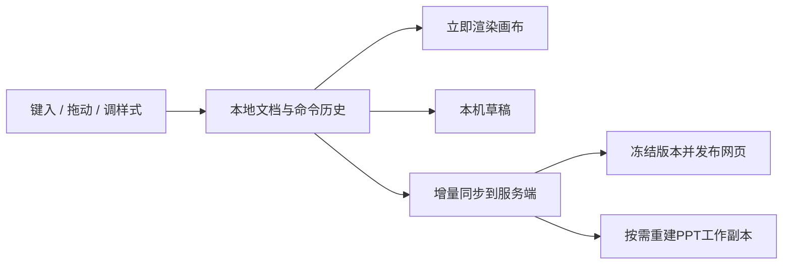

# 象生：智能识别、自由编辑与二维/三维交互方案

日期：2026-11-02。状态：供用户审阅的方案草案，尚未实施。本轮只新增方案文档，不修改业务代码。

## 1. 目标与当前问题

用户希望上传PPT后得到接近PowerPoint使用方式的网页：识别文字、各类公式、示意图、公式图、数据图表；选择合适的二维或三维交互；直接修改内容、位置和样式，立即看到结果。

代码核对发现：

1. 主画面仍以整页图片为基础，编辑按钮是图片上的元素热区，未形成完整网页对象编辑器。
2. `routes_editor.put_editor` 每次修改都写PPT工作副本，调用整份上传任务。前端 `DeckPlayer.saveEdit` 等待渲染、识别完成，才更新画面。移动文字若沿用此流程也会很慢。
3. 当前编辑接口只有文字、表格、图表、识别文本和交互配置，没有位置、旋转、层级、完整文本样式等编辑操作。
4. 图片OCR主要返回文字和少量矩阵线索；真实多模态服务尚未接入。已有对象不会阻止其他未识别区域继续理解，必须修正目前“整份材料无结果才尝试LLM”的设计。
5. 几何视图仍存在矩阵/SVD参数命名约定。单纯增加几个模板，不能解决新主题的表达能力。

## 2. 方案选择

| 路径 | 特点与代价 |
|---|---|
| 全面将所有PPT效果重建为网页原生元素 | 编辑能力完整，但母版、字体、复杂组合、艺术字、特殊效果的还原成本高，容易先丢版式 |
| 分层还原，建立网页对象模型，逐步扩大原生支持（推荐） | 原稿有独立对照；常用元素成为可编辑对象；复杂内容作为明确标记的整体对象保留。可以持续交付编辑、识别和3D能力 |

采用第二条作为实施建议，沿用React/TypeScript/FastAPI，扩展当前解析、iSpec、保存与离线发布。以上是实施建议，不代表用户已批准具体选型。

## 3. 内容识别与交互范围

“发现一个内容区域”“识别其文字/结构”“建立可计算关系”“重建可交互图形”分别记录状态。识别成某一类，不能直接算作交互转换成功。

| 内容 | 识别与编辑目标 | 可生成的交互 |
|---|---|---|
| 原生文字 | 字符、段落、文本样式、坐标、旋转、层级；直接编辑 | 拖动、缩放文本框、样式调整、与结果变量绑定 |
| 原生公式/文字公式 | 原始表示、LaTeX、可执行AST、变量、单位、定义域 | 参数计算、曲线、数值探针；明确自变量后可形成曲面 |
| 图片公式 | 公式区域定位、专用公式识别、原图与识别结果对照 | 核对后使用同一公式运行时；未支持的表达式保留排版，说明原因 |
| 原生图表、表格 | 直接读数据、系列、坐标轴和单位，保留原始类型 | 筛选、切换系列、数据点查看、数据编辑、图表与表格联动 |
| 图片图表 | 识别类型、轴、图例、数据候选，并逐项标记不确定性 | 核对后的数据用于同一图表运行时，不能把估读值当原生精确值 |
| 非公式示意图 | 区分几何图、流程图、关系图、结构图和普通插图；提取对象与连接 | 拖点、调整尺寸、路径高亮、步骤播放、分支选择；仅有文字描述时不能冒充结构重建 |
| 公式与图混合区域 | 关联公式、坐标轴、标注、图元和邻近说明 | 共享参数改变公式结果及图形，来源分别保留 |
| 照片/装饰图 | 作为图像对象识别，保留资源与位置 | 移动、缩放、裁剪、标注；不凭照片猜出可验证的物理模型 |
| 三维图/空间关系 | 提取明确坐标、尺寸、方程、空间关系；缺失条件进入确认 | 生成有依据的空间场景。二维投影不能唯一决定的三维结构不自动补为确定事实 |

所有页、所有原生元素都进入对象清单；无法分清的图片区域进入“待确认”，不能消失。上述类型全面纳入识别流程，不承诺任意复杂材料都自动识别正确或自动变成可计算模型。

## 4. 三份统一模型

### 页面对象模型 SceneDocument

页面包含真实尺寸、背景、按层级排序的对象、资源引用和导入版本。对象含稳定ID、原生来源映射、类型、父子关系、x/y/w/h、旋转、层级、样式、内容及能力标记。

- 文字保存段落和文本片段样式，解析母版/主题继承、字体、颜色、行距、对齐和文本框边距。
- 图片引用材料自己的资源，不将每张图重复编码进编辑记录。
- 图表/表格引用结构化数据；公式分别保存原文、LaTeX与AST。
- 页和元素的内部ID不再仅依赖页码/数组序号。保留与旧 `element_id` 的映射，支持重排和已有材料迁移。
- 样式、布局、语义分开记录修订；移动文字不应使公式校验失效。

### 语义关系模型

保存变量、表达式依赖、单位、定义域、图元含义、连接、步骤和来源。相同字母不自动共享；跨页关联需核对定义、单位与上下文，支持用户确认和解绑。

### 交互规格 iSpec

保留参数、受限表达式、视图、约束与来源，新增声明式 `scene2d` / `scene3d` 视图。通过显式绑定，把任意参数ID或派生量连接到对象属性，减少对 `a/b/c/d`、`steps_*` 等名称的依赖。

二维/三维由同一状态驱动，镜头、视图显示状态与数学参数分开。旧iSpec仍能读取；旧分享保持冻结。

## 5. 可编辑画布与保真方案

布局沿用：左侧缩略图和图层，中央页面，右侧属性/识别依据，顶部编辑/演示切换。

首批编辑动作：

- 点击选中，双击编辑文字；拖动位置，八向缩放，旋转。
- 字体、字号、颜色、粗体/斜体、对齐、行距；缩放文本框与改变字号分别操作。
- 多选、对齐、分布、吸附参考线、层级调整、锁定/隐藏、复制/删除。
- 图片缩放、裁剪；表格单元格和图表数据原位编辑。
- 撤销/重做覆盖文字、位置、样式和数据；一次拖动为一个操作。

React DOM负责文字/公式/表格，SVG负责二维图形，WebGL负责三维区域。初步采用Moveable类交互层实现拖动、缩放、旋转和吸附；先验证中文输入、画布缩放、嵌套分组与文字选择兼容性，再固定版本。

整页原图仅用于原稿对照和缩略图回退。编辑画布不能在含旧文字的整页图上重复绘制新文字：

1. 导入时提取页面背景与独立对象资源，构建按原层级排列的场景。
2. 可编辑原生对象从背景中排除；复杂未支持对象按整体图像保留，保留层级、透明度和能力说明。
3. 原生文本和图片可以自由移动；仅存在于一张截图里的文字需先分离识别。无法可靠修复底图时保留整体图像编辑，并明确内部内容暂不能独立移动。
4. 不用白色矩形遮盖复杂背景来假装完成原位编辑。
5. 第一轮用深色背景、渐变、重叠形状、组合、中文字体验证对象还原；失败页保留原稿并记录。

## 6. 实时预览与快速保存

网页文档成为网页编辑的事实来源；PPT原件保留。网页编辑、保存、发布与PPT重建拆开。

- 输入即时更新本地状态。保存不能阻塞继续编辑、翻页和演示。
- 停止输入约700ms后批量同步，连续编辑最长约2s触发一次同步；具体数值待测后调整。
- 新增文档PATCH接口，包含期望修订、幂等操作ID与变更集合，成功返回新修订。位置/样式只保存JSON，不启动OCR或PowerPoint。
- 本机草稿优先IndexedDB；提示区分“本机已保存”“正在同步”“已同步”“同步失败”。
- 保存队列按修订处理，旧响应不能覆盖新操作；可合并互不冲突的字段，对同字段冲突保留本地版本并提示处理。
- 缩略图和后台导出延后生成；仅修改一处时更新相关对象/页面，未变化内容使用缓存。
- 重新识别只处理变更区域及其依赖；修改图表数据不重新识别其他页，移动公式不重新调用模型。
- 需要PPT工作副本时批量重建；新增网页专用交互不承诺可反向生成等价PowerPoint动画。

性能目标（尚未实测）：在记录配置的本地测试机上，常规文字显示与二维参数更新P95≤100ms，常规拖动保持平滑，普通增量保存API P95≤500ms。目标不包含模型推理、原始PPT导出或网络不可用时间，测试需报告页数、对象数和3D网格规模。

## 7. 智能识别流水线

1. 原生结构优先：OOXML读取文字、公式、图表、表格、形状、连接与分组；不把已有精确数据重新交给图像模型估计。
2. 图片区域分类与分块：辨别公式、图表、表格、示意图、混合区域、普通插图。保留图像哈希、裁片、边界与上下文。
3. 专用提取：局部OCR、公式识别、表格结构识别、图表数值候选；按材料资源缓存。
4. 多模态理解：结合局部图、页面上下文与原生信息，提出变量、关系、步骤、对象和合适的二维/三维视图。
5. 核验：Schema、引用、范围、公式解析、依赖、单位和数值一致性检查。模型的自报置信度不能代替核验。
6. 用户核对：原图/原文与候选并列，支持改类别、纠正公式、补单位、修正连线及拒绝建议。
7. 编译为已有能力注册表允许的规格。模型不输出执行脚本，计算仍由受限引擎完成。

识别按区域推进：本页已有一个原生图表时，其余图片仍需要理解。识别未完成的页可阅读和编辑，进度按真实对象阶段报告。

真实服务需要配置可用的多模态模型、服务地址和后端认证。优先衔接项目既定的华为云MaaS路线，具体模型按账户实际可用能力验证。局部公式/图表识别可评估PaddleOCR相关流水线；安装重量、CPU耗时和本机兼容性需单独试跑。仅有接口或模拟返回不算完成智能识别。

## 8. 非矩阵与三维交互

### 二维首批

函数曲线、参数曲线、点/线/圆/多边形几何、向量关系、通用数据图表、节点连线图及有限步骤/分支。矩阵作为这些能力的一种应用保留。

### 三维首批建议

用户已确认三维首批方向为“立体几何、空间向量和函数曲面”。本次回复确定三维范围；整体方案仍为供审阅的草案。

- 空间点、线、平面、坐标轴、箭头；角度、距离、点积/叉积等有依据的数值。
- 球、长方体、圆柱、圆锥等基础几何体，修改明确尺寸并观察变化。
- `z=f(x,y)` 曲面和三维参数曲线；选择自变量、调整系数/区间，数值与网格同步更新。
- 相机旋转、缩放、平移、复位视角；选择图元查看坐标与来源。
- 可选剖切平面、截线、轨迹播放，作为后续增强，不阻塞首批三维场景交付。

Three.js负责渲染与空间视角操作，受限表达式引擎负责生成数值与网格。相机旋转只改变观察角度；拖动模型点才改变数学参数。不能用一张可旋转图片冒充三维结构。

首批完成至少一个非矩阵二维场景与一个有明确方程/尺寸来源的三维场景，并同时验证网页演示、保存恢复和离线运行。三维内容的准确构型仍受原文给定信息限制。

## 9. 可延展性规则

- 业务主流程不读取样本文件名、固定页号、公共演示坐标或样本常数。
- 相同原语能够用于新主题；常规新增内容通过对象、表达式和绑定描述，宿主页面不新增主题判断。
- 新的数学运算、绘图原语或外部格式可能需要扩展一次注册表及对应模块，不能宣称永远无需改代码。
- 能力注册表声明可编辑属性、支持的参数类型、计算器、渲染器、校验规则和离线支持。
- 页码、元素、图像裁片及推断/人工确认状态贯穿识别、编辑和发布。
- 独立校验与模型/输入修订绑定；修改位置不使数学验证过期，修改公式必须使相关结果过期。

## 10. 实施顺序与每阶段交付

| 阶段 | 核心交付 | 完成条件 |
|---|---|---|
| A：对象模型与编辑底座 | 页面对象模型、旧材料迁移、背景/对象分层验证 | 复杂背景移动文字后无旧字残留，层级和原稿对照可核查 |
| B：实时编辑和保存 | 拖动/缩放/样式、文本编辑、命令历史、草稿与PATCH | 连续输入和移动即时显示；普通编辑不调用全量渲染；保存后重开一致 |
| C：智能清单与非矩阵二维 | 多类内容识别、真实模型适配、来源核对、函数/几何/流程等规格 | 混合页不同类别均有识别状态；新主题按已有能力形成交互 |
| D：三维运行时 | 声明式空间场景、曲面/几何体、视角和参数操作 | 有明确来源的非矩阵3D例子，调参、保存恢复与离线运行通过 |
| E：陌生PPT与交付回归 | 不同主题材料、失败记录、性能与导出验证 | 不增加样本配置完成限定范围新文件；明确记录识别、绑定和执行各自的失败 |

先完成A+B解决用户最直接的编辑问题；C+D按统一模型接入。三维是这份方案的明确交付，不以新增二维矩阵示例替代。每阶段提供可运行版本和实际操作证据，不用静态界面当验收。

## 11. 验收要求

1. 未参与开发的PPT中，文字可以直接输入、拖动位置、调整样式，释放鼠标即看到最终状态；撤销恢复。
2. 编辑请求中普通文字/位置/样式保存不产生全量渲染或整份OCR任务；自动化测试验证调用次数。
3. 连续输入后立即翻页、刷新、关闭重开、短时断网及多窗口修改，均保留正确修订或给出可恢复冲突。
4. 每种内容分别统计检测、识别、关系恢复与可交互生成，不能以分类成功代替数值或结构正确。
5. 原生图表数值逐值核对；图片读数标为候选；公式结果用独立参考值核对，含定义域、单位与退化情况。
6. 至少覆盖函数/几何、物理/空间、流程/关系和办公数据等不同主题；以不少于20份授权真实材料作为后续验收目标，按整份文件划分开发和留出材料，生成测试文件单独统计。
7. 调换页序、改变文件名后，主流程仍正常，页面来源正确。
8. 全屏与离线网页继续支持新编辑文档和二维/三维规格；WebGL不可用时提供明确说明和数值/静态视图，不能白屏。

## 12. 技术资料与待验证项

- Moveable官方文档（拖动、缩放、旋转、组合、吸附）：https://daybrush.com/moveable/release/latest/doc/
- Three.js OrbitControls官方文档（空间视角）：https://threejs.org/docs/pages/OrbitControls
- PaddleOCR官方PP-StructureV3文档（版面、公式、图表等模块）：https://github.com/PaddlePaddle/PaddleOCR/blob/main/docs/version3.x/pipeline_usage/PP-StructureV3.en.md
- 华为云图像理解工作流调用示例：https://support.huaweicloud.com/api-agentarts/agentarts_07_0048.html

以上资料支持选型方向，不等于这些组件已在本项目完成兼容性、性能或识别效果验证。公式识别方案、可用模型配置、三维优先场景和复杂分层还原是实施前需要先试验和确认的关键点。
