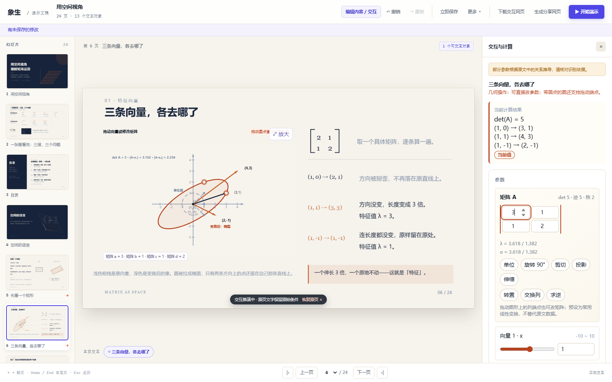
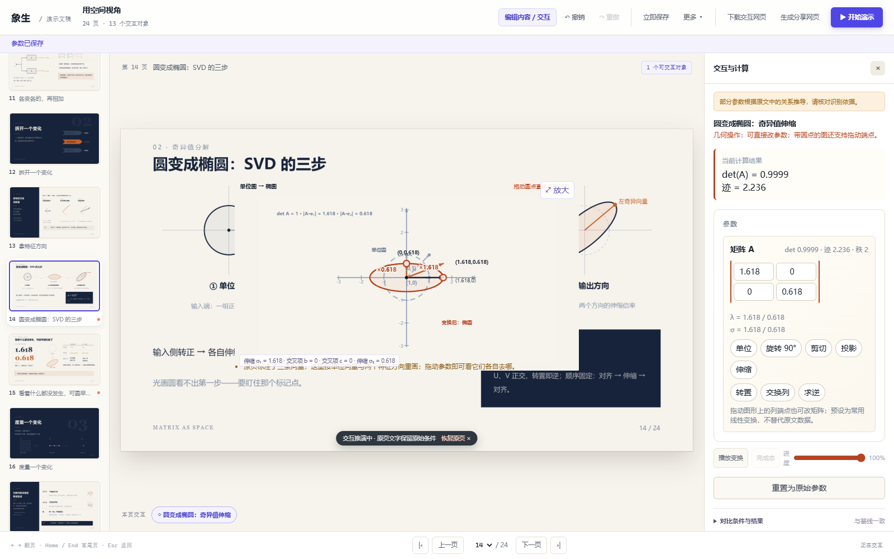
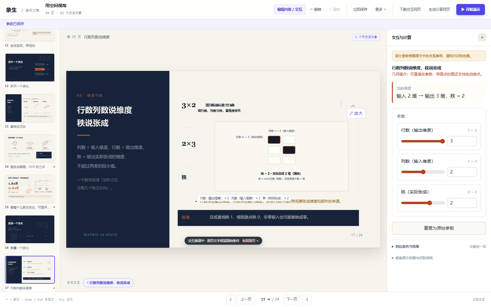
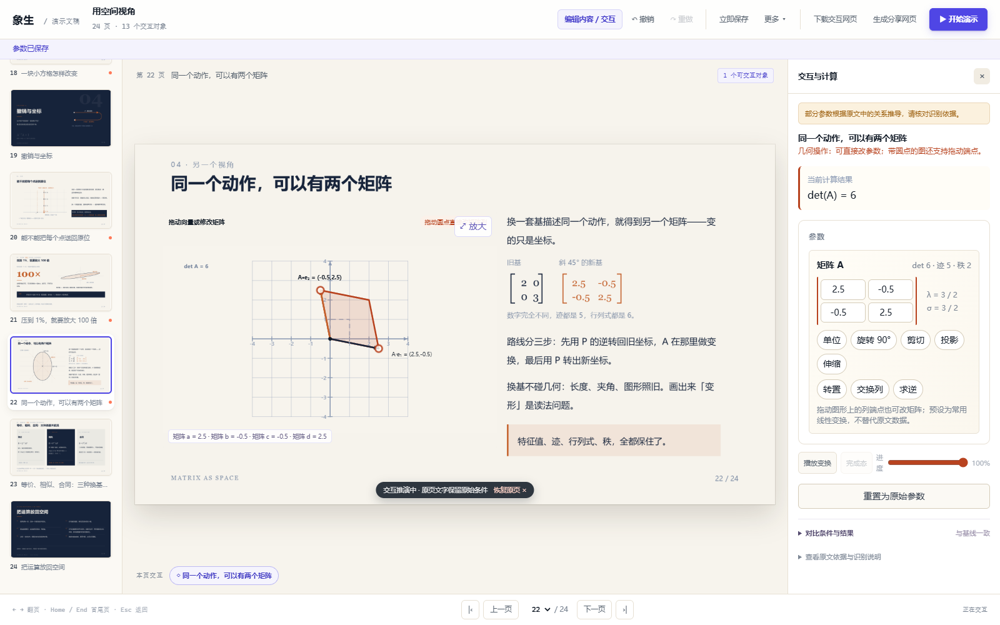

# 象生样本课件展示与交互改造需求

版本：1.0；日期：2026-11-04；使用对象：产品、前端、后端、测试人员。

本文是待实施需求。本次仅整理文档与截图，未修改业务代码。请先评估任务、确定负责人，再按下述验收条件实施。

## 1 目标与范围

目标：将当前“PPT 原图上覆盖交互图、右侧填写参数”的展示方式，改为“原稿阅读、独立实验、演示”三个明确状态。每个实验具备问题、可操作对象、变化过程和动态结论。

验收样本：`用空间视角理解矩阵运算.pptx`，24页。本轮重新上传得到13处交互：第5、6、7、8、9、10、14、15、17、18、20、21、22页。第11、13、23页目前只有原页阅读。

本轮范围：播放器布局、场景渲染、操作控件、过程动画、状态同步和样本中的数学语义。自然语言生成实验、AI API调整、任务队列、账户体系、课程管理不纳入本需求。

保留：上传、原稿、网页自由编辑、保存、撤销重做、分享、离线导出与来源查询。原始PPT文件保持不变。

## 2 当前实现与代码入口

| 现有文件 | 当前职责 | 本轮处理 |
| --- | --- | --- |
| `frontend/src/components/presentation/DeckPlayer.tsx` | 页面切换、原图、覆盖图、参数栏、放大、演示 | 拆分实验容器与原稿容器，保留宿主职责 |
| `frontend/src/components/presentation/DeckPlayer.module.css` | 原页布局、visualOverlay、侧栏、放大层、演示样式 | 实现新布局，实验不再通过visualOverlay覆盖原图 |
| `frontend/src/components/presentation/useDeckValues.ts` | 当前参数、自动保存、加载、冲突状态 | 继续作为已支持iSpec的唯一持久化参数入口 |
| `frontend/src/components/presentation/deckHistory.ts` | 参数操作历史、共享值更新 | 复用，禁止另起一套互不关联的历史 |
| `frontend/src/components/presentation/ScenarioCompare.tsx` | 基线比较 | 接入新场景比较入口 |
| `frontend/src/components/ispec/ISpecView.tsx` | 参数、视图和校验反馈 | 支持场景化控制分组，完整参数移入高级区 |
| `frontend/src/components/ispec/views/FigureSpecView.tsx` | 图形模板和部分直接操作 | 复用几何能力，新增场景分文件实现 |
| `frontend/src/ispec/{evaluate,geometry}.ts` | 表达式与矩阵几何计算 | 继续复用，缺失的分解/误差计算增加独立纯函数 |
| `frontend/src/offline/main.tsx` | 离线运行时入口 | 与在线复用场景组件和计算，避免两套行为 |
| `backend/app/ispec/`、`backend/app/documents/` | 识别、来源、文档和交互配置 | 为新增场景保存经过确认的定义和来源 |
| `backend/app/api/routes_publish.py` | 分享和导出快照 | 快照包含新增场景定义、当前参数及版本 |

建议新增目录为 `frontend/src/components/experiments/`，按任务建立 `ExperimentStage.tsx`、`ExperimentTimeline.tsx`、`OriginalComparison.tsx` 和场景子组件。这里的新增文件尚不存在，实施者应保持职责分离，不继续把所有场景堆入DeckPlayer或FigureSpecView。

## 3 公共交互与数据约定

### 3.1 三个界面状态

| 状态 | 进入方式 | 必须显示 | 必须收起 |
| --- | --- | --- | --- |
| 阅读 | 打开材料或返回原稿 | 原始PPT、翻页、可交互入口 | 实验参数和过程控件 |
| 实验 | 点击本页交互入口 | 问题、大画布、关键控制、过程、动态解释 | 原页大图、作者专用工具 |
| 演示 | 点击开始演示 | 当前实验或原页、紧凑播放控制、下一步/退出 | 编辑、保存、分享、下载等作者操作 |

实验页面提供“返回原页”和“原稿对照”。返回原页不丢失实验参数。原稿对照是明确的双栏：左栏原始条件，右栏当前条件；不得把旧文字与新图叠放在同一张PPT上。

桌面1600×1000为首个验收尺寸。实验画布使用可用空间主体，侧栏默认不超过280px；左侧页导航可折叠。关键操作与过程控制不依赖滚动到面板底部。窄屏上下排列，仍能操作和返回。

### 3.2 单一状态与计算

拟新增 `SceneDefinition` 描述 `scene_type`、关联object_id、来源页/元素、控件配置、阶段定义与版本；它不替代已有iSpec，而是组织同一实验的多个视图。

- `sourceDefaults`：原稿/已确认来源的基准，只读。
- `currentValues`：当前实验输入，复用已有参数存储与保存流程。
- `evaluation`：从currentValues计算的结果、约束与解释，不建立另一份可独立修改的结果。
- `playback`：当前阶段、阶段进度、播放状态；属于播放状态，不因每帧变化发送保存请求。
- `comparison`：原始/当前或分支的明确快照，不混用不同修订。

场景参数修改统一走 `onParameterChange(parameterId, value)` 或一次批量修改入口；原有参数继续由useDeckValues保存。新增来源数据必须由后端持久化，不能只写在组件常量中。

手动数值、拖动手柄、预设按钮必须修改同一份输入。拖动过程实时绘图，结束时形成一次可撤销操作。计算和文字说明同时更新。

### 3.3 适用范围与来源

允许为本样本配置经过人工确认的场景关联，但通用运行时不得根据文件名、固定material_id或固定页码执行硬编码逻辑。其他材料没有场景定义时，继续使用原有阅读与交互。

原页没有给出的矩阵、方向或条件必须标注“补充实验条件/用户确认”。默认展示原稿案例；沿用上个实验条件须由用户主动选择，不跨页无提示覆盖原始案例。

不统一放宽现有矩阵API的范围。尤其现有2×2模板有[-3,3]限制，而奇异值案例包含100：应在对应场景中定义输入域和校验，不能把所有实验都塞入原接口。

## 4 修改任务

### UI01 统一实验容器和演示布局

**优先级P0；负责人：前端；依赖：无。**

现状：点击交互后原稿缩小，覆盖图挤入图片区域，侧栏很长；放大后主要控制仍在弹层外。演示模式保留作者工具。

修改要求：

- [ ] 点击交互进入独立ExperimentStage，不在原页图片上绘制大面积覆盖层。
- [ ] 容器由问题标题、主画布、关键控制区、过程条、当前解释组成；原稿通过独立对照入口打开。
- [ ] “完整参数”“来源依据”折叠；默认只暴露与当前问题相关的关键控制。
- [ ] 放大使用同一个完整实验容器；进入后仍可调参、播放、比较。
- [ ] 演示模式隐藏作者操作，可用键盘翻页、单步、退出。

验收：第7、14、17页进入实验后不遮挡原文；第6页不用来回关闭弹层即可完成调参和播放；1600×1000下主要画面、控制、当前阶段可同时看到。

### UI02 当前条件与动态结论同步

**优先级P0；负责人：前端+计算；依赖：UI01。**

现状：第6页矩阵a11改成3后，当前输出为(4,3)，原页仍显示(3,3)及旧特征值。

修改要求：

- [ ] 实验区所有向量坐标、公式、指标和结论从同一evaluation生成。
- [ ] 原稿文字仅进入“原稿对照”，标注原始条件；不把旧结论当作当前解释。
- [ ] 参数越界、奇异矩阵、定义域错误分别显示状态；不保留上一帧看似正常的结果。
- [ ] 重置只恢复当前实验基准；返回原稿再进入实验保持当前参数。

验收：A=[[3,1],[1,2]]、v=(1,1)时，图、表、说明全部得到Av=(4,3)、det=5；不再同时宣称v是特征值3的特征向量。撤销后全部恢复。

### UI03 第5和10页 双路径顺序实验

**优先级P1；负责人：前端+计算；依赖：UI01、UI02。**

现状：`step_diagram`以三格向量图呈现顺序；第5页原始主角是矩形。

目标画面：两条同尺度路径。A为“旋转→拉伸”，B为“拉伸→旋转”，都有输入、中间态和最终态。

操作与结果：

- [ ] 默认使用矩形，提供基向量视角切换；两条路径从完全相同的对象出发。
- [ ] 用户可以拖动动作卡换顺序，也可用按钮/键盘完成；显示的乘积与执行顺序保持一致。
- [ ] 播放或拖时间轴时，两条路径同步；保留原形虚线、中间轮廓和最终实线。
- [ ] “叠加比较”显示最终形状差异与对应顶点偏差；保持共同坐标尺度。
- [ ] 默认控制为角度、横向倍率、纵向倍率；完整矩阵折叠。

验收：旋转90°、横向2倍、纵向1倍、输入向量(1,0)时，先转后拉=(0,1)，先拉后转=(0,2)。第5页矩形两个结果面积相同但形状/位置关系一般不同。单步停在中间态可核对；交换顺序只形成一次历史操作。

### UI04 第6、7、9、11页 向量、列组合与加法

**优先级P1；负责人：前端+计算；依赖：UI01、UI02。**

现状：第7页探针已能判断Av是否与v共线；第9页能拖矩阵列，但缺输入向量组合过程；第11页无交互。

- [ ] 第6页三条示例向量可单独选中，突出原像、像与对应解释，不同向量不堆叠同等醒目的标签。
- [ ] 第7页以“寻找仍在原直线上的方向”为问题，保留探针拖动；显示普通方向、同向、反向、映为零的不同状态，零向量不作为特征向量。
- [ ] 提供旋转90°、剪切、恒等三个情境；可先尝试再显示特征方向提示。
- [ ] 第9页加入输入向量x，分阶段显示x1·c1、x2·c2及首尾相接的和；公式对应项同步高亮。
- [ ] 第11页同一个v分别经过A和B，再播放Av+Bv的合成，并核对(A+B)v。

验收：A=[[2,1],[1,2]]时，v=(1,1)对应λ=3，v=(1,-1)对应λ=1；旋转90°无实特征方向。第9、11页拖动输入后图形与公式同步，非法输入有说明。第11页新增场景必须有持久化定义与来源标记。

### UI05 第13、14、15页 分解与形状对比

**优先级P1；负责人：前端+计算，后端补定义存储；依赖：UI01、UI02。**

现状：第13页静态；第14页`circle_ellipse`主要展示对角伸缩；第15页四个奇异值可独立修改。

第14页改为SVD过程：

- [ ] 为一个明确矩阵计算相互一致的U、Σ、V，缺少矩阵/方向来源时标为补充实验条件。
- [ ] 圆上加入彩色扇区、编号点或不对称图案，保证第一阶段方向对齐可见。
- [ ] 时间轴按Vᵀ、Σ、U的执行次序分三阶段；公式因子同步高亮，阶段端点与分解乘积一致。
- [ ] 第一/三阶段表示正交方向对齐，可能含翻转，不能把所有正交矩阵一律说成旋转。
- [ ] 支持暂停、单步和回看；改变当前矩阵后重算分解并更新阶段，不能沿用旧因子。

第13页改为“沿特征基拆开→独立伸缩→拼回”。无完整实特征基时展示不可采用该分解的状态，并可转到SVD，不能强行画出两条独立特征方向。

第15页改为两个实际矩阵的对比。首版选择剪切族，控制剪切强度，特征值、奇异值、行列式由矩阵计算；提供同尺度与形状归一两种显示，归一时明确倍率。

验收：完整三阶段的最终点与直接Av一致；标记点让第一阶段可被看见；特征分解与SVD的适用条件说明正确。第15页改变剪切时det=1、特征值仍为1和1，奇异值随之变化；不把任意独立修改的σ与固定旧特征值混用。

### UI06 第17、18页 维度、秩与有向面积

**优先级：第18页P1，第17页空间视图P2；负责人：前端+计算；依赖：UI01、UI02。**

现状：第17页由行数、列数、秩三个输入驱动格子指示；第18页同时出现四组矩阵与标题输入。

- [ ] 第17页以具体映射为输入，秩作为计算结果，不允许用输入秩替代映射计算。
- [ ] 提供3×2嵌入、2×3投影、平面压成直线三类明确案例；展示输入点集及输出点集。
- [ ] 三维案例允许转动观察视角；2×2案例可拖列向量并观察独立方向/共线变化，说明数值接近共线与精确退化的区别。
- [ ] 第18页保留四个情境卡片，点击后在一个大画布中展开；默认不出现四套完整矩阵。
- [ ] 拖动两条边向量，实时更新平行四边形、面积绝对值、有向面积和定向箭头；穿过共线状态时显示面积0。

验收：3×2案例输出有三个坐标但张成二维；2×3投影中不同深度输入可以同像；第18页列向量交换后有向面积变号，绝对面积保持。零面积、负定向有文字/纹理说明，不仅靠颜色。

### UI07 第20页 唯一原像与信息丢失

**优先级P1；负责人：前端；依赖：UI01、UI02。**

现状：`inverse_map`已有唯一解、无解、整条原像线判断，需要加强映射过程。

- [ ] 画布分输入空间和输出空间；点的编号/身份在两边一致。
- [ ] 提供可逆剪切、投影两个情境；用户可拖目标点，也可在输入侧选多个点。
- [ ] 播放时显示多个不同高度输入汇到相同输出；点击恢复后展开可能的原像集合。
- [ ] 保留现有状态判断，不能把动画可逆播放误称为数学变换可逆。

验收：投影diag(1,0)下，目标(2,1)无解，目标(2,0)显示整条原像线；可逆剪切显示唯一原像。过程与静态计算结果一致。

### UI08 第21页 扰动与逆映射敏感性

**优先级P1；负责人：前端+计算；依赖：UI07。**

现状：图形为两椭圆对比，主要结果显示det；B默认σ=(100,100)与原文“整体缩小100倍”条件相反。

- [ ] 初始对比统一为A=diag(1,0.01)、B=0.01I；均为清楚标注的实验条件。
- [ ] 主要控制为压缩程度、输出扰动大小、扰动方向；近零尺度使用对数控制或细调。
- [ ] 显示准确输出b、带扰动输出b+δb、准确输入x、恢复输入x̂。
- [ ] 主要指标为输出相对误差、输入相对误差、实际相对放大倍数与κ2；det仅为辅助。
- [ ] 两组采用相同相对误差口径；局部放大明确倍率；实际放大与条件数上界分开说明。

验收案例：x=(1,0)。A组δb=(0,0.001)，B组δb=(0,0.00001)，两组输出相对误差均0.1%；A恢复输入相对误差10%，B为0.1%；对应放大倍数100、1。该结果限于此预设，不宣称任意扰动均放大κ倍。

### UI09 第8、22、23页 坐标基与矩阵表示

**优先级：第8/22页P1，第23页P2；负责人：前端+计算；依赖：UI01、UI02。**

现状：第8页有点与基的操作；第22页为普通grid_transform，只调整一个矩阵；第23页静态。

- [ ] 第8页保留同一点的两套坐标，增加固定物理点后拖动基的清晰操作；基退化时提示坐标不能唯一确定。
- [ ] 第22页固定物理变换A与实际点x，用户修改坐标基P；实际x、Ax保持不变，坐标和B变化。
- [ ] 统一P为“新基在旧坐标中的列向量”，使用x_old=P·x_new、B=P⁻¹AP；过程说明与该约定一致。
- [ ] 同屏显示A、P、B和保持的特征值/迹/det/秩；不继续用修改B的普通变换图冒充换基过程。
- [ ] 第23页按等价、相似、合同分情境，说明可变条件和保持量；使用确定案例验证，不只播放三张公式卡。

验收：A=diag(2,3)，验证用P为顺时针45°旋转时，B=[[2.5,-0.5],[-0.5,2.5]]，迹5、det6、特征值2和3、秩2；将P标明为实验条件。拖P时同一物理点与像不移动，坐标表示变化。几何视图的坐标含义不能混淆。

### UI10 保存、分享、离线与可操作性验收

**优先级P0；负责人：前端+后端+测试；依赖：随各场景一起完成。**

- [ ] 保存场景类型、定义版本和当前输入；重开后恢复同一实验。
- [ ] 分享冻结同一修订；导出使用同一套场景渲染与计算，不能退回静态截图。
- [ ] 无新增场景的材料保持原有行为，不影响原页阅读和自由编辑。
- [ ] 拖动有键盘或数值替代；动画可暂停并尊重减少动态效果设置；结果有文本表达。
- [ ] 参数加载失败、保存冲突、场景版本不支持、缺失资源都有明确状态。

验收：在线、分享和断网HTML对同一输入得到相同结果；撤销/重做、重置、刷新、切页、返回原稿、进入演示不造成状态分叉。只对实际完成的场景标记通过。

## 5 交付顺序与完成标准

第一批：UI01、UI02、UI03，并为该场景完成UI10。交付“矩形双路径”的完整样板，先验收统一界面与状态规则。

第二批：UI05的SVD、UI07、UI08，并完成对应UI10。交付分解、信息丢失、误差放大三段可操作演示。

第三批：UI04、UI06、UI09以及其余分解情境。三维秩视图和第23页关系实验为工作量较大的扩展，单独估时，不混进第一批。

每批交付必须包含：修改文件、场景定义、参数来源、验收输入与实际结果、操作录像/截图、未完成项、兼容性与回退说明。不得仅以“画面能动”判断完成。

## 6 本轮现状截图

### 第6页 当前条件与原页旧条件同屏

### 第14页 圆椭圆模板覆盖原有三阶段内容

### 第17页 秩由输入设置，尚未展示实际空间映射

### 第22页 通用矩阵图尚未形成换基实验

截图来自2026-11-04本轮重新上传后的实际操作。截图是改造前证据，不代表已实现的新设计。
