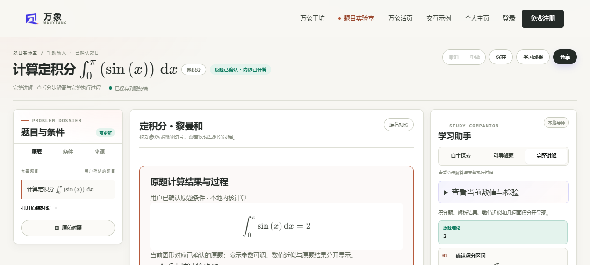

# 手动积分题流程：本阶段实施与验收

## 使用方法

打开 http://localhost:5173/labs，使用新增的“输入我的题目”区域：

1. 科目选择高等数学，积分模块选择定积分或不定积分。
2. 用现有数学按钮或直接输入被积函数，选择积分变量；定积分还需填写上下限。
3. 点击“预览并确认题目”，查看后端生成的完整积分式。
4. 勾选“我已核对公式、积分变量和全部条件”，点击“确认并计算”。
5. 进入原有工作台，查看原题结果、计算步骤、图形和执行轨迹；可以保存、修改实验参数和恢复原题。

“填入可修改示例”只在点击后填写示例值，不会把示例当作缺失条件的默认值。文件识别、文字识别和原有其他科目示例保留在下方。

## 实现范围

- 后端新增 /api/v1/labs/manual/preview 与 /api/v1/labs/manual。预览仅验证和排版；确认后调用现有积分任务内核，按现有会话权限、CSRF 与实验室保存机制保存。
- 前端复用 MathExpressionInput、LabControls、LabCanvas、LabTimeline、AssistantPanel 等组件；新增手动输入表单及原题结果展示。
- 公式或条件变化会清除旧确认。缺条件、额外未消费字段、非法表达式、未确认提交不进行创建；不定积分不携带隐藏上下限。
- 定积分保留分数、pi 等精确端点，图形参数仍使用数值。反向区间在解析值、数值和轨迹中保留符号。
- 原式结构保留，验证化简前后的实定义域；不能因化简而把负区间上的 sqrt(x)^2 或 log(x)-log(x) 当作全实数定义函数计算。
- 手动题不自动进入 AI 建模链路。原题确认状态、原题结果和修改参数后的实验有独立提示。
- 手动题使用已有核对窗口修改公式/上下限，再确认并重新计算；清空必填条件会阻止提交，修正后保留笔记与历史记录。

## 验证结果

| 题目或场景 | 实际结果 |
|---|---|
| 定积分 x²，0 → 2 | 8/3 |
| 定积分 sin(x)，0 → pi | 2，保留 pi 端点 |
| 定积分 t，1/3 → 2/3 | 1/6，保留非 x 变量及分数 |
| 定积分 x，2 → 0 | -2，符号与黎曼和一致 |
| 定积分 sqrt(x-1/3)，1/3 → 1 | 精确结果与保存后的评估一致，未因舍入误报定义域错误 |
| 不定积分 x*cos(x) | x*sin(x)+cos(x)+C，含求导核对步骤 |
| 不定积分 t² | 保留变量 t 与任意常数 C，不添加上下限 |
| 修改条件后继续计算 | 旧确认失效，必须重新确认 |
| 保存、刷新、恢复原题 | 改参状态可恢复，原题条件和原题结果保持独立 |
| 缺上下限、非法公式或额外字段 | 明确拒绝，不静默补值或忽略字段 |
| 原式在所填区间不属于实定义域 | 明确提示，不通过化简伪装成有效积分 |
| 文件识别回归 | TXT 定积分上传后仍能识别和求解；不是手动题 |
| 原有示例回归 | 浏览器仍能打开定积分示例 |

执行结果：

- 后端：`py -3.11 -m pytest tests/test_manual_integrals.py tests/test_labs_api.py tests/test_labs_kernel_models.py tests/test_labs_integral_recognition.py tests/test_labs_core.py tests/test_labs_p0_correctness.py -q`，134 项通过。
- 前端：`node --test src/labs/manualInput.test.ts src/labs/autoAI.test.ts src/labs/mathKeyboard.test.ts src/labs/integralRecognition.test.ts`，18 项通过。
- 浏览器：设置 `E2E_BASE_URL=http://localhost:5173` 后运行 `npx playwright test -c e2e/playwright.config.ts e2e/manual-integrals.spec.ts`，3 项通过。开发服务器当前监听 localhost，不能用默认的 127.0.0.1 替代。
- `npm run typecheck` 通过；`npm run build`（包括离线构建）通过，完整构建输出在 build.log。构建仍有已有的大包体提示。
- 独立只读代码复核发现四项边界问题，修正并补充回归后未发现剩余重要问题。

## 页面证据

## 支持边界与下一阶段

- 本阶段新手动入口只开放单变量定积分和不定积分，定积分上下限须为有限实数；未开放无穷端点和其他手动题型。
- 过程展示复用内核提供的计算摘要、求导回验和数值轨迹，不声称生成完整的人工换元或分部积分推导；不能完成的公式明确反馈。
- 这次验证了真实浏览器操作及有标准结果的数学用例，没有测量真实用户完成率，也没有重测图片/PDF/PPTX 的识别准确率或进行全项目回归。
- 可继续依次扩展极限、求导、408 表格任务；新增任务仍沿用科目/题型、结构化条件、确认、原生内核和工作台展示。
- 为测试创建了访客示例学习记录，未发布用户内容。开发服务保留运行，本轮专用浏览器已关闭；目录没有 git 仓库，未创建提交。
