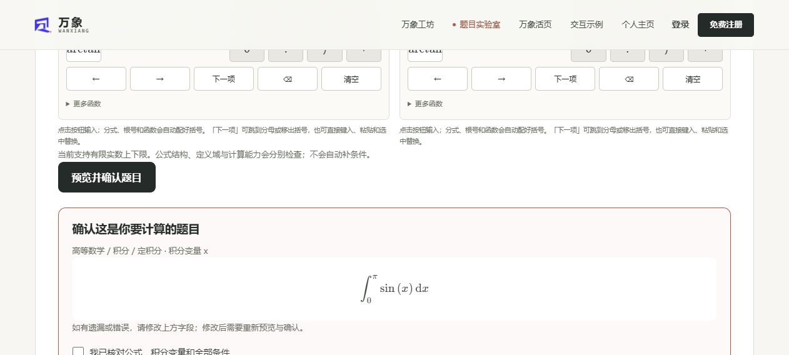
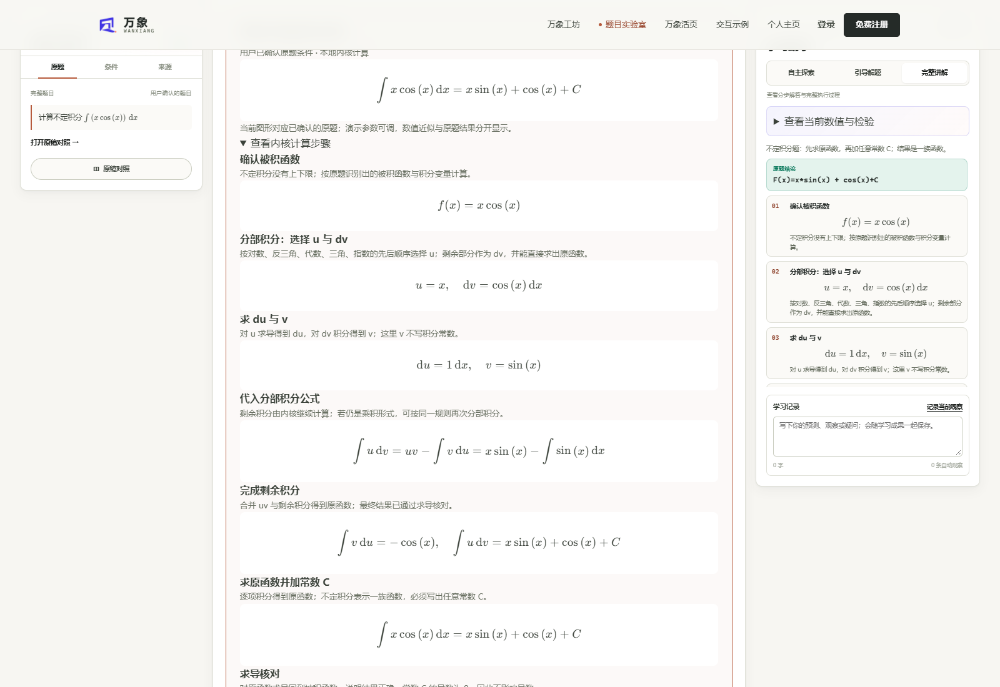
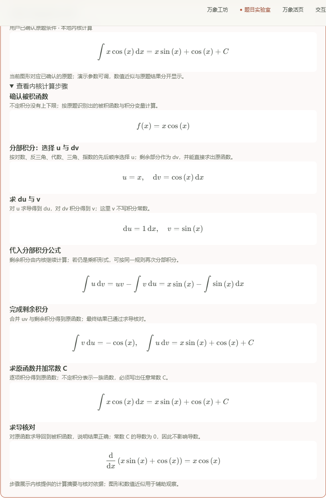
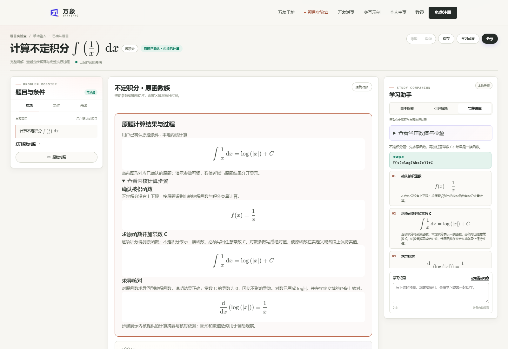
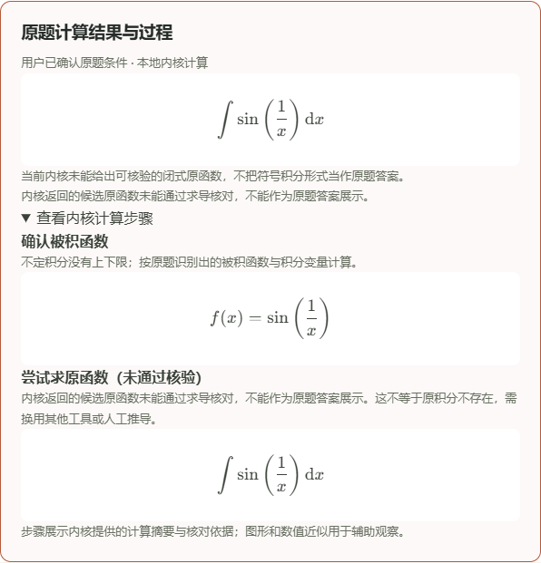
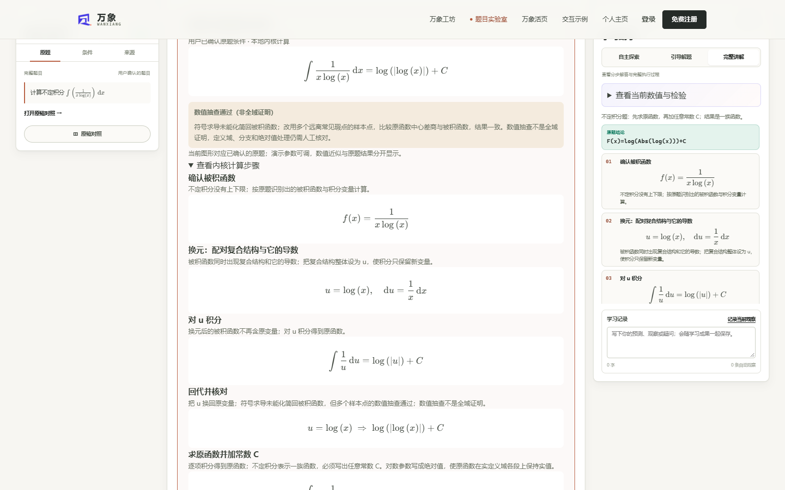
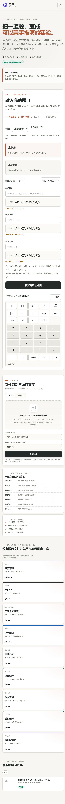

# 手动积分题流程：本阶段实施与验收

## 使用方法

打开 http://localhost:5173/labs，使用新增的“输入我的题目”区域：

1. 科目选择高等数学，积分模块选择定积分或不定积分。
2. 用共用的数学键盘或直接输入被积函数，选择积分变量；定积分还需填写上下限。
3. 点击“预览并确认题目”，查看后端生成的完整积分式。
4. 勾选“我已核对公式、积分变量和全部条件”，点击“确认并计算”。
5. 进入原有工作台，查看原题结果、计算步骤、图形和执行轨迹；可以保存、修改实验参数和恢复原题。

“填入可修改示例”只在点击后填写示例值，不会把示例当作缺失条件的默认值。文件识别、文字识别和原有其他科目示例保留在下方。

## 实现范围

- 后端新增 /api/v1/labs/manual/preview 与 /api/v1/labs/manual。预览仅验证和排版；确认后调用现有积分任务内核，按现有会话权限、CSRF 与实验室保存机制保存。
- 前端复用 MathExpressionInput、LabControls、LabCanvas、LabTimeline、AssistantPanel 等组件；新增手动输入表单及原题结果展示。
- 三个输入框共用一个数学键盘：键盘跟随当前焦点，可收起/展开，避免三个键盘把页面拉得过长；移动端确认成功后自动把确认区滚入视口。
- 公式或条件变化会清除旧确认。缺条件、额外未消费字段、非法表达式、未确认提交不进行创建；不定积分不携带隐藏上下限。
- 定积分保留分数、pi 等精确端点，图形参数仍使用数值。反向区间在解析值、数值和轨迹中保留符号。
- 原式结构保留，验证化简前后的实定义域；不能因化简而把负区间上的 sqrt(x)^2 或 log(x)-log(x) 当作全实数定义函数计算。
- 手动题不自动进入 AI 建模链路。原题确认状态、原题结果和修改参数后的实验有独立提示。
- 手动题使用已有核对窗口修改公式/上下限，再确认并重新计算；清空必填条件会阻止提交，修正后保留笔记与历史记录。

## 过程展示：只展示经核验的方法

- 内核在给出定积分或不定积分结果时，额外尝试识别换元与分部积分；每个候选方法都会先用新变量完成积分，回代后再对原变量求导并与被积函数核对，只有符号求导或数值抽查通过（具体等级写入步骤说明）才会写入解答步骤。
- 换元步骤只选择实际出现在被积函数中的复合结构，并跳过 `u=-x` 这类平移换元、倒数结构和会引出 Si/Ci 等非初等结果的候选。
- 分部积分的 `u` 只取对数、反三角或多项式；剩余积分由内核实际计算，不伪造中间过程。
- 没有通过核验的方法条目不展示；例如 `sin(x)/x`、`sin(1/x)`、`x^x` 和 `exp(cos(x))` 不会显示“换元”或“分部积分”步骤。没有方法步骤不等于积分失败：`sin(x)/x` 的定积分仍可求出，不定积分给出经求导核验的 `Si(x)+C`。
- 原函数中的对数按实定义域改写为 `log|·|`：只有被积函数在对数参数取负值时仍为实值、且改写后的原函数通过求导或数值抽查核验时才采用。`1/x` 显示为 `log|x|+C`，`log(x)^2` 仍保留 `log(x)`，不擅自扩展原题定义域。
- 不定积分的求导核对在 `log|·|` 导致 sign/Piecewise 时直接展示已核验的被积函数，并注明改写原因；图形评估复用同一个经核验的原函数，避免解答与曲线相差常数。
- 不定积分只有通过求导核验的原函数才作为答案。内核返回未求值的 `Integral` 形式，或候选原函数求导后不能回到被积函数时，结果标记为“内核暂不支持”：不显示 `F(x)=...+C`，不把符号积分形式或候选式当作答案，也不让未核验的候选式驱动图形。`x^x`、`sin(1/x)`、`exp(cos(x))` 属于此类。

## 验证等级：不把数值抽查说成证明

- 每次不定积分核对返回三级之一：“符号求导核验通过”（原函数求导差化简为 0）、“数值抽查通过（非全域证明）”（固定采样点一致）、“尚未确认”（未求得可核验原函数或无法比对）。等级、标签和说明同时写入后端解答、手动题记录和前端类型，刷新、恢复原题后仍一致。
- 工作台结果区显示对应标签；符号等级附求导差为 0 的说明，数值等级明确写“数值抽查不是全域证明”，未确认等级不显示 `+C` 或候选式。
- 换元/分部步骤只采用通过求导核对的计算；每一步的方法说明会标注证据等级：符号求导可化简回被积函数时写“符号核验”，只有样本点一致时写“数值抽查（非全域证明）”，不把数值等级写成已证明。
- 独立验收集逐题断言等级与标签，防止数值兜底被当作全域证明。

## 独立积分验收集

- 题集位于 `backend/scripts/integral_acceptance.py`，与开发调试用例分开运行（pytest 标记 `acceptance`），覆盖换元、分部、对数、根式、周期函数、特殊函数、非初等、瑕点、反向区间 9 类共 31 题。
- 每题独立断言答案与人工期望表达式一致、步骤存在性与方法前缀、误判不支持、条件丢失或擅自扩写、验证等级、定积分值与图形/改参一致性。统计口径是错误题数：answer_error、step_error、false_unsupported、condition_loss、condition_extra、verification_error、consistency_error、exception，而不是测试通过数。
- 本批次 31/31 通过，八项错误指标均为 0；报告见 [独立积分验收集报告](../integral-acceptance-2026-11-13/report.md)。
- 题集由人工按数学分类选取，不是随机抽样；期望原函数用 SymPy 结构比较（相差常数视为同一原函数族），数值抽查只说明样本点一致，不是全域证明。

## 验证结果

| 题目或场景 | 实际结果 |
|---|---|
| 定积分 x²，0 → 2 | 8/3 |
| 定积分 sin(x)，0 → pi | 2，保留 pi 端点 |
| 定积分 t，1/3 → 2/3 | 1/6，保留非 x 变量及分数 |
| 定积分 x，2 → 0 | -2，符号与黎曼和一致 |
| 定积分 sqrt(x-1/3)，1/3 → 1 | 精确结果与保存后的评估一致，未因舍入误报定义域错误 |
| 不定积分 x*cos(x) | x*sin(x)+cos(x)+C，含分部积分步骤与求导核对 |
| 不定积分 x*cos(x²) | sin(x²)/2+C，含换元步骤与求导核对 |
| 不定积分 x²*exp(-x) | 含分部积分四步；结果对原被积函数求导核验通过 |
| 不定积分 1/x | log\|x\|+C；实定义域负半轴可绘制，改写条件写入解答 |
| 不定积分 sin(x)/x | Si(x)+C；通过求导核验，不把 Si 形式伪造成换元过程 |
| 不定积分 x^x、sin(1/x) | 标记“内核暂不支持”：不显示候选答案或 +C，结果区说明未求出或未通过求导核验 |
| 数值等级标签 | `1/(x*log(x))` 显示“数值抽查通过（非全域证明）”；其换元步骤的核对说明同样标注数值抽查 |
| 独立验收集 | 9 类 31 题全部通过；答案、步骤、误判不支持、条件、等级、一致性错误均为 0 |
| 三个输入框共用键盘 | 键盘跟随焦点；收起/展开后表单长度和输入值保持正确 |
| 移动端确认区 | 390×844 下确认标题可见且在视口内，公式保留精确分式 |
| 修改条件后继续计算 | 旧确认失效，必须重新确认 |
| 保存、刷新、恢复原题 | 改参状态可恢复，原题条件和原题结果保持独立 |
| 缺上下限、非法公式或额外字段 | 明确拒绝，不静默补值或忽略字段 |
| 原式在所填区间不属于实定义域 | 明确提示，不通过化简伪装成有效积分 |
| 文件识别回归 | TXT 定积分上传后仍能识别和求解；不是手动题 |
| 原有示例回归 | 浏览器仍能打开定积分示例 |

执行结果：

- 后端：手动积分、方法与验收模块 `tests/test_manual_integrals.py tests/test_integral_methods.py tests/test_integral_acceptance.py` 共 91 项通过（手动 51、方法 8、验收 32）；与 16 个相关内核、API、识别与回归文件合并复跑，19 个文件共 359 项通过。
- 前端单元测试：`node --test "src/**/*.test.ts"`，414 项通过。
- 浏览器：设置 `E2E_BASE_URL=http://localhost:5173` 后运行 `npx playwright test -c e2e/playwright.config.ts e2e/manual-integrals.spec.ts`，7 项通过，包含数值抽查等级标签和未确认等级断言。开发服务器当前监听 localhost，不能用默认的 127.0.0.1 替代。
- `npm run typecheck` 通过；`npm run build`（包括离线构建）通过，完整构建输出在 build.log。构建仍有已有的大包体提示。
- 后端无热重载；本次验证前用 `start-dev.ps1 -Restart` 重启，浏览器证据来自重启后的服务。

## 页面证据

## 支持边界与下一阶段

- 本阶段新手动入口只开放单变量定积分和不定积分，定积分上下限须为有限实数；未开放无穷端点和其他手动题型。
- 方法展示是“可核验的辅助过程”，不是对所有积分都能给出人工推导：找不到通过求导核验的换元/分部方案时不展示方法步骤；特殊函数或非初等结果不包装成初等方法。
- 不定积分目前只把通过求导核验的原函数作为答案；内核只返回未求值积分或未通过核验的候选式时标记为“内核暂不支持”，不会显示 `F(x)=...+C`，也不会把候选式画成原函数族。这不等于积分在数学上不存在，仍可换用其他工具或人工推导。
- 这次验证了真实浏览器操作及有标准结果的数学用例，没有测量真实用户完成率，也没有重测图片/PDF/PPTX 的识别准确率。全量后端回归（排除 integration）共 1193 项通过、1 项跳过、12 项失败、8 项取消选择；12 项失败均与本功能无关：11 项来自 `tests/test_dev_route_probe.py` 在 PowerShell 控制台 GBK 编码下无法匹配中文输出，1 项来自 `tests/test_db_config.py` 对本地 `.env.example` 中 `LAB_UNDERSTANDING_PROVIDER=ollama` 的凭据样式检查。相关模块单独运行通过，失败没有被隐藏为通过。
- 可继续依次扩展极限、求导、408 表格任务；新增任务仍沿用科目/题型、结构化条件、确认、原生内核和工作台展示。
- 为测试创建了访客示例学习记录，未发布用户内容。开发服务保留运行，本轮专用浏览器已关闭；本轮改动已提交并推送到 `origin/main`。
