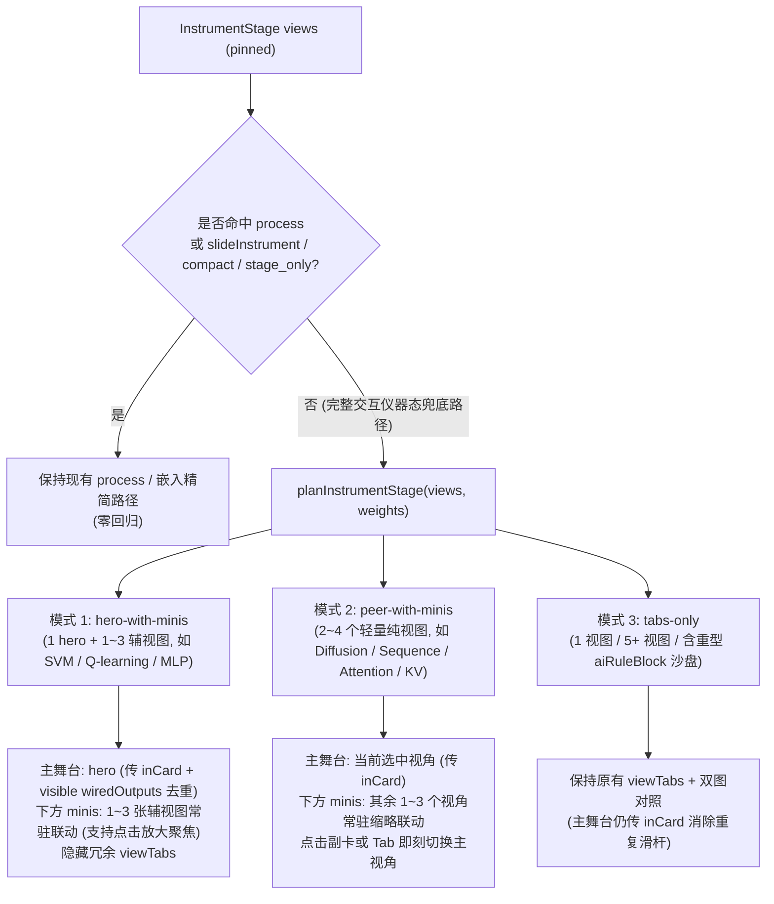

# 万象坊交互仪器态（InstrumentStage）主副协同与去重升级实施方案

> 版本：v1.0 · 2026-11-28  
> 前置依赖：已完成《[万象坊驾驶舱Bento布局与实验视图解耦实施方案.md](file:///e:/代码/ICT/万象坊驾驶舱Bento布局与实验视图解耦实施方案.md)》中的端口拆解、曲线视图与 `cockpitLayout.ts` 体量推断层。  
> 文档用途：供实施 Agent 直接按章落地；已核查 `InstrumentStage.tsx`、`instrumentStage.module.css`、`DeepAdvancedNodes.tsx`、`DeepCoreNodes.tsx` 以及全部 E2E 断言。

---

## 1. 现状诊断与升级目标

### 1.1 驾驶舱改造后，交互仪器态暴露出的 4 个体验落差

在完成驾驶舱路径 A 拆解后，`dlSvm`、`dlQlearning`、`dlManifold` 等模板的 `panel.view_node_ids` 已包含粒度清晰的独立辅视图（如 SVM 的 `分类超平面权重`、`决策分数 f(x, y)`、`训练 primal objective`）。但 [InstrumentStage.tsx](file:///e:/代码/ICT/frontend/src/canvas/InstrumentStage.tsx) 当前尚未承接这套解耦结果，导致：

1. **拆出的辅视图被平铺成顶部 `viewTabs`，既重复又极度失衡**  
   - 在 SVM 交互仪器态中，顶部出现 4 个平级 Tab：`SVM · 软间隔与二次映射 | 分类超平面权重 (w, b) | 决策分数 f(x, y) | 训练 primal objective`。
   - 停在第 1 个 Tab 时，因为 `DeepAdvancedNodes` 只在 `displayContext === 'cockpit'` 下隐藏重复子图，主舞台里仍把热力图和收敛曲线又画了一遍；切到第 2 个 Tab 时，`1×3` 的 3 个权重小方块孤零零挂在 `clamp(420px, 68vh, 760px)` 的超大主舞台里，留白高达 85%；切到第 3、4 个 Tab 时看到的是第 1 个 Tab 里已重复画过的图。
2. **主舞台里冒出重复的编辑态滑杆与端口说明**  
   - [InstrumentStage.tsx](file:///e:/代码/ICT/frontend/src/canvas/InstrumentStage.tsx#L74-L77) 中 `<View {...props} displayContext="instrument" />` **未传 `inCard`**，导致 `svmLab` / `qLearningLab` / `mlpTrainer` 在主舞台正上方重复渲染全套编辑态内部滑杆（与右侧「精密控制舱」外露滑杆重复打架），并在底部渲染面向编排态的 `<details>端口 / 数值边界</details>`。
3. **现成优秀的 `.minis` 三列副卡骨架完全闲置**  
   - [instrumentStage.module.css](file:///e:/代码/ICT/frontend/src/canvas/instrumentStage.module.css#L363-L376) 本来就设计了「主舞台 `.mainCard` + 中间结论条 `.conclusion` + 下方三列 `.minis`（`repeat(3, minmax(0, 1fr))`）」的成熟交互仪器布局，但目前仅接入了 `stageProcess`（高数/物理/408/办公管线）和 3 个 `deepProcess`（激活/CNN/优化器），其余 11 个深度学习模板全部走兜底渲染，`hasMinis === false`。
4. **打开「双图对照」会复现头重脚轻**  
   - 对照左栏放完整的 `svmLab`（高 800px+），右栏选 `分类超平面权重`（高 160px），直接重现改造前的严重失衡。

### 1.2 升级目标与安全红线

- **视觉定位协同（与驾驶舱互补，而非照搬）**：
  - **驾驶舱态**：左侧总控台 + 右侧 Bento 左右并排总览（左主右栈）；
  - **交互仪器态**：上方紧凑主舞台（`mainCard`）+ 中间结论条（`conclusion`）+ 下方 `1~3` 列常驻诊断副卡（`minis`，同屏实时联动）+ 右侧「精密控制舱（`pod`）」。
- **一屏联动、零重复、可聚焦**：
  - 打开 SVM / Q-learning / MLP 等交互仪器态时，主舞台只展示核心主图 + 紧凑控制/KPI条，**不重复画编辑滑杆、不重复画已拆出的子图**；所有辅视图常驻下方 `minis` 实时联动；点击任意副卡右上角「放大查看」可临时切入主舞台细看，再一键返回全览。
- **四条硬红线（零回归保障）**：
  1. **严禁破坏 PPT / 活页精简嵌入模式**：当 `slideInstrument` 为真或 `displayMode === 'compact' | 'stage_only'` 时（参见 E2E 断言 [material-workbench.spec.ts](file:///e:/代码/ICT/frontend/e2e/material-workbench.spec.ts#L220) `expect(plugin.locator('[data-process-minis]')).toBeHidden()`），**绝不**启用 `viewMinis` 装配，也**绝不**对主卡隐藏内置子图——避免 `.minis` 被容器查询隐藏后导致图表消失。
  2. **严禁破坏「编辑实验输入」抽屉**：[InstrumentStage.tsx](file:///e:/代码/ICT/frontend/src/canvas/InstrumentStage.tsx#L1004-L1012) 右侧控制舱底部的 `<details>编辑实验输入</details>` 里复用了 `Body` 来编辑 `pixelGridSource` 和 `dataset2dSource`，该处必须保持 `!inCard`（不得隐藏其预设/涂抹/采样控件）。
  3. **不干扰已有 `process` 路径**：`stageProcess`（高数/物理/408/办公）、`deepProcess`（`dlActivation`/`dlCnn`/`dlOptimizer`）与 `customProcess`（`aiRuleBlock` 通用舞台）的现有体验和 E2E 选择器保持完全不变。
  4. **不对重型 `aiRuleBlock` 沙盘强行多开实例**：物理/高数/线代/408 的多 `aiRuleBlock` 沙盘继续走原有 `viewTabs` + `双图对照`，不把多个重型规则动画块塞进下方 `minis`。

---

## 2. 核心设计方案（四大模块）



---

### 模块一：新增纯函数规划器 `instrumentLayout.ts`（复用 `inferCockpitWeight`）

新建 `frontend/src/canvas/instrumentLayout.ts`，直接复用已实现的 `inferCockpitWeight()`（[cockpitLayout.ts](file:///e:/代码/ICT/frontend/src/canvas/cockpitLayout.ts)），将交互仪器态的视图分配逻辑抽成无 DOM 依赖的纯函数，方便单元测试：

```ts
export type InstrumentLayoutMode = 'hero-with-minis' | 'peer-with-minis' | 'tabs-only';

export interface InstrumentViewItem {
  id: string;
  type: CanvasNode['type'];
  badge: NodeDef['badge'];
  weight: CockpitWeight;
}

export interface InstrumentStagePlan {
  mode: InstrumentLayoutMode;
  /** 默认主舞台节点 id */
  primaryId: string;
  /** 默认常驻在下方 .minis 区的辅视图 id 列表（最多 3 个） */
  miniIds: string[];
  /** 是否在顶部显示 viewTabs（hero-with-minis 总览态隐藏冗余 Tab） */
  showTabs: boolean;
  /** 是否允许开启「双图对照」（所有视图已在主+副同屏展示时隐藏冗余按钮） */
  allowCompare: boolean;
}
```

#### 判定规则（精确、可预期）

1. **前置守卫**：若 `views.length <= 1`、或 `hasProcess`、或 `isEmbeddedCompact`（`slideInstrument || displayMode === 'compact' || displayMode === 'stage_only'`）→ 返回 `tabs-only`（`miniIds: []`）。
2. **模式 1：`hero-with-minis`（主副解耦模式）**  
   - **条件**：`views.length >= 2 && views.length <= 4`，存在**恰好 1 个** `weight === 'hero'` 的视图，且其余 `1~3` 个视图不含重型交互块（非 `aiRuleBlock`、非 `composite`）。
   - **覆盖模板**：`dlSvm`（1+3）、`dlQlearning`（1+3）、`dlManifold`（1+2）、`dlRegularization`（1+2）。
   - **输出**：
     - `primaryId = hero.id`
     - `miniIds = 其余全部视图 id`（保持原始声明顺序）
     - `showTabs = false`（所有视图已同屏可见，避免 Tab 冗余）
     - `allowCompare = false`（主+副已全部并排可见，避免无意义双图对照）
3. **模式 2：`peer-with-minis`（同级轻量视图联动模式）**  
   - **条件**：`views.length >= 2 && views.length <= 4`，且**所有视图**均为轻量观察视图（`badge === '视图' || type === 'spark'`，不含 `aiRuleBlock` / `composite` / `badge === '实验'`）。
   - **覆盖模板**：`dlDiffusion`（3 视图）、`dlMultihead`（3 视图）、`dlSequence`（3 视图）、`dlAttention`（4 视图）、`dlAutoencoder`（4 视图）、`dlKv`（4 视图）。
   - **输出**：
     - `primaryId = activeId（若有效）?? views[0].id`
     - `miniIds = views 中除 primaryId 外的其余 1~3 个视图`
     - `showTabs = true`（保留顶部 Tab 切换主视角，同时下方副卡点击也可直接换入主舞台）
     - `allowCompare = true`
4. **模式 3：`tabs-only`（重型多实验 / 超 4 视图兜底）**  
   - 如物理/高数/线代/408 的 3 个 `aiRuleBlock` 沙盘、或 5+ 视图自定义画布：保持 `showTabs = true`、`allowCompare = true`、`miniIds = []`。

#### 副卡「放大查看 / 返回全览」轻量交互（针对 `hero-with-minis`）

在 `hero-with-minis` 模式下，用户默认一屏看到主舞台 + 下方 1~3 张副卡。为了兼顾想细看 `16×16` 热力图或长曲线的需求：
- 在 `InstrumentStage` 中新增局部状态 `const [focusedMiniId, setFocusedMiniId] = useState<string>();`（当 `doc` 变化或 `focusedMiniId` 不再属于 `miniIds` 时自动清空）。
- 每张由 `viewMinis` 渲染的 `.miniCard` 标题栏右侧提供一个轻巧按钮：
  - `hero-with-minis`：`放大`（点击设 `setFocusedMiniId(item.id)`，临时把该副卡放大到主舞台展示；此时主舞台标题栏出现 `← 返回主舞台` 按钮，且原主实验节点通过极小隐藏运行态或保持挂在底部副卡首位继续 `onLive` 运行！）。
  - **关键技术细节（切勿踩坑！）**：在 SVM / Q-learning 里，运行时步进状态（`frame` / `running`）和 `onLive` 发射器住在 `svmLab` / `qLearningLab` 组件内部！如果点击“放大右侧热力图”时把 `svmLab` 从 React 树里卸载了，当前跑到第 200 步的 `frame` 状态会丢失！
  - **零丢帧解法**：点击某张副卡的「放大 / 交换」时，**主实验节点 `hero` 与被放大的副卡交换位置**（即被放大的副卡进主舞台，`hero` 留在下方副卡区继续挂载并维持 `key={node.id}`——或者更稳妥地，直接支持在 `hero-with-minis` 中用 `focusedMiniId` 弹出主舞台内的**聚焦对照分屏** / 维持 `hero` 不卸载）！推荐最简洁且零状态丢失的做法：**让 `focusedMiniId` 直接复用 `InstrumentStage` 现成的 `.splitStage` 双栏聚焦模式**（左边保留 `hero` 主舞台不卸载且可继续点单步/运行，右边放大展示被点击的那张副卡），再点一次「退出放大」即回到「上主 + 下三副卡」全览！这样状态 100% 不丢、还能一边点单步一边看放大后的热力图/曲线！

---

### 模块二：交互仪器态主舞台与副卡的「去重与降噪」（零重复滑杆、零重复子图）

#### 1. 严格区分 `Body` 的两种渲染角色

修改 [InstrumentStage.tsx](file:///e:/代码/ICT/frontend/src/canvas/InstrumentStage.tsx#L74-L77)：

```tsx
function Body({ props, inCard = false, wiredOutputs }: {
  props: NodeBodyProps;
  inCard?: boolean;
  wiredOutputs?: ReadonlySet<string>;
}) {
  const View = NODE_DEFS[props.node.type].Body;
  return <View {...props} inCard={inCard} displayContext="instrument"
    wiredOutputs={wiredOutputs ?? props.wiredOutputs} />;
}
```

调用点明确区分：
- **主舞台（`.mainCard`）、对照窗（`.comparePane`）、下方副卡（`.miniCard`）**：统一传 **`inCard`**，彻底隐藏与右侧「精密控制舱」重复的编辑态内部滑杆和底部端口说明。
- **右侧「编辑实验输入」抽屉（第 1008–1009 行的 `pixelGridSource` / `dataset2dSource`）**：显式保持 **`inCard={false}`**，完整保留像素预设/画笔与数据集编辑能力。

#### 2. `visibleObservers` 安全去重计算（与驾驶舱完全同构）

在 `InstrumentStage` 中，只把**当前实际渲染在屏幕上的辅视图**（即 `viewMiniNodes` 或对照窗 `compareView` 中可见的观察节点）计入 `visibleObservers`：

```ts
const visibleObserverIds = new Set<string>();
for (const item of activeViewMiniNodes) {
  if (NODE_DEFS[item.type]?.badge === '视图' || item.type === 'spark') {
    visibleObserverIds.add(item.id);
  }
}
if (compareView && (NODE_DEFS[compareView.type]?.badge === '视图' || compareView.type === 'spark')) {
  visibleObserverIds.add(compareView.id);
}
```

再为当前主舞台节点计算 `stageWiredOutputs`：
```ts
const stageWiredOutputs = view
  ? new Set(
      doc.wires
        .filter((w) => w.from === view.id && visibleObserverIds.has(w.to))
        .map((w) => w.fromPort ?? 'out'),
    )
  : undefined;
```

**这一步的安全保证极强**：
- 在完整交互仪器态打开 `dlSvm`：下方 3 张副卡均可见 → `visibleObserverIds` 包含 `field` 热力图和 `history` 曲线 → `svmLab` 主舞台自动隐藏内部重复的热力图与曲线，只保留放大的二维平面主图！
- 在 PPT 精简嵌入（`slideInstrument` / `compact` / `stage_only`）打开 `dlSvm`：`activeViewMiniNodes` 为空 → `visibleObserverIds` 为空 → `stageWiredOutputs` 为空 → `svmLab` 主舞台**自动完整保留内置热力图与曲线**，绝不漏图！

#### 3. 扩展 `DeepAdvancedNodes` 与 `DeepCoreNodes` 的紧凑判定条件

把目前只在 `displayContext === 'cockpit'` 生效的视觉优化，平滑扩展到“交互仪器态的卡片内展示（`displayContext === 'instrument' && inCard`）”：

- **[DeepAdvancedNodes.tsx](file:///e:/代码/ICT/frontend/src/canvas/DeepAdvancedNodes.tsx#L61-L89)**：
  ```ts
  const inStage = displayContext === 'cockpit' || (displayContext === 'instrument' && Boolean(inCard));
  ```
  把原先的 `inCockpit` 替换为 `inStage`：
  - 交互仪器态主舞台自动获得单行「运行 / +10 步 / 重置 + KPI 徽章」工具条、`ⓘ 算法与数值说明` 折叠区、`Plane` 支持候选图例、无嵌套双边框的大主图、以及按 `wiredOutputs` 精确隐藏已外接的重复子图！
  - 在 `DeepAdvancedNodes` 中，若当前同时处于 `displayContext === 'instrument'`，可稍微收敛 `.plane` / `.world` 的最大高度（例如通过 `data-stage-context={displayContext}` 区分：`cockpit` 用 `min(520px, 58vh)`，`instrument` 在有下方 `minis` 时用 `min(340px, 38vh)`），避免把主舞台撑出滚动条！
- **[DeepCoreNodes.tsx](file:///e:/代码/ICT/frontend/src/canvas/DeepCoreNodes.tsx#L21-L66,L146-L190)**：
  - `Trainer`（`mlpTrainer`）：将 `const cockpit = displayContext === 'cockpit';` 改为 `const compactStage = displayContext === 'cockpit' || (displayContext === 'instrument' && Boolean(inCard));`，确保 `dlManifold` / `dlRegularization` 在交互仪器态的下方 `miniCard` 中渲染 `MLP 训练控制台` 时，同样隐藏重复的 `Boundary` 和 `loss` 曲线，只保留精干的开始/暂停/重置按钮、Epoch 进度条和实时 Train/Val 读数！
  - `Heatmap`（`matrixHeatmapView`）：将 `cockpit` 参数语义扩展为 `compact = displayContext === 'cockpit' || (displayContext === 'instrument' && Boolean(inCard))`：
    - `1×3` / `1×6` 的 SVM 权重在 `.miniCard` 中呈现为带 `w₁ / w₂ / b` 标签的紧凑横排；
    - `16×16` 决策分数热力图在 `.miniCard` 中自动启用 `matrixDense`（并进一步在 `.miniCard` 内约束最大宽约 `180px~200px`），完整放下无需滚动！

---

### 模块三：交互仪器态 `.mainCard`、`.minis` 与 `.conclusion` 视觉协调

针对 [instrumentStage.module.css](file:///e:/代码/ICT/frontend/src/canvas/instrumentStage.module.css) 做以下精确微调（不影响现有 `process` 模板）：

1. **为外接副视图 `minis` 提供弹性适配高度（消除截断滚动条）**  
   目前第 369–372 行的 `.miniCard` 写死了 `height: clamp(168px, 24vh, 224px)`，这对高数/物理的 `SeriesChart` 很合适，但放 `16×16` 热力图或 `MLP 训练控制台` 会略矮。新增属性选择器 `[data-view-minis]`：
   ```css
   .workspace:not([data-slide-instrument], [data-display-mode='compact'], [data-display-mode='stage_only']) .minis[data-view-minis] .miniCard {
     height: auto;
     min-height: 172px;
     max-height: 290px;
   }
   /* 2 张副卡时均分 50/50（覆盖 process 默认的 1fr / 1.4fr，避免 MLP 控制台与曲线失衡） */
   .minis[data-view-minis][data-cols="2"] {
     grid-template-columns: repeat(2, minmax(0, 1fr));
   }
   ```
2. **`.miniCard` 标题栏支持轻量操作按钮（`放大` / `切为主视`）**
   ```css
   .miniCard h3 {
     display: flex;
     align-items: center;
     gap: 6px;
   }
   .miniCard h3 .miniAction {
     margin-inline-start: auto;
     padding: 2px 7px;
     font-size: 11px;
     color: var(--ink-500);
   }
   ```
3. **主舞台在有 `viewMinis` 时解除 `fallback-chart` 的过高撑开，做到一屏收束**  
   看 [instrumentStage.module.css](file:///e:/代码/ICT/frontend/src/canvas/instrumentStage.module.css#L101-L105)：
   ```css
   .workspace:not([data-slide-instrument], [data-display-mode='compact'], [data-display-mode='stage_only']) .mainCard:has(> .chart[data-fallback-chart]) {
     aspect-ratio: auto;
     max-height: none;
     min-height: 0;
   }
   ```
   当 `data-has-minis` 为真且走 `viewMinis` 时，主舞台不再有内部热力图/曲线，只需为 `Plane` / `CliffGrid` / `Boundary` 提供 `min-height: clamp(290px, 44vh, 430px)`，配合上方标题 + 中间结论 + 下方 220–260px 副卡，在 `1440×900` 视口下总高度约 `780px`，**完美一屏收束，无需滚动**！
4. **增强 `.conclusion` 结论条（可选提质）**  
   当 `!process` 且主舞台是 `svmLab` / `qLearningLab` 时，可利用 `view` 的结构化 `kpis`（或通过 `ConclusionContent` 已有的 `·` 分隔自动转 `.metricChips` 能力）在结论条中展示简明摘要，例如：  
   `当前结论`：`SVM · 软间隔与二次映射` · `拖动右侧参数观察主舞台与下方 3 个诊断视图同步变化`（避免把未更新的旧通用文案撑得很长）。

---

### 模块四：典型模板在交互仪器态的最终呈现效果核对

| 模板 | 触发模式 | 主舞台（上方） | 下方 `minis` 副卡（常驻实时联动） | 顶部 `viewTabs` |
|---|---|---|---|---|
| **`dlSvm`** | `hero-with-minis` | SVM 二维平面主图 + 单行运行/步进/KPI条 + 折叠说明 | 3 列：`分类超平面权重 (w, b)` \| `决策分数 f(x, y)` \| `训练 primal objective` | 隐藏（点击副卡可分屏放大） |
| **`dlQlearning`** | `hero-with-minis` | 6×6 悬崖世界交互网格 + 单行运行/步进/KPI条 + 折叠说明 | 3 列：`策略动作（0–3）` \| `回合回报` \| `回合步数` | 隐藏（点击副卡可分屏放大） |
| **`dlManifold` / `dlRegularization`** | `hero-with-minis` | `边界与流形折叠`（放大清晰、无重复） | 2 列：`MLP 训练控制台`（去重紧凑态） \| `训练 / 验证损失` | 隐藏（点击副卡可分屏放大） |
| **`dlDiffusion`** | `peer-with-minis` | 当前选中视角（默认：加噪点） | 2 列：`解析 score 向量场` \| `反向一步后的点` | 保留（点 Tab 或副卡均可切换主视） |
| **`dlSequence`** | `peer-with-minis` | 当前选中视角（默认：RNN 隐状态） | 2 列：`LSTM 隐状态` \| `注意力检索权重（1×8 紧凑条）` | 保留 |
| **`dlAttention` / `dlAutoencoder` / `dlKv`** | `peer-with-minis` | 当前选中视角 | 3 列：其余 3 个观察视图实时联动 | 保留 |
| **`dlActivation` / `dlCnn` / `dlOptimizer`** | 已有 `deepProcess` | 保持原有过程舞台 + 时间轴 | 保持原有 `detail` + `history` | 保持不变 |
| **物理 / 高数 / 线代 / 408 / 办公沙盘** | 已有 `stageProcess` 或 `tabs-only` | 保持原有过程舞台 / `aiRuleBlock` 舞台 | 保持原有 `minis` 或不启用 `viewMinis` | 保持不变 |
| **PPT / 活页嵌入（`slideInstrument` / `compact` / `stage_only`）** | 强制保护跳过 | 完整单卡渲染（主卡不隐藏内置子图） | 不渲染 `viewMinis`（满足 E2E `toBeHidden`） | 保持不变 |

---

## 3. 逐文件修改清单

| 序号 | 文件路径 | 修改类型 | 核心改动说明 |
|---|---|---|---|
| 1 | `frontend/src/canvas/instrumentLayout.ts` | **新增** | 复用 `inferCockpitWeight()` 实现 `planInstrumentStage()` 纯函数（判定 `hero-with-minis` / `peer-with-minis` / `tabs-only`）。 |
| 2 | `frontend/src/canvas/instrumentLayout.test.ts` | **新增** | 单元测试覆盖：`dlSvm`(1+3)、`dlQlearning`(1+3)、`dlManifold`(1+2)、`dlDiffusion`(3 纯视图)、`dlAttention`(4 纯视图)、物理 3 个 `aiRuleBlock` 沙盘（退回 `tabs-only`）、嵌入模式 `slideInstrument/compact/stage_only` 强制 `tabs-only`。 |
| 3 | [frontend/src/canvas/InstrumentStage.tsx](file:///e:/代码/ICT/frontend/src/canvas/InstrumentStage.tsx) | 修改 | 接入 `planInstrumentStage()`；为 `Body` 增加 `inCard` 与 `wiredOutputs` 参数（主舞台/副卡/对照传 `inCard`，右侧「编辑实验输入」抽屉保留 `inCard={false}`）；计算 `visibleObserverIds` 与 `stageWiredOutputs`；组装 `viewMinis` 并入 `miniCards`（带 `data-view-minis` 标识与「放大/切换」按钮）；支持 `hero-with-minis` 下点击副卡触发不卸载 `hero` 的双栏聚焦放大。 |
| 4 | [frontend/src/canvas/instrumentStage.module.css](file:///e:/代码/ICT/frontend/src/canvas/instrumentStage.module.css) | 修改 | 新增 `.minis[data-view-minis]` 弹性高度与 2 列均分样式、`.miniAction` 按钮样式、副卡内紧凑容器（去多余内边距、限制高密热力图尺寸）、有 `viewMinis` 时主舞台的一屏协调高度与响应式规则。 |
| 5 | [frontend/src/canvas/DeepAdvancedNodes.tsx](file:///e:/代码/ICT/frontend/src/canvas/DeepAdvancedNodes.tsx) & [deepAdvanced.module.css](file:///e:/代码/ICT/frontend/src/canvas/deepAdvanced.module.css) | 修改 | 将 `inCockpit` 扩展为 `inStage = displayContext === 'cockpit' || (displayContext === 'instrument' && Boolean(inCard))`；通过 `data-stage-context={displayContext}` 在仪器态有 `minis` 时微调 `.plane`/`.world` 最大高度，避免主舞台出现内部滚动条。 |
| 6 | [frontend/src/canvas/DeepCoreNodes.tsx](file:///e:/代码/ICT/frontend/src/canvas/DeepCoreNodes.tsx) & [deepCore.module.css](file:///e:/代码/ICT/frontend/src/canvas/deepCore.module.css) | 修改 | `Trainer`（`mlpTrainer`）与 `Heatmap`（`matrixHeatmapView`）将 `cockpit` 判断扩展为 `compactStage = displayContext === 'cockpit' || (displayContext === 'instrument' && Boolean(inCard))`，使 `1×N` 权重、`16×16` 热力图和 `MLP 训练控制台` 在交互仪器态副卡中同样呈现紧凑去重形态。 |

---

## 4. 关键防踩坑预警（必读）

1. **严禁在点击副卡放大时卸载 `svmLab` / `qLearningLab` / `mlpTrainer`**  
   它们的运行时 `frame`（优化步数/回合数/MLP Epoch）存在组件内部 `useState`/`useRef` 中，且负责通过 `onLive` 向下游副卡广播实时值。点击副卡「放大」时，应使用 `.splitStage` 并排聚焦（左保 `hero` 不卸载，右放放大副卡），切忌用 `setActiveId(miniId)` 直接替换掉主舞台上的 `hero`，否则不仅丢失当前训练进度，右侧热力图/曲线也会因失去 `onLive` 发射源而退回初始帧！
2. **`slideInstrument` 与 `compact` / `stage_only` 的双重防护**  
   既要在 JS 侧由 `planInstrumentStage` 阻止生成 `viewMinis`，也要保证此时 `visibleObserverIds` 为空，使 `svmLab` 主卡自动兜底渲染内部热力图与曲线。这样可以同时满足 `material-workbench.spec.ts` 中 `[data-process-minis]` 隐藏断言与幻灯片嵌入内容完整性。
3. **`data-fallback-chart` 的宽度约束**  
   注意 [instrumentStage.module.css](file:///e:/代码/ICT/frontend/src/canvas/instrumentStage.module.css#L229-L238) 中 `.chart[data-fallback-chart] > div { max-width: 820px; }` 与 `> div:has(> svg) > svg { width: min(100%, 460px); }`。对于 `dlSvm` / `dlQlearning` / `dlManifold` 在 `hero-with-minis` 下的主舞台，确认主图容器居中、无横向滚动条、且不会被 `padding` 和 `max-height` 挤压裁剪。
4. **`inCard` 不要误传给第 1008–1009 行「编辑实验输入」抽屉**  
   该处 `pixelGridSource` 和 `dataset2dSource` 需要显示预设切换、画笔灰度与数据分布选择器，必须保留 `inCard={false}`。
5. **切换模板时重置局部聚焦态**  
   在 `InstrumentStage` 中，当 `doc.title` / `templateKind` / `views` 变化时，重置 `focusedMiniId` 和 `activeId`，防止从一个模板切到另一个模板后残留无效 id。

---

## 5. 分阶段实施路线与验收标准

### Phase 1：纯函数布局规划与单元测试
- 完成：`instrumentLayout.ts`、`instrumentLayout.test.ts`。
- 验收：`node --test src/canvas/instrumentLayout.test.ts` 全绿，覆盖全部 3 种模式及嵌入保护条件。

### Phase 2：节点组件支持仪器态紧凑去重
- 完成：`DeepAdvancedNodes.tsx`、`deepAdvanced.module.css`、`DeepCoreNodes.tsx`、`deepCore.module.css`。
- 验收：确保 `displayContext === 'canvas'`（编辑态）和 `displayContext === 'cockpit'`（驾驶舱态）行为零变化。

### Phase 3：`InstrumentStage` 接入主副协同与样式收束
- 完成：`InstrumentStage.tsx`、`instrumentStage.module.css`。
- 手工/浏览器验收清单（1440×900 视口）：
  1. **SVM 交互仪器态**：上方主舞台仅显示单行运行/步进/KPI条 + 放大的二维平面点云（无重复滑杆、无内部重复热力图与曲线、无冗余 4 个 Tab）；下方 3 列 `minis` 整齐常驻 `分类超平面权重 (w, b)`、`决策分数 f(x, y)`、`训练 primal objective`；点击「运行」或「+10 步」或拖动右侧「二次特征」「惩罚 C」，主舞台与下方 3 卡同步实时变化；点击任一副卡「放大」可左右并排细看且**不重置当前已跑优化步数**。
  2. **Q-learning 交互仪器态**：上方 6×6 悬崖世界主舞台 + 下方 3 列（策略动作、回合回报、回合步数）同屏联动。
  3. **MLP 流形/正则化交互仪器态**：上方 `边界与流形折叠` 主舞台 + 下方 2 列均分（`MLP 训练控制台` 去重紧凑态 + `训练 / 验证损失` 曲线），点击「开始训练」主图流形变形与下方损失曲线实时同步。
  4. **Diffusion / Sequence / Attention 交互仪器态**：保留顶部 Tab，同时下方常驻其余观察视角实时联动，点击副卡可一键切入主舞台。
  5. **回归检查**：高数/物理/408/办公沙盘、`dlActivation`/`dlCnn`/`dlOptimizer`、右侧「编辑实验输入」抽屉、以及通文册 PPT 嵌入（`slideInstrument`）均无回归。

### Phase 4：全量自动化验证
在 `frontend` 目录执行：

```powershell
cd frontend
npm run typecheck
npm test
npm run build
```
