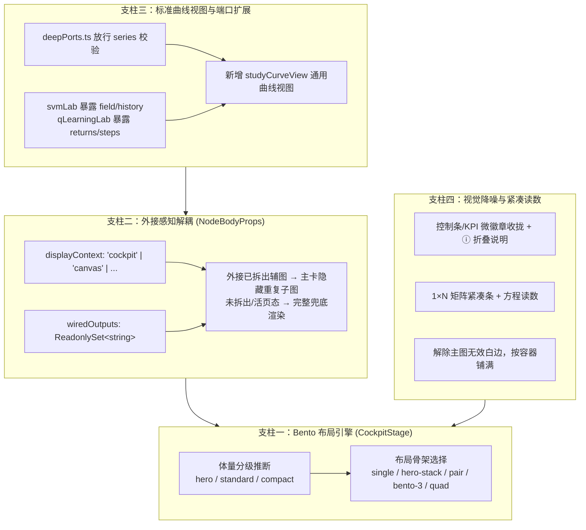

# 万象坊驾驶舱 Bento 布局与实验视图解耦实施方案（路径 A）

> 版本：v1.0 · 2026-11-28  
> 适用范围：万象坊「驾驶舱态（CockpitStage）」全学科排版引擎 + 深度学习等复合实验积木的主/辅视图解耦（路径 A）  
> 文档用途：供实施 Agent 直接按章落地，已基于本地代码库逐文件实证核查全部接口、端口协议与单元测试约束。

---

## 1. 问题诊断与总体目标

### 1.1 当前痛点（以 SVM 驾驶舱为例的 4 层根因）

1. **信息粒度极度失衡（巨无霸实验卡 vs 原子小卡片）**  
   在 [deepWorkshop.ts](file:///e:/代码/ICT/frontend/src/canvas/deepWorkshop.ts#L192-L202) 中，`dlSvm` 的 `view_node_ids` 为 `[svmLab, matrixHeatmapView(1×3)]`。左侧 `svmLab`（[DeepAdvancedNodes.tsx](file:///e:/代码/ICT/frontend/src/canvas/DeepAdvancedNodes.tsx#L40-L63)）一次性塞入了控制按钮栏、两行原理注释、标量 `loss`、二维点云平面、16×16 决策分数热力图、primal objective 收敛曲线，高度超过 800px；右侧仅有一个 `1×3` 的权重向量卡片，高度不足 200px。`dlQlearning` 存在同类问题，而 `dlManifold` / `dlRegularization` 则出现 `mlpTrainer` 内部与外部 `boundaryView`、`spark` 重复渲染的冗余问题。
2. **驾驶舱网格只有横向比例，缺乏纵向补位与奇偶骨架**  
   [CockpitStage.tsx](file:///e:/代码/ICT/frontend/src/canvas/CockpitStage.tsx#L226-L236) 与 [cockpitStage.module.css](file:///e:/代码/ICT/frontend/src/canvas/cockpitStage.module.css#L175-L195) 仅提供 `.gridSingle`、`.gridAsymmetric`（`1.55fr / 0.85fr`）与默认 `auto-fit` 网格，且统一 `align-items: start`。当左侧很高、右侧很短时，右下角露出 70% 以上空白；当全站物理、高数、线代、408、办公决策等沙盘呈现 **3 个视图** 时，2 列网格必然出现“上 2 下 1、右下缺角”的残缺观感。
3. **实验卡内部沿用“窄节点单列垂直流”，浪费宽屏空间**  
   [deepAdvanced.module.css](file:///e:/代码/ICT/frontend/src/canvas/deepAdvanced.module.css#L15) 将正方形 `Plane`（`viewBox="0 0 340 340"`）限制在 `max-height: 280px` 并居中，导致在宽卡片内左右各留出大片无效白边，同时把热力图与 Loss 曲线挤出首屏折叠线以下，用户拖动左侧滑杆时无法在一屏内同时观察全部联动变化。
4. **顶部控制条与长段教学说明喧宾夺主（“头重”）**  
   `运行 / 单步 / 重置`、两行浅橙色原理注释、`loss` 读数全部堆在主图上方，把真正的视觉主角压到屏幕中下部。

### 1.2 总体目标（路径 A 核心思想）

- **治本解耦**：把巨无霸实验节点的辅助图表（决策分数热力图、训练目标函数曲线、回合回报/步数曲线等）通过真实输出端口拆成独立视图积木。编辑态能看清完整数据流连线，驾驶舱态能按“**左主舞台 + 右侧诊断栈**”天然拼盘。
- **全站 Bento 化**：为 [CockpitStage.tsx](file:///e:/代码/ICT/frontend/src/canvas/CockpitStage.tsx) 引入基于“卡片视觉体量（`hero` / `standard` / `compact`）”的自适应 Bento 布局引擎，一次性解决 `1+N` 主副失衡、3 视图缺角与迷你卡片孤悬问题，普惠深度学习及物理/高数/线代/408/办公决策全部万象坊模板。
- **一屏收束、联动可见**：在 1440×900 及以上桌面视口中，核心实验的主图与所有诊断视图尽量**一屏完整呈现**，拖滑杆或点单步无需上下滚动。
- **严格向后兼容（零回归红线）**：
  - 不破坏已发布活页课程使用的 [deepTemplates.ts](file:///e:/代码/ICT/frontend/src/canvas/deepTemplates.ts) 与 [InstrumentStage.tsx](file:///e:/代码/ICT/frontend/src/canvas/InstrumentStage.tsx)；
  - 当实验节点在画布上孤立使用（未外接拆分辅图）或处于活页单卡模式时，依旧保留完整内部图表，绝不丢失信息。

---

## 2. 核心架构设计（四大支柱）



---

### 支柱一：驾驶舱 Bento 布局引擎与体量分级契约

#### 1. 节点体量声明（`CockpitWeight`）

在 [nodes.tsx](file:///e:/代码/ICT/frontend/src/canvas/nodes.tsx) 的 `NodeDef` 中增加可选元数据：

```ts
export type CockpitWeight = 'hero' | 'standard' | 'compact';

export interface NodeDef {
  title: string;
  badge: '源' | '变换' | '视图' | '学习' | '文字' | '实验';
  width: number;
  /** 驾驶舱默认视觉体量；缺省时由 CockpitStage 按类型/输出维度自动推断 */
  cockpitWeight?: CockpitWeight;
  inputs?: readonly PortSpec[];
  outputs?: readonly PortSpec[];
  Body: ComponentType<NodeBodyProps>;
}
```

并在 [types.ts](file:///e:/代码/ICT/frontend/src/canvas/types.ts#L251-L256) 的 `CanvasPanel` 中预留可选布局提示（非必填，完全兼容旧文档）：

```ts
export type CockpitLayoutMode = 'auto' | 'hero-stack' | 'grid' | 'bento-3';

export interface CanvasPanel {
  title?: string;
  exposed_params: CanvasPanelParam[];
  view_node_ids: string[];
  read_only_layout?: boolean;
  /** 可选：显式指定驾驶舱骨架；缺省为 'auto'，由引擎按视图体量与数量自动选择 */
  cockpit_layout?: CockpitLayoutMode;
}
```

#### 2. 体量自动推断规则（`inferCockpitWeight(node, bodyProps)`）

为避免逐个改动上百个老节点，在新建工具函数 `frontend/src/canvas/cockpitLayout.ts` 中实现纯函数推断（便于写单元测试）：

| 体量 | 判定优先级与覆盖范围 |
|---|---|
| **`hero`（主舞台）** | 1. `def.cockpitWeight === 'hero'`；<br/>2. `badge === '实验'`（如 `svmLab`、`qLearningLab`、`resnetLab` 等）；<br/>3. 空间/几何主视觉节点：`boundaryView`、`universalStageView`、`emFieldView`、`transformView`、`studyTrajectory`、`functionPlot`、`gradientContour`、`odeSlopeField`；<br/>4. `aiRuleBlock` 且其 payload 中 `preferredView === 'shapes' \| 'canvas'`。 |
| **`compact`（紧凑诊断卡）** | 1. `def.cockpitWeight === 'compact'`；<br/>2. 轻量标量/短列表/单行向量类：`detGauge`、`eigRead`、`energyMeter`、`spark`、`studyTokenView`、`studyCurveView`、`studyStatsView`、`studyBars`；<br/>3. **`matrixHeatmapView` 动态判定**：当其输入 `values.in` 为 `tensor2d` 且 `rows <= 2`（例如 SVM 的 `1×3` / `1×6` 权重向量、注意力的 `1×8` 单行检索权重）时，动态归类为 `compact`！ |
| **`standard`（常规视图）** | 其余所有视图（如 `4×4` ~ `16×16` 矩阵热力图、`studyCloudPlot`、`studyVectorPlot`、`aiRuleBlock` 的 `chart`/`grid` 等）。 |

#### 3. 驾驶舱布局骨架决策矩阵（`planCockpitLayout(views, weights)`）

`CockpitStage` 不再把所有卡片平铺进单一的 `auto-fit` 网格，而是由 `planCockpitLayout` 输出结构化骨架，并用 CSS Grid 命名区域或显式主副双栏渲染：

| 视图组合场景 | 选中骨架 | 桌面端（≥ 1100px）排版策略 | 解决的问题 |
|---|---|---|---|
| **1 张卡** | `single` | 单列铺满（`minmax(0, 1fr)`），`max-width: 1180px` | 单视图宽屏充分展示 |
| **1 `hero` + 1~3 张非 `hero` 卡**（如 **SVM 1+3**、**Q-learning 1+3**、**MLP 1+2**） | **`hero-stack`** | **两栏 Bento**：左栏 `minmax(0, 1.38fr)` 独占主舞台（`align-self: stretch`，内部主图弹性居中放大）；右栏 `minmax(300px, 1fr)` 为**纵向 Flex 诊断栈**（`display: flex; flex-direction: column; gap: 12px`），把右侧 1~3 张卡片紧凑叠放，总高度与左栏自然齐平！ | **彻底消灭 SVM / Q-learning 左长右短、右下 70% 空白** |
| **2 张同级卡**（无显著主副差，或 2 个 `hero`） | `pair` | 50% / 50% 等宽两栏（`repeat(2, minmax(0, 1fr))`），卡片 `align-items: stretch` 等高对齐 | 消除同级双图底部参差不齐 |
| **3 张卡（无单一 `hero`，或全为 `standard`/`hero`）**（全站物理/高数/线代/408/办公决策、`dlDiffusion`、`dlMultihead`） | **`bento-3`** | 若第 3 张是 `compact` / `chart`（如 `dlSequence` 的 `1×8` 检索权重、物理的 `energyBar`、线代的 `markov`）：**上 2 等宽 + 下 1 跨两列横条**（`grid-column: 1 / -1`）；<br/>若第 1 张为主视觉、后 2 张为对比/核对：**左 1 跨两行（`grid-row: span 2`）+ 右 2 上下叠放**；<br/>若 3 张完全同构（如 `dlDiffusion` 3 个点云/向量场）：宽屏（≥1280px）**三列均分 `repeat(3, minmax(0, 1fr))`**，中等屏回退为上 2 下 1 跨列。 | **彻底消灭全站 3 视图“右下角缺一块”的残缺感** |
| **4 张卡（非 `1 hero + 3`）**（如 `dlAttention`、`dlAutoencoder`、`dlKv`） | `quad` | 紧凑 `2×2` 网格（`repeat(2, minmax(0, 1fr))`），等高行（`align-items: stretch`），当有 1 张 `compact`（如 `dlKv` 的 `studyTokenView`）时可置顶跨列做成紧凑词元条 + 下方 3 列柱状图 | 四视图对称均衡、压缩留白 |
| **5+ 张卡** | `grid` | `repeat(auto-fit, minmax(360px, 1fr))` + `compact` 卡自动合并紧凑高度 | 自由拼装超多视图时稳定降级 |
| **窄屏（≤ 980px）** | 单列流 | 所有骨架统一回退为单列 `1fr`，保证无横向溢出 | 移动端/分屏兼容 |

> **关键细节**：`hero-stack` 模式下，主视区（`.main`）尽量将 `.mainHead` 压缩为单行紧凑顶栏（标题 + 徽章 + 右侧提示/模式切换），释放 40px 纵向高度，使整个 Bento 区域在 `100dvh` 内实现“一屏全览”。

---

### 支柱二：实验节点“主舞台 / 辅视图”外接感知解耦

#### 1. 扩展 `NodeBodyProps` 契约

在 [nodes.tsx](file:///e:/代码/ICT/frontend/src/canvas/nodes.tsx#L56-L88) 的 `NodeBodyProps` 中增加两个完全向后兼容的可选属性：

```ts
export interface NodeBodyProps {
  // ...保留所有现有字段
  /** 当前渲染上下文：canvas=编辑画布卡片 / cockpit=驾驶舱 / instrument=活页仪器 / inspector=右侧检查器 */
  displayContext?: 'canvas' | 'cockpit' | 'instrument' | 'inspector';
  /** 当前节点在所属画布中已连出到下游视图的输出端口集合（如 new Set(['out', 'field', 'history'])） */
  wiredOutputs?: ReadonlySet<string>;
}
```

#### 2. 注入方式（两处极小改动）

- 在 [CanvasBoard.tsx](file:///e:/代码/ICT/frontend/src/canvas/CanvasBoard.tsx) 的 `makeBodyProps(node, ctx)` 中，补充计算 `wiredOutputs`：
  ```ts
  const wiredOutputs = new Set(
    activeWires
      .filter((w) => w.from === node.id)
      .map((w) => w.fromPort ?? 'out'),
  );
  ```
- 在 [CockpitStage.tsx](file:///e:/代码/ICT/frontend/src/canvas/CockpitStage.tsx#L249) 渲染 `<Body>` 时显式传入 `displayContext="cockpit"`（同时保留 `inCard`）。
- 在 [InstrumentStage.tsx](file:///e:/代码/ICT/frontend/src/canvas/InstrumentStage.tsx#L76) 传入 `displayContext="instrument"`；在 `CanvasBoard` 画布节点传入 `displayContext="canvas"`；在 `NodeInspector` 传入 `displayContext="inspector"`。

#### 3. 主卡智能瘦身规则（零回归核心）

以 [DeepAdvancedNodes.tsx](file:///e:/代码/ICT/frontend/src/canvas/DeepAdvancedNodes.tsx#L40-L63) 中的 `Experiment` 为例：
- `const inCockpit = displayContext === 'cockpit';`
- **按端口粒度决定是否隐藏内部重复子图**（而非一刀切隐藏！）：
  - 若 `inCockpit && wiredOutputs?.has('field')`：隐藏 `svmLab` 内部重复渲染的“决策分数 f(x,y)” `Heatmap`；
  - 若 `inCockpit && wiredOutputs?.has('history')`：隐藏 `svmLab` 内部重复渲染的“训练 primal objective” `Curve`；
  - 若 `inCockpit && (wiredOutputs?.has('returns') || wiredOutputs?.has('steps'))`：隐藏 `qLearningLab` 内部对应已被外接出去的 `Episode return` / `Episode steps` 曲线。
- 同理，在 [DeepCoreNodes.tsx](file:///e:/代码/ICT/frontend/src/canvas/DeepCoreNodes.tsx#L85-L119) 的 `Trainer`（`mlpTrainer`）中：
  - 若 `inCockpit && wiredOutputs?.has('boundary')`：隐藏 `mlpTrainer` 底部重复渲染的 `<Boundary value={out.boundary} layer={0}/>`；
  - 若 `inCockpit && wiredOutputs?.has('loss')`：隐藏 `mlpTrainer` 内部重复渲染的 `<svg className={styles.loss}>`（保留训练控制按钮、网络结构摘要、Epoch 进度与当前 Train/Val 数值读数），让 `mlpTrainer` 瞬间从冗长大卡变成精干的**训练控制台卡**！

**效果保障**：
- 在万象坊新模板的驾驶舱态：`svmLab` / `qLearningLab` 只展示**紧凑控制与 KPI 条 + 饱满放大的主舞台（二维平面 / 6×6 悬崖网格）**，辅助图全部在右侧诊断栈独立呈现、零重复。
- 在活页课程（`InstrumentStage`）或用户自己单独拖一个未连线的 `svmLab` 到画布上：`wiredOutputs` 不含 `field`/`history`，完整保留所有内置图表，**100% 兼容旧行为**。

---

### 支柱三：标准化曲线视图积木与实验端口扩展

#### 1. 在 `deepPorts.ts` 放行 `series` 类型校验

[types.ts](file:///e:/代码/ICT/frontend/src/canvas/types.ts#L39-L46) 已经原生定义了 `series` 类型：
```ts
{
  kind: 'series';
  title: string;
  unit?: string;
  labels: string[];
  values: number[];
  secondary?: { name: string; values: number[] }[];
}
```
只需在 [deepPorts.ts](file:///e:/代码/ICT/frontend/src/canvas/deepPorts.ts#L13-L26) 的 `validDeepValue()` 中补充对 `series` 的严格校验：
```ts
if (value.kind === 'series') {
  return Array.isArray(value.values)
    && value.values.length > 0
    && value.values.length <= 2048
    && value.values.every(Number.isFinite)
    && (!value.secondary || value.secondary.every((s) =>
      Array.isArray(s.values) && s.values.every(Number.isFinite)));
}
```
> **为什么选 `series` 而不是把曲线硬塞进 `tensor2d`？**  
> 因为 `validDeepValue()` 规定 `tensor2d` 最多 `16×16`，而 SVM 跑到 800 步时 `history` 有 80 个点，Q-learning 跑到 200 回合时 `returns`/`steps` 有 200 个点。使用已有的 `series` 类型可以保留**真实全量历史曲线**（不损失分辨率），支持多条曲线（`secondary`）同图对比，且完全不破坏 [deepAdvanced.test.ts](file:///e:/代码/ICT/frontend/src/canvas/deepAdvanced.test.ts#L89) 对 `tensor2d <= 16` 的已有断言。

#### 2. 扩展 `svmLab` 与 `qLearningLab` 的输出端口

在 [deepAdvanced.ts](file:///e:/代码/ICT/frontend/src/canvas/deepAdvanced.ts#L170-L178) 和 [DeepAdvancedNodes.tsx](file:///e:/代码/ICT/frontend/src/canvas/DeepAdvancedNodes.tsx#L66-L74) 中新增以下输出端口（保留全部原有端口不变）：

| 节点 | 原有输出端口（保持不变） | 新增输出端口 | 数据载荷说明 |
|---|---|---|---|
| **`svmLab`** | `out`（`tensor2d`, `1×3`/`1×6` 权重 `w/b`）<br/>`data`（`dataset2d`, 支持候选）<br/>`loss`（`scalar`, Objective） | `field`（`tensor2d`）<br/>`history`（`series`） | `field`: `tensor(boundary)`（已算好的 `16×16` 决策分数 `f(x,y)`，零额外算力）<br/>`history`: `{ kind: 'series', title: '训练 primal objective', labels: m.history.map((_, i) => String(i * 10)), values: m.history }` |
| **`qLearningLab`** | `out`（`tensor2d`, 6×6 max Q/π）<br/>`policy`（`tensor2d`, 6×6 贪心动作）<br/>`loss`（`scalar`, 末回合 return） | `returns`（`series`）<br/>`steps`（`series`） | `returns`: `{ kind: 'series', title: 'Episode return（原始奖励）', labels: ..., values: m.returns }`（可选用 `secondary` 同图带入或拆开）<br/>`steps`: `{ kind: 'series', title: 'Episode steps', labels: ..., values: m.steps }` |

> **实时联动验证**：`Experiment` 组件每次点击「运行 / 单步 / 重置」更新 `frame` 时，会自动执行 `live.current?.(snapshot.outputs)`（[DeepAdvancedNodes.tsx](file:///e:/代码/ICT/frontend/src/canvas/DeepAdvancedNodes.tsx#L50)）。[engine.ts](file:///e:/代码/ICT/frontend/src/canvas/engine.ts#L137-L138) 会优先从 `ctx.live.get(`${node.id}|${portId}`)` 读取实时值。因此只要把 `field`、`history`、`returns`、`steps` 放进 `snapshot.outputs`，右侧所有外接的独立视图卡片就会随单步优化**实时帧级跳动**！

#### 3. 新增通用曲线观察视图 `studyCurveView` 并修正 `studyStages` 视图徽标

1. 在 [studyStages.ts](file:///e:/代码/ICT/frontend/src/canvas/studyStages.ts) 中新增：
   ```ts
   studyCurveView: {
     title: '收敛与演化曲线',
     inputs: [{ id: 'in', label: '曲线数据', accepts: ['series', 'tensor2d'] }],
     outputs: [],
   }
   ```
   并在 `studyOutput` 中对 `studyCurveView` 返回 `null`（纯视图节点）。
2. 在 [StudyStageNodes.tsx](file:///e:/代码/ICT/frontend/src/canvas/StudyStageNodes.tsx) 中实现 `studyCurveView` 的渲染：
   - 接收 `series`（含 `secondary` 多折线）或 `tensor2d`（每行一条折线）；
   - 自适应 SVG（如 `viewBox="0 0 340 110"`，紧凑优雅，适配诊断栈高度）；
   - 显示标题/末值 KPI、最大值/最小值刻度、折线 + 柔和渐变填充（单曲线时）、多曲线图例（有 `secondary` 时）、悬停/焦点数值提示、横轴起止标注；
   - **同时修正现有纯视图型 `StudyStage` 的 `badge` 与 `cockpitWeight`**：
     - 在 [StudyStageNodes.tsx](file:///e:/代码/ICT/frontend/src/canvas/StudyStageNodes.tsx#L138-L140) 中，凡是 `spec.outputs.length === 0` 的纯观察节点（`studyStatsView`、`studyCloudPlot`、`studyVectorPlot`、`studyBars`、`studyTrajectory`、`studyTokenView`、`studyCurveView`），将 `badge` 从 `'变换'` 修正为 `'视图'`！
     - 为 `studyTrajectory` 设 `cockpitWeight: 'hero'`；为 `studyCurveView`、`studyBars`、`studyTokenView`、`studyStatsView` 设 `cockpitWeight: 'compact'`；为 `studyCloudPlot`、`studyVectorPlot` 设 `cockpitWeight: 'standard'`。

---

### 支柱四：驾驶舱卡片头部降噪、紧凑读数与主图去白边

#### 1. `DeepAdvancedNodes`（`svmLab` / `qLearningLab` 等）在驾驶舱态的视觉重塑

- **顶部合并为单行「控制 + KPI」紧凑工具条**（当 `displayContext === 'cockpit'`）：
  - 左侧：紧凑按钮组 `[▶ 运行]` `[+10 步]` `[↺ 重置]` + 轻徽标 `+0 步`；
  - 右侧：核心数值 KPI 徽章，例如 SVM 显示 `Loss 1.434`、`验证准确率 75.0%`、`模式：线性/二次`（可从 `snapshot` 新增可选结构化 `kpis?: { label: string; value: string; tone?: 'accent' | 'neutral' }[]` 字段，避免用正则从中文 `note` 字符串硬解析！）；
  - 原本占两整行的浅橙色 `.note` 文本，在驾驶舱态收拢为一个轻量 **`<details className={styles.noteFold}><summary>ⓘ 算法与数值说明</summary><p>{snapshot.note}</p></details>`**（默认折叠，一键展开，不抢主画面空间）。
- **主舞台 `Plane` 与 `CliffGrid` 撑满可用高度、消除左右大白边**：
  - 在 [deepAdvanced.module.css](file:///e:/代码/ICT/frontend/src/canvas/deepAdvanced.module.css) 中新增 `.cockpitHero` 样式类（仅在 `inCockpit && hasDetachedViews` 时挂载）：
    - 取消 `Plane` 的 `max-height: 280px` 硬限制，改为 `flex: 1; display: flex; flex-direction: column; justify-content: center;`，SVG 允许放大至 `max-height: min(520px, 58vh); aspect-ratio: 1;`；
    - 去除主图外层多余嵌套边框（已经在 `.viewCard` 内部，无需再套一层 `.figure` 灰框形成“框套框”）；
    - 为 `svmLab` 的 `Plane` 增加清晰的图例底栏（蓝点=正类、橙点=负类、黑圈=支持候选 margin≤1.05），弥补隐藏长注释后的直觉可读性。

#### 2. `matrixHeatmapView`（[DeepCoreNodes.tsx](file:///e:/代码/ICT/frontend/src/canvas/DeepCoreNodes.tsx#L21-L38)）紧凑形态增强

- **针对 `1×N` / `2×N` 矮矩阵（如 SVM 权重 `1×3` 或 `1×6`）**：
  - 在 `cockpit` 下不再给 `.viewBody` 施加硬性的 `min-height: 180px`（[cockpitStage.module.css](file:///e:/代码/ICT/frontend/src/canvas/cockpitStage.module.css#L230) 的 `.viewBody { min-height: 180px }` 是导致矮卡片下方凭空多出一截空白的元凶之一！应对 `.viewCardCompact .viewBody` 取消 `min-height: 180px`，改为 `min-height: auto; padding: 10px 12px;`）。
  - 矩阵单元格采用横向紧凑排布，底部元信息单行展示，并支持可选的符号/列名标注（例如 1×3 权重可展示 `w₁ = 0.60 · w₂ = -0.63 · b = 0.01`，二次特征 1×6 展示 `w₁..w₅, b`），让右侧顶部第一张诊断卡既紧凑又有极高信息密度。
- **针对 `16×16` 较密热力图（如 SVM 决策分数 `f(x, y)`）**：
  - 在诊断栈中保持紧凑正方形（`max-width: 240px~280px` 或配合左右留白放色阶图例与悬停坐标读数），避免把诊断栈拉得过高导致页面再次出现滚动条。

---

## 3. 重点模板改造详单（路径 A 落地清单）

### 3.1 样板一：`dlSvm`（SVM · 软间隔与二次映射）—— 首要标杆

**改动文件**：[deepWorkshop.ts](file:///e:/代码/ICT/frontend/src/canvas/deepWorkshop.ts#L192-L202)

- **节点与连线图**：
  ```text
  dataset2dSource ─→ studySvmFeatures ─→ svmLab ──(out)─────→ matrixHeatmapView「分类超平面权重 (w, b)」[compact]
                         ↑                  │   ├──(field)──→ matrixHeatmapView「决策分数 f(x, y)」     [standard]
                     slider(二次特征)       │   └──(history)→ studyCurveView「训练 primal objective」 [compact]
                                            ↑
                                       slider(惩罚 C)
  ```
- **`panel.view_node_ids` 顺序**：
  `[learner.id, weightsView.id, fieldView.id, historyView.id]`
- **驾驶舱最终排版（`hero-stack` 骨架，一屏完整收束）**：
  - **左主栏（~58%）**：`SVM · 软间隔与二次映射`（紧凑控制/KPI条 + 放大饱满的二维平面点云与支持候选 + 图例 + 折叠说明）
  - **右诊断栈（~42%，从上到下 3 张卡紧凑堆叠）**：
    1. `分类超平面权重`（`1×3` 或 `1×6` 紧凑横条）
    2. `决策分数 f(x, y)，域 [-2, 2]²`（`16×16` 热力图 + 悬停值）
    3. `训练 primal objective`（`studyCurveView` 收敛折线图 + 末值）

### 3.2 样板二：`dlQlearning`（Q-learning / REINFORCE）

**改动文件**：[deepWorkshop.ts](file:///e:/代码/ICT/frontend/src/canvas/deepWorkshop.ts#L267-L279)

- **新增外接视图**：
  - 保留原有 `watch(learner, 4, 0, '策略动作（0–3）', 'policy')`（6×6 动作矩阵）；
  - 新增 `watch(learner, 4, 1, '回合回报（Episode return）', 'returns', 'studyCurveView')`；
  - 新增 `watch(learner, 4, 2, '回合步数（Episode steps）', 'steps', 'studyCurveView')`（或者在 `qLearningLab` 的 `returns` 端口上也可以单拆，两条紧凑曲线叠加在策略矩阵下方高度刚好与左侧 6×6 悬崖网格齐平）。
- **`panel.view_node_ids`**：
  `[learner.id, policyView.id, returnsView.id, stepsView.id]`
- **驾驶舱最终排版（`hero-stack`）**：
  - 左主栏：`Q-learning / REINFORCE`（紧凑控制/KPI条 + 放大清晰的 `6×6 悬崖世界` 交互网格，点击格子查 Q(s,a) / 策略概率）；
  - 右诊断栈：`策略动作矩阵` + `回合回报曲线` + `回合步数曲线`。

### 3.3 样板三：`dlManifold` / `dlRegularization`（MLP 流形展开与正则化）

**改动文件**：[deepWorkshop.ts](file:///e:/代码/ICT/frontend/src/canvas/deepWorkshop.ts#L203-L230)、[DeepCoreNodes.tsx](file:///e:/代码/ICT/frontend/src/canvas/DeepCoreNodes.tsx#L85-L119)

- **现状问题**：`panel.view_node_ids` 是 `[boundary.id, trainer.id, loss.id]`，但 `trainer` 内部又渲染了一遍 `Boundary` 和 `loss` 曲线，导致画面重复且 3 张卡放进 2 列出现缺角。
- **改造方案**：
  - `boundaryView` 标记为 `cockpitWeight: 'hero'`；
  - `mlpTrainer` 在 `displayContext === 'cockpit'` 且 `wiredOutputs` 包含 `boundary` / `loss` 时隐藏内部重复的 `Boundary` 与 `loss` SVG，仅保留紧凑训练控制台（开始/暂停/重置按钮、网络结构 `2 → 6 → 2 → 1`、Epoch 进度条、训练/验证 Loss 实时读数），体量自动变为 `compact`；
  - `spark`（训练 / 验证损失）体量为 `compact`；
  - **`hero-stack` 自动生效**：左侧大主舞台展示 `boundaryView`（决策场与流形网格变形），右侧上下叠放 `MLP 训练控制台` + `训练 / 验证损失曲线`！一屏收束、零重复、高度完美对齐。

### 3.4 普惠升级：其余深度学习模板 & 全站多学科沙盘

得益于支柱一的 Bento 引擎，以下模板**无需大改节点内部代码**即可自动获得显著的排版提升：

| 模板类别 | 代表模板 | 原问题 | Bento 升级后表现 |
|---|---|---|---|
| **深度学习 3 视图** | `dlDiffusion`（加噪点 / score 向量场 / 反向一步）、`dlMultihead`（头1 / 头2 / 合并输出） | 2 列网格出现“上 2 下 1 右下缺角” | 宽屏三列均分或上 2 下 1 跨列对齐，彻底消灭缺角 |
| **深度学习主副混合** | `dlSequence`（RNN 矩阵 / LSTM 矩阵 / `1×8` 注意力检索权重） | 第 3 卡是极矮单行矩阵，占满半屏宽度下方大空白 | `1×8` 矩阵自动识别为 `compact`，转为上方 2 栏对比 + 下方通栏紧凑检索权重条 |
| **深度学习 2 视图** | `dlActivation`（十层累计梯度柱状图 + 10×4 逐层矩阵） | 左短右长不齐 | 等高对齐 + 柱状图自适应拉伸 |
| **深度学习 4 视图** | `dlKv`（3 柱状图 + 1 极短词元列表） | 词元列表 `ol` 极短，留白难看 | `studyTokenView`（`compact`）优化为横向词元胶囊流，与其他 3 图配合紧凑排版 |
| **物理/高数/线代/408/办公沙盘** | `phy01-mechanics`、`la05-eigen-dynamics` 等（全站 30+ 个 3 视图全景沙盘） | `board()` 固定 3 个视图，宽屏下全部是“2+1 右下大缺口” | `bento-3` 骨架自动识别 `shapes`（主）vs `chart`/`grid`（辅），切换为“左 1 主 + 右 2 叠”或“上 2 + 下 1 通栏”，全站质感同步跃升 |

---

## 4. 逐文件修改清单与接口约定

> 实施 Agent 请严格按以下文件范围推进，避免扩散修改无关模块。

| 序号 | 文件路径 | 修改类型 | 核心改动点 |
|---|---|---|---|
| 1 | [frontend/src/canvas/types.ts](file:///e:/代码/ICT/frontend/src/canvas/types.ts) | 修改 | `CanvasPanel` 增加可选 `cockpit_layout?: CockpitLayoutMode`。 |
| 2 | [frontend/src/canvas/deepPorts.ts](file:///e:/代码/ICT/frontend/src/canvas/deepPorts.ts) | 修改 | `validDeepValue()` 补充对 `kind === 'series'` 的合法性校验。 |
| 3 | [frontend/src/canvas/deepAdvanced.ts](file:///e:/代码/ICT/frontend/src/canvas/deepAdvanced.ts) | 修改 | `AdvancedSnapshot` 增加可选 `kpis`；`svmLab` 输出新增 `field`（16×16 `tensor2d`）与 `history`（`series`）；`qLearningLab` 输出新增 `returns` 与 `steps`（`series`）。 |
| 4 | [frontend/src/canvas/studyStages.ts](file:///e:/代码/ICT/frontend/src/canvas/studyStages.ts) | 修改 | 新增 `studyCurveView` 定义（接收 `series` / `tensor2d`，无输出）；`studyOutput` 中返回 `null`。 |
| 5 | [frontend/src/canvas/StudyStageNodes.tsx](file:///e:/代码/ICT/frontend/src/canvas/StudyStageNodes.tsx) | 修改 | 实现 `studyCurveView` 自适应折线图渲染（支持单/多曲线、末值、极值刻度与 hover 读数）；将 `studyTokenView` 优化为紧凑横向词元胶囊；将所有无输出的观察型 `studyStage` 的 `badge` 设为 `'视图'` 并赋予准确的 `cockpitWeight`。 |
| 6 | [frontend/src/canvas/nodes.tsx](file:///e:/代码/ICT/frontend/src/canvas/nodes.tsx) | 修改 | `NodeDef` 增加 `cockpitWeight?: CockpitWeight`；`NodeBodyProps` 增加 `displayContext` 与 `wiredOutputs`；给 `spark`、`detGauge`、`eigRead`、`energyMeter` 等明确标注 `compact`，给 `boundaryView`、`universalStageView`、`transformView` 等标注 `hero`。 |
| 7 | `frontend/src/canvas/cockpitLayout.ts` | **新增** | 纯函数实现 `inferCockpitWeight()` 与 `planCockpitLayout()`（输出 `mode`、`hero`、`stack`、`slots` 等布局决策结果），无 React/DOM 依赖，方便单测。 |
| 8 | `frontend/src/canvas/cockpitLayout.test.ts` | **新增** | 单元测试覆盖：1/2/3/4/5 视图组合、`1 hero + 1~3 stack`、`1×3` 动态 `compact` 判定、全站 3 视图 `bento-3` 布局无缺角、显式 `cockpit_layout` 覆盖。 |
| 9 | [frontend/src/canvas/CockpitStage.tsx](file:///e:/代码/ICT/frontend/src/canvas/CockpitStage.tsx) | 修改 | 接入 `planCockpitLayout()`；按骨架渲染 `hero-stack` / `bento-3` / `pair` / `quad` / `single`；向 `<Body>` 透传 `displayContext="cockpit"`；精简 `.mainHead` 为紧凑单行。 |
| 10 | [frontend/src/canvas/cockpitStage.module.css](file:///e:/代码/ICT/frontend/src/canvas/cockpitStage.module.css) | 修改 | 新增 `.bentoHeroStack`、`.heroSlot`、`.sideStack`、`.bentoThreeWideBottom`、`.bentoThreeLeftHero`、`.bentoThreeCols`、`.bentoQuad`、`.viewCardHero`、`.viewCardCompact` 等样式；解除 `.viewCardCompact .viewBody` 的 `min-height: 180px` 死限；配置 1280px / 980px / 860px 响应式断点。 |
| 11 | [frontend/src/canvas/CanvasBoard.tsx](file:///e:/代码/ICT/frontend/src/canvas/CanvasBoard.tsx) | 修改 | `makeBodyProps` 计算并注入 `wiredOutputs` 与默认 `displayContext`；[InstrumentStage.tsx](file:///e:/代码/ICT/frontend/src/canvas/InstrumentStage.tsx) 透传 `displayContext="instrument"`。 |
| 12 | [frontend/src/canvas/DeepAdvancedNodes.tsx](file:///e:/代码/ICT/frontend/src/canvas/DeepAdvancedNodes.tsx) & [deepAdvanced.module.css](file:///e:/代码/ICT/frontend/src/canvas/deepAdvanced.module.css) | 修改 | `Experiment` 消费 `displayContext` 与 `wiredOutputs`：外接拆出子图时隐藏重复子图；驾驶舱态启用单行控制+KPI顶栏、`ⓘ` 折叠说明、`Plane`/`CliffGrid` 放大铺满且去嵌套双边框；更新 `DEEP_ADVANCED_DEFS` 声明新增端口与 `cockpitWeight: 'hero'`。 |
| 13 | [frontend/src/canvas/DeepCoreNodes.tsx](file:///e:/代码/ICT/frontend/src/canvas/DeepCoreNodes.tsx) & [deepCore.module.css](file:///e:/代码/ICT/frontend/src/canvas/deepCore.module.css) | 修改 | `Trainer`（`mlpTrainer`）支持外接 `boundary`/`loss` 时在驾驶舱态去重瘦身为紧凑控制台；`Heatmap`（`matrixHeatmapView`）在 `rows === 1` 矮向量时优化为紧凑横排，可选展示精炼统计条。 |
| 14 | [frontend/src/canvas/deepWorkshop.ts](file:///e:/代码/ICT/frontend/src/canvas/deepWorkshop.ts) | 修改 | 重构 `dlSvm`、`dlQlearning` 模板连线与 `view_node_ids`；检查 `dlManifold` / `dlRegularization` 的 `view_node_ids` 顺序（确保 `boundary.id` 在首位作 `hero`）。 |
| 15 | [frontend/src/canvas/deepTemplates.test.ts](file:///e:/代码/ICT/frontend/src/canvas/deepTemplates.test.ts) & [deepAdvanced.test.ts](file:///e:/代码/ICT/frontend/src/canvas/deepAdvanced.test.ts) | 修改 | 补充对 `svmLab`（`field`/`history`）与 `qLearningLab`（`returns`/`steps`）新端口的静态求值与维度/有限性断言；验证 `dlSvm`、`dlQlearning` 拆分后所有 `view_node_ids` 输入均默认非空。 |

---

## 5. 关键防踩坑指南（代码实证核查结论）

1. **`deepTemplates.test.ts` 的全视图非空断言（必看）**  
   [deepTemplates.test.ts](file:///e:/代码/ICT/frontend/src/canvas/deepTemplates.test.ts#L62-L66) 会遍历 `deepWorkshopDoc(kind)` 中 `panel.view_node_ids` 的每一个节点，检查 `Object.values(inputValues(ctx, node))` 全部非空。  
   - **坑点**：如果 `studyCurveView` 的输入没有成功通过 `engine.ts` → `deepAdvancedOutput()` 静态求值，或者 `validDeepValue()` 拦截了 `series`，测试会直接报错！  
   - **要求**：新增端口必须同时在 `deepAdvanced.ts` 的 `advancedSnapshot().outputs` 返回**且**被 `validDeepValue()` 放行。
2. **禁止误改 `deepTemplates.ts`（已发布活页模板）**  
   [deepWorkshop.ts](file:///e:/代码/ICT/frontend/src/canvas/deepWorkshop.ts#L5) 明确注释：`Workbench templates are separate from the documents used by published lessons.` 本次路径 A 拆分只改 `deepWorkshop.ts`，保持 `deepTemplates.ts` 原样，确保已发布课程的活页卡片零波动。
3. **`onLive` 实时同步避免循环重渲染**  
   在 `DeepAdvancedNodes.tsx` 中，`Experiment` 已通过 `serialized = JSON.stringify({ node, values })` 隔离父级重渲染引用变化。修改 `Experiment` 时，**千万不要**把 `wiredOutputs`（每次新建的 `Set`）直接放进 `useEffect` 的依赖数组或 `resetKey` 中，否则点击运行会不断重置 `frame = 0`！
4. **`16×16` 热力图在诊断栈里的溢出与高度控制**  
   `svmLab` 的 `field` 是 `16×16` 矩阵。当前 [deepCore.module.css](file:///e:/代码/ICT/frontend/src/canvas/deepCore.module.css) 中的 `.matrix button` 如有 `min-height` 或 `aspect-ratio`，16 行可能会撑高到 360px+。在驾驶舱诊断栈中应对高维矩阵（`rows >= 12`）约束最大宽度（如 `max-width: 240px`）与紧凑格子（`gap: 1px`），确保整个右侧诊断栈（权重 + 决策场 + 曲线）总高度控制在 `~620px–720px` 以内。
5. **编辑态节点坐标排布整洁**  
   在 `deepWorkshop.ts` 里给 `dlSvm` 和 `dlQlearning` 增加 2 个新视图节点后，注意把它们的 `(column, row)` 坐标纵向错开（例如 `(4, 0)`、`(4, 1)`、`(4, 2)`），避免在切回「编辑态」时节点互相重叠。

---

## 6. 分阶段实施路线与验收标准

建议实施 Agent 按以下 4 个阶段顺序推进，每阶段完成后立刻自测：

### Phase 1：数据端口与曲线视图基础层（不改布局）
- 完成：`types.ts`、`deepPorts.ts`、`deepAdvanced.ts`、`studyStages.ts`、`StudyStageNodes.tsx`（含 `studyCurveView` 与纯视图 `badge: '视图'` 修正）、`deepAdvanced.test.ts`。
- 阶段验收：运行 `deepAdvanced.test.ts` 与 `deepTemplates.test.ts` 全绿，验证 `svmLab.field`、`svmLab.history`、`qLearningLab.returns`、`qLearningLab.steps` 输出有限合法。

### Phase 2：Bento 布局引擎（全站驾驶舱骨架）
- 完成：`cockpitLayout.ts`、`cockpitLayout.test.ts`、`nodes.tsx`（`cockpitWeight` + `displayContext` + `wiredOutputs`）、`CanvasBoard.tsx`、`InstrumentStage.tsx`、`CockpitStage.tsx`、`cockpitStage.module.css`。
- 阶段验收：运行 `cockpitLayout.test.ts` 全绿；浏览器抽检全站 3 视图沙盘（如物理第 1 章、线代第 5 章、`dlDiffusion`），确认彻底消除“2+1 右下缺角”。

### Phase 3：实验主卡瘦身与模板解耦（SVM / Q-learning / MLP 样板落地）
- 完成：`DeepAdvancedNodes.tsx`、`deepAdvanced.module.css`、`DeepCoreNodes.tsx`、`deepCore.module.css`、`deepWorkshop.ts`。
- 阶段验收：
  1. 打开 **SVM 驾驶舱态（1440×900）**：左侧为一屏饱满的二维点云与支持候选主舞台，顶部为紧凑控制+KPI条，说明默认折叠；右侧上下依次为「分类超平面权重（1×3 紧凑条）」「决策分数热力图」「训练 primal objective 曲线」，左右两栏高度基本齐平，**一屏完整可见、无大片空白**。
  2. 点击「运行」/「单步 +10 优化步」或拖动「二次特征（0→1）」「惩罚 C」「数据噪声」：左侧点云支持候选圈、右侧权重（1×3 ↔ 1×6 切换）、决策热力图、Loss 收敛曲线**四者同步实时联动**。
  3. 打开 **Q-learning 驾驶舱态**与 **MLP 流形/正则化驾驶舱态**：均实现左主右栈平衡布局，且 MLP 无重复渲染的决策边界和 Loss 曲线。
  4. 切回「编辑态」：节点排布整齐无重叠，所有新连线清晰可见且可自由断开/重连。
  5. 回归检查：新建画布单独拖入一个未连线的 `svmLab`，或打开活页课程中的 `dlSvm`（`InstrumentStage`），确认内置热力图与曲线完整兜底显示。

### Phase 4：全量自动化验证
在 `frontend` 目录下执行完整校验，确保全部通过：

```powershell
cd frontend
npm run typecheck
npm test
npm run build
```

如需进一步端到端视觉验收，可启动开发服务并在 Playwright / 浏览器中按 `1440×900` 与 `960×800` 两个视口截取 `dlSvm`、`dlQlearning`、`dlManifold`、`dlDiffusion`、`phy01-mechanics` 五张驾驶舱截图核对首屏完整度与左右平衡度。
