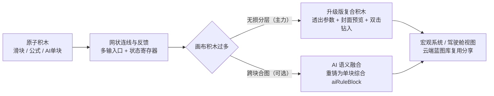

# 万象工坊「我的世界」宏观搭建与「积木融合」实施方案

> **文档背景**：整理自关于万象工坊 AI 积木能力边界、宏观搭建演进与画布积木融合的讨论，面向工程落地设计。  
> **核心目标**：在不破坏现有沙箱安全与求值稳定性的前提下，让万象工坊既能**从小零件一层层搭成宏观复杂系统**，又能在画布积木变多时**优雅收纳与融合**。

---

## 一、现状盘点与核心设计原则

### 1.1 当前已有底座
- **AI 自建积木（`aiRuleBlock`）**：基于隔离 Web Worker 沙箱（300ms 超时熔断，禁止网络/DOM/异步/`Math.random`），支持同步确定性计算与可控伪随机 `rand()`，可渲染 6 种视图（`shapes` 2D 矢量图、`grid` 32×32 热力网格、`chart` 折线、`graph` 节点图、`timeline` 甘特轴、`table` 数据表）。关键文件：`backend/app/workshop/ai_rule.py`、`frontend/src/canvas/ruleSandbox.ts`。
- **连线生长**：支持从上游输出口拖线至空白处，带上游结构摘要一键调用 AI 生成承接下游数据的积木（`frontend/src/canvas/aiRulePorts.ts`）。
- **基础复合积木（`composite`）**：画布已支持多选后点击 `📦 封装成积木`（将跨界连线折成 `portIn`/`portOut` 端口节点）、展开还原（`explode`）及存入本地积木库（`frontend/src/canvas/CanvasBoard.tsx`、`frontend/src/canvas/customBlocks.ts`）。

### 1.2 核心设计原则：双轨并行
面对“积木越搭越多”与“系统越来越宏观”的诉求，**不能只靠单一的“AI 合并代码”**（容易超出 300ms 沙箱预算、破坏确定性或无法还原），而应采用**双轨策略**：
1. **主力用「无损结构封装」承载宏观分层**：像芯片设计/《我的世界》红石模块一样，100% 保真、可逆、支持内置积木与 AI 积木混编、支持多层嵌套。
2. **辅以「AI 语义融合」实现跨块合图炼丹**：把多块分散计算或分散视图的积木，按用户意图重铸为一块紧凑的同屏联动新积木。



---

## 二、模块一：积木融合双轨机制（解决“画布积木过多”）

### 2.1 路线 A：无损封装升级（Composite 2.0）

当前 `composite` 封装后是一个纯黑盒小卡片，想调内部参数或看内部结果只能“展开炸回主画布”。升级以下 3 项能力：

#### 1) 扩展 `CompositeSub` 协议（外壳参数透出 + 封面预览）
**涉及文件**：`frontend/src/canvas/types.ts`、`frontend/src/canvas/engine.ts`

```ts
export interface ExposedParam {
  /** 内部目标节点 id */
  nodeId: string;
  /** 内部参数 key（如 'v' / 'zeta'） */
  paramKey: string;
  /** 展示在外壳上的标签 */
  label: string;
  min?: number;
  max?: number;
  step?: number;
}

export interface CompositeSub {
  nodes: CanvasNode[];
  wires: Wire[];
  ports: CompositePort[];
  /** 透出到外壳卡片直接调节的关键参数（建议默认勾选最多 4 个） */
  exposedParams?: ExposedParam[];
  /** 指定某个内部可视化节点作为外壳封面缩略视图 */
  previewNodeId?: string;
  /** 一句话模块说明 */
  summary?: string;
}
```
- **交互**：点击 `📦 封装成积木` 后，弹出轻量配置浮层（或直接在检查器勾选）：自动列出内部源节点/滑块参数，默认勾选前 3 个透出到外壳；自动选最后一个视图节点作为外壳封面。
- **求值**：在外壳修改透出参数时，直接写回 `sub.nodes` 对应节点的 `params`，触发子图重新求值，无需展开。

#### 2) 双击钻入子画布（面包屑层级导航）
**涉及文件**：`frontend/src/canvas/CanvasBoard.tsx`
- 在 `CanvasBoard` 中维护当前浏览路径栈 `viewPath: string[]`（空数组表示顶层主画布，如 `['comp_1', 'comp_2']` 表示钻入两层）。
- 双击任意 `composite` 节点即压栈进入其 `sub` 子画布，顶部展示面包屑 `主画布 / 供需模块 / 价格弹性`，点击任意层级返回。
- 原有的 `explode`（展开回本层）保留在右键菜单/检查器中作为辅助操作，避免误操作把宏观画布撑乱。

#### 3) 封装时 AI 自动命名与摘要（可选一键）
- 封装完成后，可选调用轻量接口（把内部节点标题、类型、连线关系发给模型），自动生成模块名（如“二阶阻尼能量分析组”）与一句话简介，替代默认名 `自制积木`。

---

### 2.2 路线 B：AI 语义融合（重铸为单块 `aiRuleBlock`）

当用户希望把多块分散的积木**合并成一张同屏对比图或一个统一 2D 场景**时，提供 AI 融合能力。

#### 1) 前端触发入口
**涉及文件**：`frontend/src/canvas/CanvasBoard.tsx`、`frontend/src/canvas/BlockCreatorModal.tsx`
- 在多选操作栏中，与 `📦 封装成积木` 并列新增按钮：`✨ AI 融合`（当选中 2~6 个节点时可用）。
- 点击后收集选中子图的上下文：
  - 每个节点的 `title`、`type`、`params`、`text`、`code`（若是 `aiRuleBlock`）及当前实时输出摘要。
  - 选中节点之间的内部连线，以及**与外部未选中节点相连的入边/出边**。
- 打开造物台弹窗（预填融合意图，例如：“将选中的 3 个积木融合成一块同屏展示位移、速度与能量的综合积木”），允许用户微调提示词。

#### 2) 后端融合生成接口
**涉及文件**：`backend/app/workshop/ai_rule.py` 及对应路由
- 新增 `fuse_ai_rule(nodes_summary, wires_summary, external_ports, user_prompt)`（复用 `normalize_rule_payload` 与同一套沙箱静态校验）。
- Prompt 明确要求模型：
  - 合并重复参数，保留核心可调控件（≤8 个）。
  - 在同一帧中通过 `shapes` / `series` / `grid` 联合展示多组结果。
  - 保留对外部入边数据的 `upstream` 消费逻辑，并把外部出边所需的标量/序列写回 `data` 与 `frames`。

#### 3) 安全兜底与无损回退
- 生成结果必须先通过前端 `verifyAiRulePayload` 沙箱试跑验证（含所有 `presets`），**不通过则绝不替换原节点**。
- 替换时写入单条 Undo 历史记录，支持 `Ctrl+Z` 一键恢复原拓扑；同时提供“保留原积木，在旁边生成融合块”的勾选选项。

---

## 三、模块二：「我的世界」式宏观搭建引擎（解决“越搭越宏观”）

要让画布从“单链条小实验”演进为“可涌现的宏观系统”，需要补齐以下 4 项底层机制：

### 3.1 AI 积木自定义多输入/多输出端口（网状汇聚）
**现状瓶颈**：目前 `aiRuleBlock` 仅支持主输入 `in` 与可选辅助输入 `aux`（`frontend/src/canvas/nodes.tsx`），难以承接 3~6 个上游子系统。

**改造方案**：
- 在 `AiRuleBlockPayload` 中增加可选端口声明：
  ```ts
  inputs?: Array<{ id: string; label: string; kind?: ValueKind }>;
  outputs?: Array<{ id: string; label: string; kind: 'scalar' | 'series' | 'customFrames' }>;
  ```
- 沙箱输入 `input` 除兼容数组 `upstream` 外，新增按端口名索引的对象 `inputs: Record<string, unknown>`（如 `inputs.population`、`inputs.energy`）。
- 沙箱输出支持在 `data.outputs` 中按端口 id 返回多个标量/序列，供下游多个子系统分流消费。

### 3.2 跨积木时间步反馈环（Feedback Loop）
**现状瓶颈**：当前求值器 `frontend/src/canvas/engine.ts` 通过 `visiting` 截断一切闭环，无法实现“模块 A 第 t 步输出 → 模块 B → 反馈给模块 A 第 t+1 步”的宏观动力学（如生态捕食、宏观经济、PID 闭环控制）。

**改造方案**：
- 新增内置基础积木 **`delayRegister`（状态延迟寄存器 / 记忆积木）**，配一个初始值 `init` 参数：
  - 当前渲染周期输出上一拍缓存值 `prev`（存在 `live` 通道中，不触发循环依赖）。
  - 接收当前拍的输入 `next`，在全局时钟步进器（`Global Tick`）前进一拍时原子提交 `prev = next`。
- 在画布工具栏增加全局仿真控制条：`播放 / 暂停 / 单步 +1 / 重置到 t=0`。
- **优势**：无需改写现有的 DAG 求值算法，只在 `delayRegister` 处自然断开同步依赖环，既安全又符合电路与控制论直觉。

### 3.3 宏观“驾驶舱 / 总控台”模式
**现状瓶颈**：画布超过 20~30 个积木后，满屏连线和卡片会分散注意力。

**改造方案**：
- 允许用户给任意滑块/参数或可视化卡片打上 `📌 钉选到驾驶舱` 标记。
- 画布顶部切换 **`编辑态（积木连线）` / `驾驶舱态（宏观总览）`**：
  - 驾驶舱态隐藏所有连线和中间计算节点，自动将钉选的全局参数排布在左侧控制栏，将钉选的 2~4 个宏观视图（2D 场景、热力图、趋势曲线）放大平铺在主视区，实时联动演示。

### 3.4 蓝图库持久化与分享（突破规模上限）
**现状瓶颈**：`frontend/src/canvas/customBlocks.ts` 当前存 `localStorage`，上限 24 个积木、单块 400KB。

**改造方案**：
- 后端 `backend/app/workshop/` 增加个人蓝图存储接口（支持 `composite` 与 `aiRule` 两种类型），解除 24 个数量上限。
- 支持一键导出/导入 `.json` 蓝图包（含版本号与依赖校验），便于师生/玩家之间共享成熟子模块（如“经典 PID 控制器”、“M/M/1 排队引擎”），真正实现站在别人积木上继续往上盖楼。

---

## 四、分阶段落地路线图

| 阶段 | 核心交付 | 价值与定位 | 预估工作量 |
| :--- | :--- | :--- | :--- |
| **P0（立即可做，收益最高）** | 1. 无损封装升级：外壳透出参数 + 封面预览 + 双击钻入子画布<br/>2. AI 积木自定义多输入端口（支持 3~6 路汇聚） | 立刻解决“积木多了画布乱”和“多模块难汇聚”两大痛点 | 中 |
| **P1（核心亮点）** | 1. 多选栏 `✨ AI 融合`（后端融合接口 + 前端沙箱试跑兜底）<br/>2. `delayRegister` 状态延迟积木 + 全局时钟步进条 | 打通“跨块合图炼丹”与“跨积木闭环反馈涌现” | 中偏大 |
| **P2（宏观与生态）** | 1. 宏观驾驶舱 / 总控台视图<br/>2. 后端蓝图库持久化 + 蓝图导入导出分享 | 支撑大型教学沙盘展示与模块生态复用 | 中 |

---

## 五、关键风险与验收标准

1. **沙箱与性能防线**
   - AI 融合生成的单块代码仍严格受 `RULE_TIMEOUT_MS = 300ms`、静态禁用词与输出体积上限约束；若融合后超时，提示用户改用“无损封装”。
   - 复合积木嵌套深度建议软限制在 6 层以内，防止极端深层嵌套拖慢渲染。
2. **数据兼容与撤销安全**
   - `CompositeSub` 新增字段（`exposedParams`、`previewNodeId`、`summary`）全部可选，100% 向后兼容已有画布与本地自制积木库。
   - 封装、钻入修改、AI 融合均纳入现有 Undo/Redo 历史栈。
3. **端到端验收场景（示例）**
   - **场景 1（宏观搭建）**：搭建“供给模块 + 需求模块 + 政策滑块 → 市场出清（多输入）→ 经 `delayRegister` 反馈回下一拍价格”，将供需两块封装为复合积木并在外壳透出弹性滑块，点击全局播放观察价格收敛/蛛网震荡。
   - **场景 2（积木融合）**：框选“位移曲线 + 速度曲线 + 能量曲线”3 块积木，点击 `✨ AI 融合`，生成单块同屏三曲线综合积木并通过沙箱试跑，且可 `Ctrl+Z` 无损还原。
