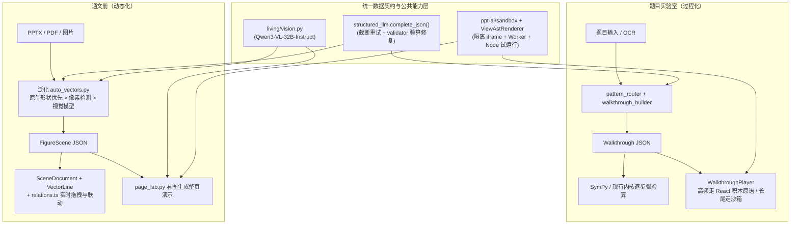

# 万象改进实施方案：题目实验室「过程化」与通文册「动态化」（v3 综合定稿版）

> 版本：v3 · 2026-11-23  
> 基础：融合前序方案（v1/v2）与本地代码库逐文件实证核查结果，已对齐当前本地工作区现状（含 `.env` 模型配置与全部核心模块接口）。

---

## 0. 核心目标与总体判断

- **目标一（题目实验室「过程化」）**：不做“答案搬运工”。把产出从「答案 + 静态/专用画布」升级为「**可操作的过程脚本（Walkthrough）**」——每一步包含讲解、随参数联动的公式、可交互画面、控件与可选的预测检查点，最后一步才是经 SymPy 验算的答案。体验标杆为仓库现存的 [SurfaceIntegralLab.tsx](file:///e:/代码/ICT/frontend/src/components/showcase/SurfaceIntegralLab.tsx)。
- **目标二（通文册「动态化」）**：上传 PPTX/PDF/图片后，自动将图示还原为**带属性手柄与数学关系的矢量场景图（FigureScene）**，支持拖拽端点、调节线型/颜色/线长并实时传播联动（如拖动基向量 $b_2$ 时坐标文字与虚线平行四边形实时更新）；在此之上支持自然语言添加关系，并由大模型结合场景图生成整页可演示的交互系统。
- **核心架构判断**：两条线缺的不是从零造引擎，而是**把仓库里已有的成熟零件接成一条线**，并在**数据层统一、运行时分离**，避免再造第三套孤岛。



---

## 1. 仓库现成零件实证清单（已核实）

以下模块均已在本地代码库实读确认，可直接复用或演进，**无需重复造轮子**：

| 零件 | 仓库路径 | 已核实的当前状态 | 在本方案中的角色 |
|---|---|---|---|
| **多模态与文本模型配置** | [backend/.env](file:///e:/代码/ICT/backend/.env)、[model_profiles.py](file:///e:/代码/ICT/backend/app/model_profiles.py) | 已独立配置文本主模型 `maas / deepseek-v4.1-flash-1017` 与视觉模型 `siliconflow / Qwen/Qwen3-VL-32B-Instruct`，互不干扰 | 视觉能力开箱即用，无需新增模型接入周期 |
| **结构化 LLM 与修复闭环** | [structured_llm.py](file:///e:/代码/ICT/backend/app/structured_llm.py) | `complete_json()` 基于 `instructor` 封装，自带 `finish_reason=='length'` 截断重试、自定义 HTTP 适配、以及 `validator` 校验失败自动回传模型重试 | 实验室 SymPy 验算修复、活页几何校验修复均直接挂在 `validator` 上 |
| **沙箱与按页 AI 实验** | [page_lab.py](file:///e:/代码/ICT/backend/app/ppt_ai/page_lab.py)、[protocol.ts](file:///e:/代码/ICT/frontend/src/ppt-ai/sandbox/protocol.ts)、[ViewAstRenderer.tsx](file:///e:/代码/ICT/frontend/src/ppt-ai/runtime/ViewAstRenderer.tsx) | 已跑通“模型生成 `params + timeline(t/step) + render(input) -> ViewAST` → Node 子进程试运行修复 → iframe/Worker 渲染”；支持 13 种节点（含 `mermaid`/`chart`/`scene3d`），但 `interactions: []` 尚不支持画布内拖拽，且 `page_lab.py` 目前只读文字不看图 | 活页 L3 整页演示 + 实验室长尾动态视图的共用沙箱底座 |
| **声明式算子与安全解析** | [model_contract.py](file:///e:/代码/ICT/backend/app/labs/model_contract.py)、[ai_solve.py](file:///e:/代码/ICT/backend/app/labs/ai_solve.py) | `model_contract.py` 含 10 种计算算子（最多 6 步）；`ai_solve.py` 含 SymPy 安全解析 `_expr` 与 `math_verify_adapter` | Walkthrough 独立定义，只复用算子校验与 SymPy 安全解析 |
| **原生与视觉矢量化** | [auto_vectors.py](file:///e:/代码/ICT/backend/app/documents/auto_vectors.py)、[vision.py](file:///e:/代码/ICT/backend/app/living/vision.py)、[diagram.py](file:///e:/代码/ICT/backend/app/living/diagram.py) | `auto_vectors.py`（532 行）已实现 PPTX 原生线条提取（含主题色）、像素箭头检测、视觉模型兜底及 `_basis_overlay`（带动态像素擦除 `cleaned`）；`diagram.py` 已有 OCR 证据匹配与降级 | 活页 L1 的直接起点：泛化，不重写 |
| **矢量线手柄与换基联动** | [VectorLine.tsx](file:///e:/代码/ICT/frontend/src/components/editor/VectorLine.tsx)、[BasisComposition.tsx](file:///e:/代码/ICT/frontend/src/components/editor/BasisComposition.tsx)、[basisComposition.ts](file:///e:/代码/ICT/frontend/src/document/basisComposition.ts) | `VectorLine` 已支持端点拖拽（实时 `onPreview`）、线宽、虚/点/实线、箭头与流动动画；`BasisComposition` 已实现斜基坐标实时重算与虚线平行四边形，但参数与文案硬编码 | 保留 `VectorLine` 作编辑手柄；将 `BasisComposition` 迁移为通用关系引擎的内置宏 |
| **数据流求值参考** | [engine.ts](file:///e:/代码/ICT/frontend/src/canvas/engine.ts) | 面向定象坊学科积木的 DAG 求值器（`cache + visiting` 防环） | **不复用代码与模型**，只借鉴缓存与防环思路新建 `relations.ts` |
| **标杆样板** | [SurfaceIntegralLab.tsx](file:///e:/代码/ICT/frontend/src/components/showcase/SurfaceIntegralLab.tsx)、[SurfaceCanvas.tsx](file:///e:/代码/ICT/frontend/src/components/showcase/SurfaceCanvas.tsx) | 手写一题一份，球面几何写死，但交互联动与视觉观感已达标 | 抽离并泛化为实验室标准原语库 |

> [!IMPORTANT]
> **现状债务确认**：`backend/app/labs/` 已膨胀至 **76 个 Python 文件**（单文件最高 210KB），[LabWorkbenchPage.tsx](file:///e:/代码/ICT/frontend/src/pages/LabWorkbenchPage.tsx) 达 1571 行、[LabCanvas.tsx](file:///e:/代码/ICT/frontend/src/components/labs/LabCanvas.tsx) 达 1862 行；活页旧体系 [user_config.py](file:///e:/代码/ICT/backend/app/ispec/user_config.py) 的启发式模板是历史诊断中“83% 推断值”的来源。本方案包含明确的**冻结与减负动作**。

---

## 2. 六条核心设计原则

1. **过程第一**：答案只是过程脚本的最后一步，每步必须做到“画面 + 参数化公式 + 控件”联动。
2. **按「解题思想」组织，冻结新内核**：用约 10 个可复用的解题思想替代 76 个题型关键词文件；已有内核降级为验算器，不再新增关键词规则与专用内核。
3. **LLM 生成 + 内核验算，明确机验边界**：只用 SymPy/现有内核验算**可机验字段**（代数化简、边界值、积分结果、参数代入数值）；解题思想选择、文案与构图在 Schema 中与机验字段分离，并在 UI 清晰标注来源（内核已验证 / 模型推断 / 题面给出）。
4. **数据层统一，运行时分离**：统一 `Walkthrough` 与 `FigureScene` 两份 JSON 契约；前端保留两套各司其职的运行时——`SceneDocument + VectorLine`（60fps 直接拖拽、撤销、存盘）与 `ppt-ai/sandbox + ViewAST`（隔离执行模型生成程序），通过适配器互通，不再造第三套场景模型。
5. **原生优先、像素次之、视觉兜底、失败可降级**：能读 PPTX 原生几何就不猜图；任何一层失败都退回原题/原图加现有结果页，不报错、不白屏。
6. **垂直切片验收驱动**：每个解题思想、每类图示必须有明确验收样例通过才允许合并。

---

## 3. 题目实验室实施方案（「过程化」）

### 3.1 数据契约：`Walkthrough`（独立于 `model_contract.py`）
- 新增后端模块 `backend/app/labs/walkthrough/` 与前端类型 `frontend/src/labs/walkthrough.ts`。
- 作为 `LabProblem.walkthrough` 的**可选字段**挂接，完全兼容历史文档（原 [LabSolutionStep](file:///e:/代码/ICT/frontend/src/labs/types.ts#L329-L334) 仅含 4 个纯展示字段，不破坏其既有引用）。
- 区分 `view.kind`：
  - **`primitive`（首选，覆盖高频思想）**：指向前端高质量参数化原语组件，保证美观度与直接拖拽手感；
  - **`program`（兜底，仅长尾/非标图示）**：走 `ppt-ai/sandbox` 生成 `ViewAST`（初期仅支持外部滑块与时间轴驱动，M6 再补画布内手柄）。

```yaml
version: 1
pattern: slice_accumulate
strategy:
  why: "球面关于 z 轴旋转对称，按 z 切成环带可将曲面积分化为一元积分"
  alternatives: ["球坐标参数化 (θ, φ) 做二重积分"]
params:
  - { id: R, label: "球半径", min: 0.5, max: 2, default: 1, source: problem }
  - { id: h, label: "截面高度", min: -1, max: 1, default: 0.2, source: teaching }
  - { id: n, label: "环带数", min: 4, max: 48, default: 12, source: teaching }
steps:
  - id: s1
    title: "把曲面切成环带"
    explain: "说明对称性与切片方向的选择依据"
    formulas:
      - text: "dS = R \\, d\\theta \\, |dz|"
        verify: { op: integrate, expr: "..." }   # 可机验字段，后端 SymPy 重算
    view: { kind: primitive, name: slice_bands, bind: { surface: sphere, R: R, h: h, n: n } }
    controls: [h, n]
    checkpoint:
      type: predict
      prompt: "环带面积 2πR·Δz 随高度 z 怎么变化？"
      options: ["随 |z| 增大而变小", "与 z 无关，恒定不变", "在赤道处最大"]
      answer: 1
  - id: sN
    title: "累加得到最终答案"
    final: true
verification:
  engine: sympy
  status: verified
  checks: [...]
```

### 3.2 第一批解题思想库

| 解题思想 | 覆盖题型 | 复用的现有验算内核 | 核心画面原语 |
|---|---|---|---|
| `slice_accumulate`（首期切片） | 曲面积分、二重/三重积分、旋转体体积、弧长、面积 | `space.py`、`space_integral_details.py`、`double_integral.py`、`integral_applications.py` | `slice_bands`（参数化旋转曲面族）、`cumulative_chart`、`region_shade` |
| `substitution` | 极/柱/球坐标变换、雅可比 | `double_affine.py` | `grid_warp` |
| `limit_approach` | 极限、导数定义、泰勒展开 | `limit_extra.py`、`calculus_analysis.py` | `zoom_curve` |
| `optimize_iterate` | 梯度下降、拉格朗日乘数 | `extrema.py`、`constrained.py` | `trajectory` |
| `state_machine` | BFS、堆、调度、页面置换、银行家 | `heap.py`、`opsys.py` 等 | 现有画布按步封装 |

### 3.3 生成与验算流水线
1. **读题**：沿用现有 `extract.py`（OCR）与 `split_problems`。
2. **`pattern_router`**：LLM 先行路由解题思想并抽取题面参数；原 `classify_subject` 退为兜底与一致性参考。
3. **`walkthrough_builder` + `walkthrough_verifier`**：直接调用 [structured_llm.py](file:///e:/代码/ICT/backend/app/structured_llm.py) 的 `complete_json()`，将 `walkthrough_verifier` 注入 `validator` 参数：
   - 逐步用 SymPy（复用 `ai_solve.py` 的 `_expr`）和现有内核重算 `verify` 字段；
   - 数值/表达式对不上时自动将差异回传模型重试（最多 1–2 次）；仍不一致则标 `unverified` 并在 UI 标红提示。
4. **接口与灰度策略（绞杀者模式）**：新增 `POST /labs/{id}/walkthrough`，结果写入 `LabProblem.walkthrough` 随 `GET /labs/{id}` 返回；首期**仅对高数曲面积分灰度接管**，其他科目维持原状，无 LLM 配置时平滑退回现有结果页。

### 3.4 前端 `WalkthroughPlayer`、原语抽取与减负
- **原语库抽取（`frontend/src/components/labs/primitives/`）**：从 `showcase/` 复制抽离 `CumulativeChart`、`SurfaceCanvas`、`controls.tsx`（`LabSlider`/`Segmented`/`Stat`）、`Formula.tsx`（保留原 showcase 页面不动，避免破坏演示）。
  - **关键泛化要求**：现有 [SurfaceCanvas.tsx](file:///e:/代码/ICT/frontend/src/components/showcase/SurfaceCanvas.tsx) 的网格与半径函数写死了完整球面，抽离时必须泛化为**参数化旋转曲面族**（至少支持 `sphere / hemisphere / cylinder / cone / paraboloid`）及自定义被积函数，确保支撑 5 道变体验收。
- **前端减负**：
  - [LabWorkbenchPage.tsx](file:///e:/代码/ICT/frontend/src/pages/LabWorkbenchPage.tsx) 拆分子模块，新代码一律放入独立目录 `components/labs/walkthrough/`；
  - 保留旧画布作为「结果」标签页，新增「过程」标签页并默认进入；
  - 将 [ReviewDialog.tsx](file:///e:/代码/ICT/frontend/src/components/labs/ReviewDialog.tsx) 的**拦路确认弹窗改为行内可忽略提示**；
  - 将 `explore | guided | solution` 三种学习模式合并为一种（默认逐步引导，支持自由跳步）。

### 3.5 垂直切片验收标准（高数曲面积分）
1. 上传与 showcase 同款的球面题图，30 秒内生成 `slice_accumulate` 过程脚本，参数源自题面。
2. 至少包含 5 步：为什么切片 → 微元 $dS$ → 单环带 $\Delta I$ → 累加成积分 → 答案与验算核对。
3. 拖动截面高度 $h$ 时，当前环带 $\Delta I$ 与累积曲线实时联动；增大环带数 $n$ 时离散累加逼近精确曲线。
4. 每步可机验数值带验证标记；人为篡改任意一步中间结果，verifier 必须拦截/标红。
5. **5 道变体**（半球面、柱面侧面、换被积函数、第二类曲面积分等）至少 4 道通过。
6. 未配置 LLM 时退回现有结果页，不报错、不白屏。

---

## 4. 通文册实施方案（「动态化」）

### 4.1 场景图契约：`FigureScene`
对齐现有 [diagram.py](file:///e:/代码/ICT/backend/app/living/diagram.py) 的版本/置信度/证据风格，描述可交互的几何与概念图：

```yaml
version: 1
frame: { origin_px: [168, 270], unit_px: 100 }
objects:
  - { id: b1, type: vector, from: [0, 0], to: [1, 0], style: { stroke: "#167abc", width: 3 }, label: "b₁" }
  - { id: b2, type: vector, from: [0, 0], to: [1, 1], style: { stroke: "#916428", width: 3 }, label: "b₂" }
  - { id: v,  type: vector, from: [0, 0], to: [2, 1], style: { stroke: "#182033", width: 3 } }
  - { id: guide, type: polyline, points: [b1.to, v.to, b2.to], style: { line_style: dashed } }
  - { id: t1, type: text, at: [0.5, -0.4], text: "斜基：坐标 (1, 1)", bind: coord_B }
relations:
  - "v = a*b1 + b*b2"
  - "coord_B = solve(v, [b1, b2])"
params: [{ id: b2, kind: point, default: [1, 1], editable: true }]
provenance: { b1: vision, b2: vision, v: vision }   # native | pixel | vision | user_confirmed
confidence: 0.82
warnings: []
```

- 提供两个轻量适配器：`FigureScene → SceneNode`（供直接编辑与拖拽）和 `FigureScene → ViewAST`（供 `page_lab.py` 沙箱消费），杜绝第三套场景模型。

### 4.2 第一层（图 → 场景图）：泛化 `auto_vectors.py`
- **不新建并列模块**，直接在 [auto_vectors.py](file:///e:/代码/ICT/backend/app/documents/auto_vectors.py) 上扩展：
  1. **原生几何优先**：保留 `native_vector` 与 `_stroke_color`，并在 [importer.py](file:///e:/代码/ICT/backend/app/documents/importer.py) / 解析层递归拆解 `GROUP` 组合形状内部的线条、连接线与文字（目前顶层组被整体当静态图片）；
  2. **像素检测次之**：保留现有直线箭头像素检测（几何精确、零幻觉）；
  3. **视觉模型兜底**：复用 [vision.py](file:///e:/代码/ICT/backend/app/living/vision.py)（`Qwen/Qwen3-VL-32B-Instruct`），将提示词从“仅认彩色实心直线箭头”扩充为 `FigureScene`（覆盖坐标轴、虚线、折线、文字标签与关系），输入改为**元素裁图 + OCR 文字框 + 原生几何提示**；先估原点与单位长度，再做整数/半整数网格吸附；
  4. **按需触发与可诊断**：去掉“最多 4 次调用 / 8 张图”的硬限制，改为用户在画布点击「矢量化此图」触发（`POST /materials/{id}/pages/{n}/figures/{element_id}/vectorize`），结果按内容哈希缓存，且 HTTP 状态、原始响应、逐条拒收原因必须落盘；
  5. **校验闭环**：几何一致性校验（同坐标系共点检查、标签邻近检查）+ OCR 证据匹配作为 `structured_llm.complete_json()` 的 `validator`。

### 4.3 第二层（手柄编辑 + 关系引擎）：`VectorLine` + 新建 `relations.ts`
- **保留现有手柄**：继续使用 [VectorLine.tsx](file:///e:/代码/ICT/frontend/src/components/editor/VectorLine.tsx) 的端点拖拽、线宽、线型（实/虚/点）、颜色、箭头、流动动画以及 `DynamicStyleControls` / `NodeProperties`。
- **双底图模式（修正重影问题）**：保留 `auto_vectors.py` 已有的动态像素擦除（`cleaned`）能力，在编辑器中区分两种视图状态：
  - **校对态**：显示**未擦除的原图半透明叠底**，方便用户拖手柄核对矢量位置；
  - **演示/编辑态**：显示**擦除动态墨迹后的 `cleaned` 干净底图**，拖动 `b₂` 时无重影。
- **新建关系引擎 `frontend/src/document/relations.ts`**：
  - 不复用 `canvas/engine.ts`（仅借鉴其 `cache + visiting` 防环拓扑求值思想）；
  - 关系 DSL 复用 `labs/expr.py` 与 `ispec/expr.ts` 的白名单解析器，**严禁 `eval`**；
  - 将硬编码的 [BasisComposition.tsx](file:///e:/代码/ICT/frontend/src/components/editor/BasisComposition.tsx) 迁移为内置关系宏 `basis_decompose`。
- **自然语言加关系**：选中对象后输入指令（如“让 $b_2$ 可拖动并实时显示 $v$ 的坐标”），模型输出关系 JSON → 白名单校验 → **预览确认后才应用**，纳入 `document/controller.ts` 撤销栈。
- **细粒度 `viewer_parameters` 与离线导出同步**：
  - 扩展 [frontend/src/document/types.ts](file:///e:/代码/ICT/frontend/src/document/types.ts#L55) 中 `SceneNode.viewer_parameters`（当前仅支持 `'geometry' | 'style' | 'flow'` 粗粒度枚举），支持标注具体可调属性与关系；
  - M4 交付时同步重新构建 [backend/app/static/offline/runtime.js](file:///e:/代码/ICT/backend/app/static/offline/runtime.js)，确保离线 HTML 导出后拖动与关系联动完全一致。

### 4.4 第三层（大模型生成整页演示）与旧功能收拢
- **让 [page_lab.py](file:///e:/代码/ICT/backend/app/ppt_ai/page_lab.py) 看懂图**：输入由“仅页面文字”扩充为“页面标题与要点 + `FigureScene`”，输出契约（至多 6 个滑块 + 时间轴 + `render(input)`）与 Node 试运行校验保持不变。
- **补齐 `ViewAST` 协议（M6）**：在 [protocol.ts](file:///e:/代码/ICT/frontend/src/ppt-ai/sandbox/protocol.ts)、后端校验 Schema、[ViewAstRenderer.tsx](file:///e:/代码/ICT/frontend/src/ppt-ai/runtime/ViewAstRenderer.tsx) 三处同步新增 `arrow`、`polygon`、`formula`（KaTeX）节点，并实现 `drag-handle` 画布内拖拽回写协议。
- **停用旧噪声**：关闭 [user_config.py](file:///e:/代码/ICT/backend/app/ispec/user_config.py) 中图片启发式模板（`steps_*`、伸缩）的默认自动生成（仅保留为手工可选模板）；修正识别数量统计口径不一致的问题；将残留 `ISEPC_LLM_*` 配置统一收口至 `LLM_*`。

### 4.5 活页验收标准（以换基向量图为例）
1. 上传换基图，25 秒内生成两个坐标系的坐标轴、基向量（$e_1/e_2$、$b_1/b_2$）、目标向量、虚线辅助线及坐标文字；位置偏差 $< 3\%$ 图宽的对象占比 $\ge 90\%$。
2. 修改 $b_2$ 的颜色、线型、线长即时生效；支持“校对态（原图半透明叠底）”与“演示态（擦除干净底图）”切换。
3. 拖动 $b_2$：右图坐标文字从 `(1, 1)` 实时更新，虚线平行四边形跟随变化，左图 `(2, 1)` 保持不变。
4. 自然语言新增关系成功；非法表达式被白名单拦截并给出明确原因。
5. 分享页与离线 HTML 导出后，标记为 `viewer_parameters` 的对象可拖动且关系联动正常，其余只读。
6. 未配置视觉模型时给出明确提示，并保留手工添加矢量对象路径。
7. 含原生矢量形状的 PPTX 页面走原生几何提取，参数来源全为 `native`。

---

## 5. 里程碑与节奏安排

> 推荐节奏：**1 人开发按 `M0 → M1 → M2 → M3` 串行（实验室先行）**；**2 人开发可并行推进 `M1–M2`（实验室）与 `M3` 一周探针（活页）**。

| 阶段 | 核心交付物 | 预计周期 | 验收口径 |
|---|---|---|---|
| **M0：两项实测与基线** | ① 用换基图实测本地 `Qwen3-VL-32B-Instruct` 矢量化精度与耗时，定 Prompt 与误差基线；② 实机走一遍 `LabWorkbenchPage` 曲面积分链路留痛点截图。（`.env` 配置、`LabSolutionStep` 与 `structured_llm.py` 接口已核实，无需重复查验） | **1–2 天** | 精度结论报告 + 实机基线截图 |
| **M1：实验室原语 + WalkthroughPlayer** | 抽离并泛化 `SurfaceCanvas`（5 种旋转曲面族）+ `CumulativeChart` + `Formula`；手写 JSON 驱动曲面积分 Walkthrough；冻结新内核、拆分 `LabWorkbenchPage`、取消 `ReviewDialog` 拦路弹窗、合并三模式 | **2 周** | 体验与交互手感达到 showcase 水平 |
| **M2：实验室 AI 生成与验算闭环** | `pattern_router` + `walkthrough_builder` + SymPy `walkthrough_verifier`（挂接 `complete_json()`）；灰度接管高数曲面积分 | **2 周** | §3.5 全部 6 条验收通过（含 5 道变体 $\ge 4$ 道通过） |
| **M3：活页 L1 泛化矢量化** | 泛化 `auto_vectors.py` → `FigureScene`；递归拆解 PPTX `GROUP` 形状；按点击触发 + 缓存 + 诊断落盘；校对态/演示态双底图；停用 `ispec` 启发式默认补位 | **2 周**（可先做 1 周探针） | §4.5 第 1、2、6、7 条通过 |
| **M4：活页 L2 关系引擎与离线同步** | 新建 `relations.ts` + 迁移 `basis_decompose` 宏；扩展细粒度 `viewer_parameters` 与「动态化」面板；重编离线 `runtime.js` 并回归离线导出 | **2 周** | §4.5 第 3、5 条通过（在线 + 离线均联动） |
| **M5：广度扩展** | 实验室扩展二重/三重积分、旋转体等思想；活页上线“自然语言添加关系”与预览确认流 | **2–3 周** | 每个思想与关系类型均有独立验收样例 |
| **M6：L3 整页演示与沙箱底座升级** | `page_lab.py` 接入 `FigureScene` 看图生成演示；`ViewAST` 新增 `arrow/polygon/formula` 与 `drag-handle`；打通实验室长尾 `program` 视图 | **2–3 周** | §4.5 第 4 条通过 + 实验室长尾程序视图可用 |

---

## 6. 关键风险与对策

- **LLM 生成与验算不稳定**：`structured_llm.complete_json()` 自动重试 + 内容哈希缓存 + 原始响应与拒收原因全量落盘 + 失败平滑降级到现有结果页。
- **位图矢量化坐标误差**：原生形状 > 像素检测 > 视觉模型；原点/网格吸附 + 校对态原图叠底 + 手柄微调校正。
- **老功能回归**：新字段全部可选、只增不改；旧画布保留为「结果」标签页；每次合并保证现有 `pytest` 与前端 `node --test` 全绿。
- **代码继续膨胀**：新功能严格放入独立目录（`backend/app/labs/walkthrough/`、`frontend/src/components/labs/walkthrough/`、`frontend/src/components/labs/primitives/`），禁止继续向 `LabWorkbenchPage.tsx`、`LabCanvas.tsx`、`recognize.py`、`solvers.py` 追加新逻辑。
- **离线导出割裂**：凡涉及 `SceneNode` 新属性或 `relations.ts` 的改动，必须同步触发离线 `runtime.js` 重编与回归验证。
- **安全边界**：沙箱保持 `opaque-origin iframe + Worker + 白名单 AST`；关系 DSL 严禁 `eval`，仅走受限表达式白名单解析。
