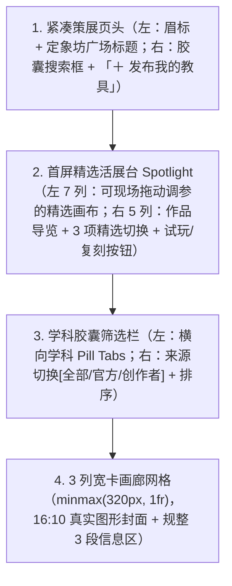

# 定象坊广场视觉与排版重塑实施方案

> **目标**：将当前 `/plaza` 广场从“绿灰底大字贴纸 + 表单感平铺网格”重塑为与全站 **纸墨画室（`atelier-paper`）** 审美一脉相承的 **定象坊交互教具策展画廊**；阶段性隐藏通文册露出，为每张卡片提供真实可视化画面，并把点开后的试玩页升级为单行顶栏沉浸式舞台。

---

## 一、范围收敛：只展示定象坊，保留底层兼容

1. **后端接口不破坏兼容**：保留 `deck` 类型的数据表与接口能力，方便未来重新开放；仅扩展 `GET /api/v1/plaza` 的来源筛选与 `GET /api/v1/creators/{user_id}`、`GET /api/v1/plaza/bookmarks` 的可选 `kind` 过滤参数（默认前端统一传 `kind=workshop`）。
2. **前端入口全面聚焦定象坊**：
   - `/plaza` 顶部筛选移除「通文册课件」与 `通用 PPT 模板` 学科；
   - 「发布我的教具」弹窗（`PublishPicker`）只拉取并展示用户的定象坊作品（`worksApi.list()`），不再请求 `listMaterials`；
   - `/u/:userId` 创作者展厅与 `/space` 的广场收藏/管理区块默认只展示定象坊作品。

---

## 二、视觉系统与信息架构（对齐全站纸墨画室）

### 1. 配色与材质规范
- **页面底色**：外层包裹全站统一的 `studio-scope atelier-paper`（暖宣纸底 + 细腻肌理），彻底替换现有生硬的 `#fbf8ef → #eaf0ed` 灰绿渐变与 `#275745` 深绿控件。
- **主色与边框**：卡片纸面 `#fffdf8`，细分割线 `var(--hairline)`，墨黑标题 `var(--ink-900)`，主操作按钮采用墨黑/朱砂强调色（与定象坊、个人主页保持一致）。
- **学科专属色标（用于胶囊标签与封面图主色调）**：
  - 数学（`math`）：黛青 `#2b4c7e`
  - 物理（`physics`）：朱砂 `#b5492e`
  - 计算机 / 408（`cs`）：青瓷 `#1e6f68`
  - 人工智能（`ai`）：靛紫 `#55418c`
  - 经管商科（`business`）：赭石 `#9a6324`
  - 通用（`general`）：墨灰 `#47525e`

### 2. `/plaza` 页面 4 层结构

- **智能折叠规则**：当用户输入搜索关键词、选中特定学科或切换到「创作者作品」时，自动收起首屏 Spotlight 展台，直接把筛选结果顶到首屏。
- **首屏 Spotlight 精选活展台**：
  - 从官方精选列表中挑选 3 件最具交互视觉冲击力的代表作作为切换项（`理想与阻力抛体`、`Fourier 频谱与 Gibbs 现象`、`优化器 · 四种地形赛跑`）；
  - 左侧直接渲染轻量只读交互画布（复用 `CanvasBoard` 交互模式，加载对应 `worksApi.getShare(shareId)`），用户刚打开广场就能直接拖动参数滑块体验，右下角附「全屏试玩 ↗」角标；
  - 右侧展示学科徽章、作品标题、教学简介、节点/连线数、作者名片，以及「进入全屏试玩」「⚡ 复刻到定象坊」双按钮。

---

## 三、核心提质点：双层「真实图形封面」引擎

彻底废除当前 `PlazaCards.tsx` 中“灰绿底 + 一行大号文字”的做法，新建 `frontend/src/components/plaza/PlazaCoverArt.tsx`，按优先级渲染两类高质量 `16:10` 视觉封面：

### 层 1：官方精选 8 件定制纸墨矢量插画（按 `preview_template` 匹配）
在细腻点阵坐标纸底纹上，绘制对应学科的手绘感矢量示意图（风格统一复用定象坊的线框与高亮色），右上角点缀极小的等宽公式标签：
1. `projectile-drag`（物理）：抛物线双轨对比（理想虚线 vs 阻力实线）+ 速度矢量 + 机械能双柱仪表；
2. `charged-particle`（物理）：平行板电场 + 垂直磁场圆弧偏转轨道 + 半径标注 `r`；
3. `rc-circuit`（物理）：RC 回路简图 + 电压/电流指数充放电曲线；
4. `fourier-gibbs`（数学）：方波目标框 + 多阶正弦叠加曲线 + Gibbs 过冲高亮 + 频谱小柱状图；
5. `la05-eigen-dynamics`（数学）：变换前后倾斜坐标网格 + 双特征向量箭头 + 轨线相图；
6. `dlOptimizer`（人工智能）：等高线损失地形 + SGD / Momentum / Adam 下降轨迹对比；
7. `graphAlgo`（计算机 / 408）：带权有向图节点网络 + 最短路径高亮连线 + 访问队列微标；
8. `biz-breakeven`（经管商科）：收入线 / 总成本线交叉点 + 盈亏平衡阴影区域标注。

### 层 2：用户自创画布的「真实节点拓扑缩略图（`<MiniTopologyCover />`）」
解决“普通用户自己新建并发布的画布没有预设插画”的问题：
1. **后端提取轻量拓扑**（新增公共函数 `extract_canvas_topology(document)`）：
   - 读取 `document.nodes` 与 `document.wires`，将节点坐标归一化到 `[8..92] × [14..86]` 视窗区间；
   - 最多截取前 18 个节点与 24 条连线，每节点仅存 `{ x, y, kind, label }`（`label` 最多 10 字，`kind` 归类为 `control` / `stage` / `plot` / `note`），总大小控制在 `< 1KB`；
   - 在 `publish_work` / `add_listing`（以及 `seed_plaza`）时自动写入 `cover_meta_json["topology"]`，并在 `routes_plaza.py` 的 `dto()` 封面白名单中放行 `"topology"` 字段；
   - 对历史已发布但尚未写入 `topology` 的用户作品，在 `dto()` 读取时可按需兜底或前端回退为精致的点阵几何骨架图。
2. **前端渲染真实缩略图**：
   - 在淡点阵纸背景上，按真实坐标绘制圆角微模块卡片（带类型色顶条与微文字标题）+ 平滑三次贝塞尔连线 + 端口小圆点；
   - 卡片右上角仅放一枚精简半透明胶囊（如 `6 节点 · 5 连线`），左下角放学科色标胶囊；
   - **悬停动效**：卡片轻浮（`translateY(-3px)`）+ 柔投影，封面连线微亮，浮现玻璃质感 `▶ 试玩交互` 胶囊。

---

## 四、重构试玩页（`WorkSharePage.tsx`）：三栏合一的沉浸式画布

当前 `WorkSharePage.tsx` 顶部同时叠了 `SharePlazaBar`、`playerBar`、`playerHint` 三条横栏，既重复又挤占画布空间。本次改为**单行 56px 工作室顶栏 + 全视口画布**：

1. **单行顶栏（56px，固定贴顶，毛玻璃纸面）**：
   - **左侧**：`← 广场`（仅当未上架广场时显示 `← 定象坊`） | 作品标题（单行省略） | 学科小胶囊 | 作者小头像与昵称（点击跳转 `/u/:userId`） | 若有复刻来源则显示轻量 `改自 @原作者` 链接；
   - **右侧**：`♥ 点赞 (N)` | `★ 收藏` | 主按钮 **`⚡ 复刻到定象坊`**（未登录时点赞/收藏点击轻量提示或跳转登录，复刻按钮始终可用）。
2. **全视口交互画布（`height: calc(100dvh - 56px)`）**：
   - 去掉占满整行的 `playerHint` 灰条，改为画布**左下角半透明悬浮引导胶囊**（`拖动控件参数，实时观察画布联动变化`，带 `×` 一键收起）；
   - 画布**右下角**保留「自动整理排版 / 适应全图」浮动工具坞；
   - `embed=1` 嵌入模式保持完全纯净无顶栏（同时可供首屏 Spotlight 或外链 iframe 复用）。

---

## 五、创作者展厅（`CreatorPage.tsx`）与个人主页同步升级

1. **`CreatorPage.tsx`（`/u/:userId`）**：
   - 外层同步接入 `studio-scope atelier-paper` 纸墨背景；
   - 左侧保留 Bento `SpaceCreatorCard`（只读态），右侧「置顶代表作」采用横幅大图卡片，「公开教具」采用新版宽卡网格；
   - 请求创作者作品时过滤为 `kind=workshop`，仅展示定象坊公开教具。
2. **`SpacePage.tsx`（`/space`）**：
   - 个人主页内的广场收藏/公开管理卡片同步复用升级后的 `PlazaCards`（同样隐藏通文册入口，保持整站风格一致）。

---

## 六、精确文件改动清单

### 后端（最小增量，不影响现有契约）
| 文件 | 改动说明 |
| :--- | :--- |
| `backend/app/workshop/store.py` | 新增 `extract_canvas_topology(document)` 纯函数，生成归一化轻量节点/连线摘要 |
| `backend/app/api/routes_workshop.py` | 在 `publish_work` 构造广场封面时附带 `topology`（以及 `wire_count`） |
| `backend/app/api/routes_plaza.py` | 1. `dto()` 的 `cover` 白名单放行 `topology` 和 `wire_count`； 2. `gallery()` 新增 `source: Literal["all", "official", "community"]` 过滤（便于在 `kind=workshop` 下区分官方精选与创作者作品）； 3. `bookmarks()` 与 `creator()` 支持可选 `kind` 查询参数； 4. `add_listing()` 为用户定象坊作品写入 `topology` |
| `backend/app/plaza_seeds.py` | 为官方定象坊种子补写 `wire_count` 与 `topology` 元数据（兜底一致） |

### 前端（视觉重塑与聚焦定象坊）
| 文件 | 改动说明 |
| :--- | :--- |
| `frontend/src/api/plazaTypes.ts` | 新增 `WORKSHOP_SUBJECTS`（去除 `ppt`）、扩展 `cover` 类型（`wire_count`、`topology`） |
| `frontend/src/api/plaza.ts` | `bookmarks()` 与 `creator()` 支持传 `kind=workshop` 参数 |
| `frontend/src/components/plaza/PlazaCoverArt.tsx` *(新增)* | 封装 8 套官方精选纸墨 SVG 矢量插画 + 用户画布 `<MiniTopologyCover />` 拓扑缩略图组件 |
| `frontend/src/components/plaza/PlazaSpotlight.tsx` *(新增)* | 首屏「精选活展台」组件（左栏嵌入式可交互 `CanvasBoard`，右栏 3 项精选切换、信息与一键试玩/复刻） |
| `frontend/src/components/plaza/PlazaCards.tsx` | 升级为 `16:10` 宽卡结构，接入 `<PlazaCoverArt />`、学科色标胶囊、2 行简介截断、悬停试玩蒙层与清晰底栏 |
| `frontend/src/components/plaza/Plaza.module.css` | 全面重写为全站纸墨画室风格（宣纸底、胶囊筛选栏、Spotlight 布局、3 列宽卡、沉浸式单行顶栏样式） |
| `frontend/src/components/plaza/SharePlazaBar.tsx` | 拆出可嵌入单行顶栏的 `PlazaCompactActions`（点赞/收藏/复刻）与整合式顶栏组件 |
| `frontend/src/pages/PlazaPage.tsx` | 聚焦定象坊（固定 `kind=workshop`）、接入紧凑策展页头 + `PlazaSpotlight` + 横向学科 Pill Tabs + 精简 `PublishPicker`（仅定象坊作品） |
| `frontend/src/pages/WorkSharePage.tsx` | 重构为单行 56px 沉浸式顶栏 + `calc(100dvh - 56px)` 全视口画布 + 左下角可关闭悬浮提示胶囊 |
| `frontend/src/pages/CreatorPage.tsx` | 接入纸墨背景、新版宽卡与 `kind=workshop` 过滤 |

---

## 七、实施顺序与验证标准

### 实施步骤
1. **步骤 1（后端轻量升级）**：实现 `extract_canvas_topology`，打通 `routes_plaza.py`、`routes_workshop.py` 与 `plaza_seeds.py`，并补充后端 pytest 单测验证拓扑提取与 `kind`/`source` 筛选。
2. **步骤 2（封面图形引擎 + 宽卡组件）**：实现 `PlazaCoverArt.tsx`（8 套定制矢量图 + 用户拓扑缩略图）与新版 `PlazaCards.tsx`、`Plaza.module.css`。
3. **步骤 3（广场首页 + 精选活展台）**：实现 `PlazaSpotlight.tsx`，重构 `PlazaPage.tsx`（隐藏通文册、横向学科胶囊、紧凑页头、仅定象坊发布器）。
4. **步骤 4（沉浸式试玩页 + 创作者展厅）**：合并 `WorkSharePage.tsx` 三层顶栏为单行 56px 顶栏并全屏化画布，同步更新 `CreatorPage.tsx` 与 `SpacePage.tsx` 的广场区块。
5. **步骤 5（全量验证）**：执行后端 `py -3.11 -m pytest`（广场相关单测）、前端 `npm run typecheck`、`npx vite build`，并检查空态/移动端响应式/未登录态交互细节。

### 验收标准
- 打开 `/plaza` 首屏即呈现纸墨画室风格，无任何通文册或 PPT 模板条目露出；
- 首屏 Spotlight 左侧可直接拖动滑块观察实时曲线/轨迹变化，支持切换精选作品；
- 下方 3 列宽卡每张均有清晰图形画面（官方为学科矢量图，用户自创为真实画布节点连线拓扑图），无大字纯色贴纸卡；
- 点进任意作品进入 `/work-shares/:shareId` 后，顶部仅有一行 56px 顶栏，下方画布占满剩余视口且可顺畅交互、点赞、收藏、一键复刻。
