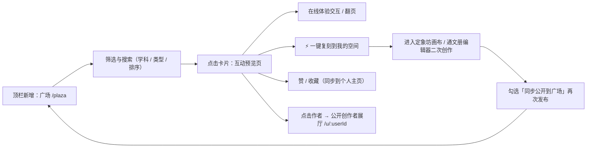

# 万象（象生）轻量级作品广场与复刻生态实施方案

> **定位**：不做高成本、易冷场的“发帖聊天型论坛”，而是围绕本平台最核心的差异化资产——**定象坊交互教具**与**通文册互动演示文稿**——构建「**在线试用 → 一键复刻（Remix）→ 创作者公开展厅**」的轻量化作品广场（对标 Figma Community / GeoGebra Materials / Desmos）。

---

## 一、现状盘点：我们已有哪些现成底座？

梳理当前前后端代码，项目其实已经具备 **70% 的底层能力**，无需推倒重来：

| 模块 | 已有能力 | 当前缺口（本方案补齐） |
| :--- | :--- | :--- |
| **定象坊发布与改造** | `WorkshopShareRecord` 表、`POST /works/{id}/publish`、`GET /work-shares`、`POST /work-shares/{sid}/fork`（含 `forks` 计数与 `forked_from_share` 谱系） | 缺少作者归属、学科分类、简介、点赞/收藏；且 `GET /work-shares` 当前将所有项的 `can_delete` 硬编码为 `True`（需顺手修复鉴权） |
| **通文册发布与播放** | `ShareRecord` 表、`POST /materials/{id}/publish`、`/p/:shareId` 公开只读播放页、原生可编辑 PPT 文稿存储 | 只能凭链接私密访问，无法上架广场；缺少 `POST /p/{share_id}/fork` 一键复刻为自己的可编辑演示文稿 |
| **账号与创作者名片** | `users` / `user_profiles` 表（含头像、简介、身份、学校、兴趣标签）；前端已完成 Bento 版 `SpaceCreatorCard` 与 `SpaceShowcaseHero` | 个人主页目前仅自己可见（`/space`），缺少面向他人的只读公开展厅 `/u/:userId` |
| **冷启动内容资产** | 定象坊内置微积分、线代、物理、408、深度学习、商科数十个可交互模板；通文册内置 6 套视觉主题与课件模板 | 尚未以“官方精选”身份汇入统一的广场发现页 |

---

## 二、产品边界：做什么 vs 坚决不做什么

### 1. 本方案重点做（高感知、强闭环）
- **双引擎统一广场（`/plaza`）**：定象坊交互作品 + 通文册互动 PPT 同屏展示，支持按「类型 / 学科 / 关键词 / 热门复刻 / 最新」筛选。
- **零门槛在线试玩**：点开任意卡片直接可拖动滑块、切换参数或翻页演示，所见即所得。
- **一键复刻（Remix）**：将广场里的定象坊作品或通文册演示文稿一键复制到自己的工作台继续二次修改，自动记录「改自 @原作者」谱系与复刻次数。
- **轻量正向反馈**：点赞（觉得好用）+ 收藏（收入个人主页「我的收藏」），满足创作者成就感。
- **公开创作者展厅（`/u/:userId`）**：复用刚重构好的 Bento 名片卡，点作者头像直达对方公开主页，串联「广场 ↔ 创作者 ↔ 作品」。

### 2. 本阶段坚决不做（避免低效内耗与合规风险）
- ❌ 自由发帖讨论区 / 水帖论坛（冷启动易成“鬼城”）
- ❌ 站内私信 / 实时聊天室 / 复杂消息中心
- ❌ 关注流 / 粉丝体系 / 复杂推荐算法
- ❌ 多层盖楼评论与重型人工审核后台（若后续确有教学问答需求，仅在 P2 作为可选开关提供单层“教学用法备注”）

---

## 三、信息架构与核心页面设计

### 1. 顶栏导航调整（`SiteNav.tsx`）
- 导航项由 4 项扩展为 5 项，保持清晰克制：
  `首页` · `定象坊` · `通文册` · **`广场`** · `个人主页`

### 2. 核心页面一：互动作品广场（`/plaza`）
- **顶部精选横幅（Editorial Hero）**：简洁标题 + 搜索框 +「发布我的作品」快捷按钮（引导从定象坊/通文册选择已有作品一键上架）。
- **双维度筛选条**：
  - 类型切换：`全部` · `定象坊教具` · `通文册课件` · `官方精选`
  - 学科标签：`全部学科` · `数学` · `物理` · `计算机 / 408` · `人工智能` · `经管商科` · `通用 PPT 模板`
  - 排序方式：`推荐精选` · `最多复刻` · `最新发布`
- **作品卡片（与全站纸墨视觉体系一致）**：
  - 封面区：定象坊复用画布节点预览/学科缩略图；通文册展示首页渲染图或主题版式预览，右上角标注类型角标（`交互画布 · 12 节点` / `互动文稿 · 16 页`）。
  - 信息区：作品标题、一句话教学用途简介、学科标签。
  - 底栏：作者头像与昵称（点击跳转 `/u/:userId`）、复刻数（`↻ 24`）、点赞数（`♥ 68`）。

### 3. 核心页面二：升级现有分享预览页（`/work-shares/:shareId` 与 `/p/:shareId`）
不另起炉灶，直接在两个现有公开分享页顶部增加轻量的 **广场工具栏（当该分享已上架广场时显示）**：
- 左侧：返回广场链接 + 作者头像/昵称（可进 `/u/:userId`）+ 学科标签 +（若为改造作品）`改自 @原作者` 谱系链接。
- 右侧：`♥ 点赞 (N)` · `★ 收藏` · 主按钮 **`⚡ 复刻到我的空间`**。
- 复刻交互：
  - **定象坊**：调用现有 `POST /api/v1/work-shares/{share_id}/fork`，成功后直接跳转 `/canvas?work={new_work_id}`。
  - **通文册**：调用新增 `POST /api/v1/p/{share_id}/fork`，将公开快照（原生文稿 JSON / 页图与交互区域）克隆为当前用户的新材料，直接跳转 `/materials/{new_material_id}/work`。

### 4. 核心页面三：公开创作者展厅（`/u/:userId`）
- **完全复用 Scheme A 的 Bento 视觉组件**（将 `SpaceCreatorCard` 拆出 `readOnly` 模式）：
  - 左侧/顶部：展示作者头像、昵称、身份/学校、个人简介、兴趣标签、封面主题、累计公开作品数与获赞/被复刻总数（**严格隐藏**手机号、邮箱与编辑按钮）。
  - 主区域：该创作者的置顶代表作 + 已公开到广场的所有定象坊教具与通文册课件列表，每张卡片支持直接试玩与一键复刻。
- 在本人访问 `/space`（个人主页）时：
  - 新增「复制公开主页链接」按钮（拷贝 `/u/:userId`）；
  - 在个人展厅内增加「我的收藏」快捷卡片，收纳自己在广场里收藏过的教具与模板。

### 5. 上架与下架流程（嵌入现有发布弹窗）
- 在定象坊「发布」和通文册「发布/分享」弹窗中，新增一组可选配置：
  - 开关：`同时公开到「广场」，允许他人在线试用与复刻`（默认关闭，保护隐私）
  - 学科分类（必选其一）
  - 一句话简介（选填，最多 120 字，如“课堂演示傅里叶级数阶数变化对波形收敛的影响”）
  - 允许复刻开关（默认开启，关闭时仅可预览不可复刻）
- 创作者随时可在「个人主页 → 我的公开作品」或原发布弹窗中一键**从广场下架**（下架后不再出现在 `/plaza`，不影响原有直链或可选择同步撤销分享）。

---

## 四、后端数据模型与 API 设计（最小侵入）

为避免改动现有 9 张核心表与已有分享快照契约，采用**增量独立表**设计（继续由 `init_db` 的 `create_all` 幂等创建）：

### 1. 新增 2 张轻量表（`backend/app/db/models.py`）

#### 表 1：`plaza_items`（广场统一索引表）
| 字段 | 类型 | 说明 |
| :--- | :--- | :--- |
| `id` | `String(64)` PK | 主键，前缀 `plz_` + 32 hex |
| `kind` | `String(16)` | `workshop`（定象坊）或 `deck`（通文册） |
| `share_id` | `String(64)` Unique | 关联 `workshop_shares.share_id` 或 `shares.share_id`（官方精选模板可用 `tpl_<key>`） |
| `author_user_id` | `String(64)` Nullable | 关联 `users.id`；`NULL` 表示官方精选 |
| `author_session_id` | `String(64)` | 用于权限校验（仅发布者本人可下架/编辑简介），**绝不对外返回** |
| `title` | `String(120)` | 广场展示标题 |
| `summary` | `String(240)` | 一句话用途/教学说明 |
| `subject` | `String(32)` | 学科枚举：`math` / `physics` / `cs` / `ai` / `business` / `ppt` / `general` |
| `tags_json` | `JSON` | 自定义标签数组（最多 4 个） |
| `cover_meta_json` | `JSON` | 封面元数据（如 `page_count` / `node_count` / `theme_id` / `preview_template`） |
| `allow_fork` | `Boolean` | 是否允许一键复刻（默认 `True`） |
| `is_featured` | `Boolean` | 是否官方精选置顶 |
| `views` / `likes` / `bookmarks` / `forks` | `Integer` | 反规范化计数，列表排序直接读取 |
| `status` | `String(16)` | `published` / `unlisted` |
| `created_at` / `updated_at` | `String(32)` | ISO 8601 UTC 字符串 |

#### 表 2：`plaza_reactions`（点赞与收藏防重表）
| 字段 | 类型 | 说明 |
| :--- | :--- | :--- |
| `id` | `String(64)` PK | 主键 |
| `plaza_item_id` | `String(64)` FK | 关联 `plaza_items.id` |
| `user_id` | `String(64)` | 操作用户 ID（点赞与收藏要求登录态，防止刷赞） |
| `kind` | `String(16)` | `like` 或 `bookmark` |
| `created_at` | `String(32)` | 操作时间 |
| 唯一索引 | `(plaza_item_id, user_id, kind)` | 保证同一用户对同一作品只能点赞/收藏一次 |

### 2. 核心 API 清单（新增 `backend/app/api/routes_plaza.py`）

| 方法与路径 | 鉴权 | 功能说明 |
| :--- | :--- | :--- |
| `GET /api/v1/plaza` | 公开（可选读登录态） | 广场列表，支持 `kind`、`subject`、`q`（关键词）、`sort`（`featured` / `forks` / `latest`）、`author_id`、`limit`、`offset`；若已登录一并返回每项的 `liked_by_me` / `bookmarked_by_me` |
| `POST /api/v1/plaza/items` | 需登录 | 将已发布的 `workshop` 或 `deck` 的 `share_id` 上架广场（校验当前用户确实拥有该分享） |
| `PATCH /api/v1/plaza/items/{id}` | 仅作者 | 修改广场标题、简介、学科、是否允许复刻 |
| `DELETE /api/v1/plaza/items/{id}` | 仅作者 | 从广场下架（软置 `unlisted` 或删除记录） |
| `POST /api/v1/plaza/items/{id}/react` | 需登录 | 切换 `like` 或 `bookmark` 状态，原子更新对应计数并返回最新状态 |
| `GET /api/v1/plaza/bookmarks` | 需登录 | 获取当前用户的收藏作品列表（供个人主页「我的收藏」使用） |
| `POST /api/v1/p/{share_id}/fork` | 会话即可（访客/登录均可） | **通文册一键复刻**：把公开快照克隆为当前会话的新 `MaterialRecord`（复用原生文稿 JSON 与页图文件拷贝/引用），并使对应 `plaza_items.forks + 1` |
| `GET /api/v1/creators/{user_id}` | 公开 | 公开创作者资料（仅返回 `display_name`、`bio`、`occupation`、`school`、`interests`、`avatar_url`、统计数据与公开作品列表；**绝不返回邮箱、手机号、session_id**） |
| `GET /api/v1/creators/{user_id}/avatar` | 公开 | 公开读取创作者头像（复刻 `avatars.py` 已有安全读盘逻辑，带 ETag/缓存头） |

> **顺手修复项**：在 `backend/app/api/routes_workshop.py` 的 `GET /work-shares` 中，将 `can_delete` 改为按当前会话归属判定（`row.session_id == current_session_id`），并在 `POST /work-shares/{share_id}/fork` 成功时同步递增 `plaza_items.forks`。

---

## 五、冷启动与防“鬼城”策略（开箱即饱满）

为了确保哪怕在零外部用户的演示现场，打开 `/plaza` 第一眼也极具质感，采用 **「官方种子精选 + 用户发布融合」** 机制：

1. **定象坊官方精选（8~10 件）**：从现有已打磨好的模板（如抛体运动与能量柱、带电粒子速度选择器、RC 充放电、傅里叶级数合成、矩阵特征向量变换、梯度下降与学习率、BFS/Dijkstra 寻路、盈亏平衡模型）中精选代表作，直接支持点击试玩与一键「在定象坊中打开/保存」。
2. **通文册官方精选（4~6 件）**：预置 4~6 套不同学科与风格的原生可交互演示文稿（如《线性代数：特征值与几何变换》《大学物理：简谐振动与相位》《毕业论文答辩通用框架》《商务数据分析汇报》），点击即可全屏翻页+调参，并支持一键复刻进自己的通文册直接改字改图。
3. **官方标识区分**：种子作品统一署名为「万象官方教研组」并带 `官方精选` 徽章，用户发布的新作品按时间/热度自然排入同一画廊。

---

## 六、隐私与安全红线

沿用项目既有的安全规范（与 `routes_publish.py` 保持一致）：
1. **公开接口零敏感字段**：`/api/v1/plaza*` 与 `/api/v1/creators/*` 响应体经过显式白名单序列化，**严禁**出现 `email`、`phone`、`session_id`、`material_id`、`source_filename` 或本地文件绝对路径。
2. **明确同意才公开**：任何作品默认均为私有，只有用户在发布时显式勾选「公开到广场」才会进入 `plaza_items`。
3. **防刷与限流**：上架广场、点赞、收藏均需登录账号，数据库层面用唯一约束保证单人单赞；复刻允许访客体验（落入访客临时会话，转化注册动机）。

---

## 七、分阶段实施路线图

| 阶段 | 目标与交付物 | 预计工作量 |
| :--- | :--- | :--- |
| **P0：广场核心与双端复刻闭环** | 1. 后端新增 `plaza_items`、`plaza_reactions` 表与 `routes_plaza.py` 2. 实现通文册 `POST /api/v1/p/{share_id}/fork` 复刻接口 3. 修复 `work-shares` 的 `can_delete` 权限并打通 `forks` 计数联动 4. 内置 12~16 个官方精选种子作品 5. 前端新增 `/plaza` 广场页面与顶栏入口，并在定象坊/通文册发布弹窗加入「公开到广场」开关 | 约 1.5 ~ 2 天 |
| **P1：创作者公开展厅与个人主页联动** | 1. 后端新增 `/api/v1/creators/{user_id}` 与公开头像端点 2. 前端新增 `/u/:userId` 公开创作者展厅（复用 Bento `SpaceCreatorCard` 只读态） 3. 升级 `/work-shares/:shareId` 与 `/p/:shareId` 顶部广场互动栏（作者、点赞、收藏、一键复刻） 4. 在 `/space` 个人主页增加「复制公开主页链接」与「我的收藏」卡片 | 约 1 天 |
| **P2：轻交流增强（按需可选）** | 1. 复刻谱系展示（「改自 @原作者」徽章与直达链接） 2. 作品页底部增加极简**单层「教学用法备注 / 简短留言」**（无盖楼、限 200 字、作者可删，不引入论坛复杂度） | 约 0.5 ~ 1 天 |

---

## 八、验证与演示验收标准

- **冷启动验收**：全新空库启动后访问 `/plaza`，首屏即可看到 ≥ 12 个分类清晰、可直接交互试玩的精选作品。
- **创作—上架—复刻闭环**：
  1. 账号 A 在定象坊或通文册发布作品并勾选「公开到广场」；
  2. 账号 B（或访客）在 `/plaza` 筛选找到该作品，在线试玩并点击「一键复刻」；
  3. 自动跳转到账号 B 自己的编辑器且修改完全不影响账号 A 原作，同时广场卡片复刻数 `+1`；
  4. 点击账号 A 头像进入 `/u/:userId`，能看到 Bento 创作者展厅与其公开作品，且接口抓包确认无邮箱/手机号泄露。
